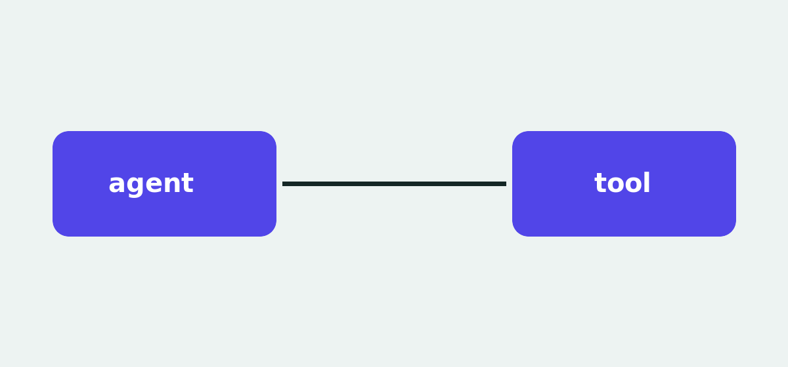

Этот пост — заглушка. Он нужен, чтобы проверить страницы блога на настоящем Markdown до того, как
написан первый пост: заголовки, список, цитату, картинку с подписью, код и таблицу. В рабочую сборку
он не попадает, потому что в его заголовке стоит `draft: true`.

## Что показывает страница поста

Сначала заголовок, дата, время чтения и темы, потом обложка. Дальше текст в одну удобную для
чтения колонку. Заголовки попадают в оглавление рядом с текстом на широком экране.

- Длина строки остаётся удобной для чтения.
- Ссылки, например [на документацию](/ru/docs), выглядят как на остальном сайте.
- Код в строке, например `tg inbox --json`, набран моноширинным шрифтом.

> Цитата отделена от текста вокруг, без цветной полосы.

## Картинка с подписью



## Код

```sh
npm install -g @wirecat/tg-cli
tg inbox --json | jq '.chats[0]'
```

## Таблица

| Команда | Что делает |
| --- | --- |
| `tg inbox` | Непрочитанные чаты |
| `tg review --unanswered` | Кто ещё ждёт ответа |

## Конец поста

После текста идут ссылки на обсуждение, ссылки для подписки и, когда появится адрес для подписки,
форма рассылки.
