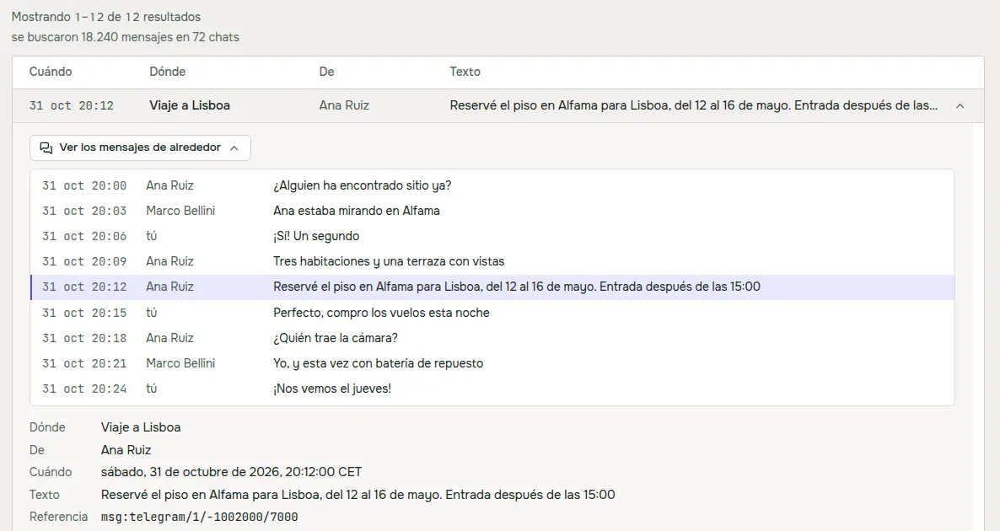
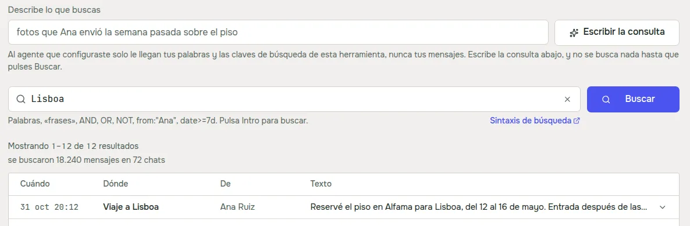
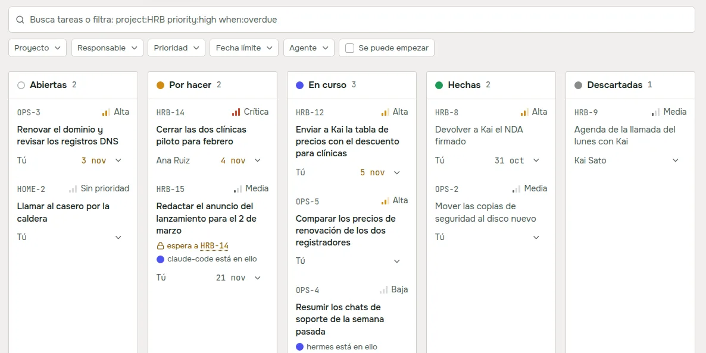
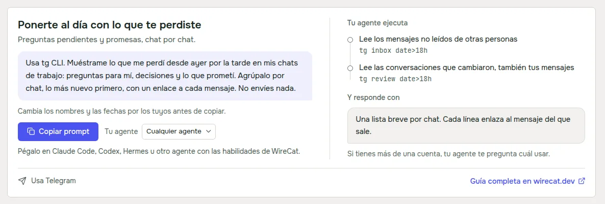

La versión 0.2 trajo a la app de escritorio las páginas Buscar, Memoria, Tareas y Guías. Luego la probé con mis
propios chats y mi correo, y mucho no aguantó. Hoy sale la 0.3.0. Casi todo son arreglos de lo que encontré, más
algunas cosas que eché en falta al usar la app a diario.

## Búsqueda con datos reales

Lo peor era un mensaje que decía "La búsqueda no se ejecutó" cuando sí se había ejecutado y simplemente no había
encontrado nada. Telegram y WhatsApp siempre avisan de los chats que aún no han descargado, y la app tomaba ese aviso
por un fallo. En mi prueba pasó en 326 de 726 búsquedas. Ahora una búsqueda vacía dice que no hay resultados y muestra
debajo el aviso de la herramienta, por ejemplo cuántos chats no se han descargado.

Los resultados de WhatsApp y del correo ya se pueden abrir, con los mensajes de alrededor. Antes abrir uno fallaba
siempre. Y si tienes varias copias de una herramienta instaladas, la app usa la más nueva. Yo tenía una copia vieja de
otro gestor de paquetes, y la app buscaba con ella mientras mi terminal usaba la nueva.

Un resultado sin texto muestra lo que lleva, como "Foto", "Mensaje de voz" o el nombre de un archivo. Y cuando filtras
por una persona, la caja de la consulta muestra su nombre donde la consulta tiene su id. La consulta sigue enviando el
id, así que copiar y pegar funciona igual.

## La consulta a partir de tus palabras

Las herramientas tienen su propio lenguaje de consultas, con `from:`, `has:photo`, `date>=7d` y demás. Es preciso,
pero nadie quiere aprenderlo para encontrar un mensaje. Así que encima de la caja de la consulta ahora hay un campo
donde describes lo que buscas con tus palabras y en tu idioma, y **Escribir la consulta** lo convierte en una consulta.

Usa el agente que ya tienes. Primero Claude Code, y Codex si Claude Code no está instalado o no tiene la sesión
iniciada. Al agente solo le llegan tus palabras y la lista de campos por los que busca la herramienta, nunca tus
mensajes ni los resultados. La respuesta rellena la caja de la consulta, y no se busca nada hasta que pulsas Buscar.
Con "las fotos que me mandó Javier del piso en Valencia este mes", Claude Code escribió
`piso Valencia from:"Javier" has:photo date>=2026-11-01` en pocos segundos. En inglés y en ruso funciona igual.

## Una barra de filtros para Tareas y Memoria

Memoria tenía cinco selectores sueltos y Tareas un campo de búsqueda con filtros. Ahora las dos páginas usan la misma
barra. Los filtros escriben palabras como `priority:high` o `project:HRB` en el campo de búsqueda, así que puedes
escribir un filtro o elegirlo con el ratón, y la cruz de un filtro quita solo ese.

Las fechas usan ahora un calendario propio. El selector de fecha del sistema ignoraba el tema oscuro y desentonaba. El
nuevo funciona con el teclado, elige un día o un rango y empieza la semana en lunes. Y arrastrar una tarea en el
tablero ya no abre su ficha al soltarla.

## Guías para tu mensajería

Antes todas las guías decían "Usa tg CLI", así que si solo tenías WhatsApp te llegaban comandos de una herramienta que
no tienes. Ahora cada guía se escribe para la mensajería que tienes instalada. Si tienes varias, un selector en la guía
elige cuál, y el prompt y los pasos cambian con él.

Los pasos también indican qué cuenta debe usar tu agente, y solo usan comandos que la herramienta tiene de verdad. El
resumen de cada mañana todavía no se ofrece para WhatsApp, porque la herramienta de WhatsApp no puede programar al
agente.

## Herramientas y agentes al día

Cuando la app actualiza una herramienta, ahora actualiza también las instrucciones que tus agentes leen para usarla, y
te dice para qué agentes lo hizo. Antes la herramienta era nueva y tu agente seguía las instrucciones viejas.

Telegram y WhatsApp mantienen al día su copia de tus mensajes solo mientras su herramienta corre en segundo plano. Sin
eso, Telegram se pone al día solo cuando sincronizas, y WhatsApp no se pone al día nunca. Ahora la página Herramientas
dice "No se mantiene al día en segundo plano" debajo de esa cuenta, y **Mantener al día** la pone en marcha. Si se para
después de reiniciar el ordenador, vuelve a ponerla en marcha ahí mismo.

La sección del servidor MCP en la página Herramientas vuelve a funcionar con las versiones actuales de las
herramientas. MCP es la forma en que apps de chat como ChatGPT y Claude llegan a una herramienta en tu ordenador.

## Linux y seguridad

En Linux, los paquetes .deb y .rpm ahora muestran un mensaje corto después de instalar, con los siguientes pasos. El
comando de actualización para un .deb primero copia el paquete a la carpeta propia de apt, así que apt ya no muestra un
aviso confuso sobre un usuario llamado `_apt`.

También hice una revisión de seguridad de la app y arreglé lo que salió. Cuando conectas Hermes u OpenClaw, los agentes
que reciben peticiones desde un chat, cada cuenta empieza en modo solo lectura. Los registros y los informes de errores
ocultan más tipos de tokens y claves. Y la app descarga Node.js, Tailscale y cloudflared solo por https.

## Descarga

Si tienes la 0.2, la propia app te ofrece la actualización. En Linux con un .deb o un .rpm, descarga el paquete y te da
un comando para instalarlo. Si eres nuevo, descarga WireCat desde [wirecat.dev/es/download](/es/download), para macOS,
Windows o Linux. La lista completa de cambios está en las
[notas de la versión en GitHub](https://github.com/WireCatLabs/wirecat-desktop/releases/tag/v0.3.0).

Lo siguiente que me gustaría es llevar el redactor de consultas a las propias herramientas, para que tu agente también
pueda usarlo fuera de la app. Si algo falla o te parece raro, cuéntamelo en [Discord](https://discord.gg/DebENqbRrJ) o
abre un issue en [GitHub](https://github.com/WireCatLabs/wirecat-desktop/issues). Lo leo todo.
