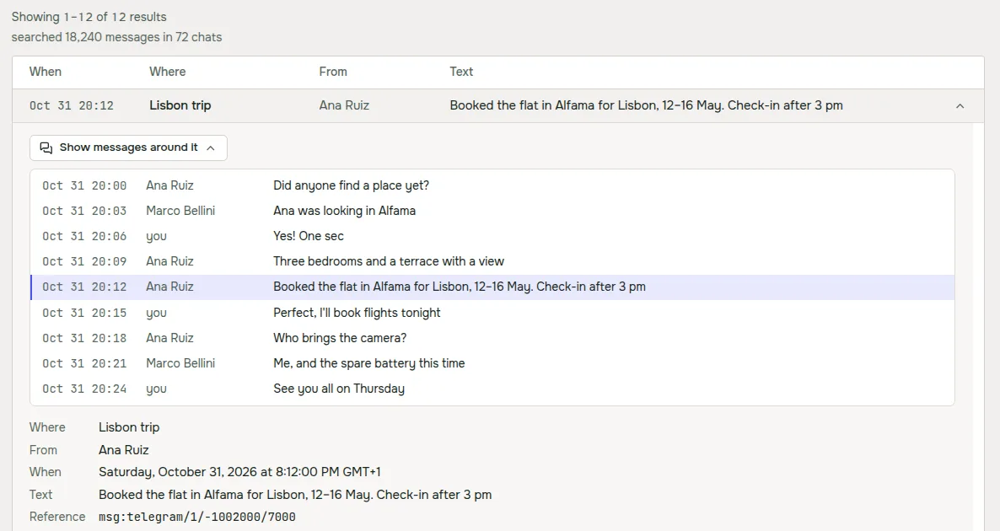
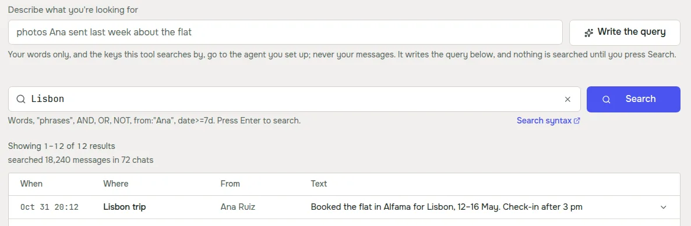
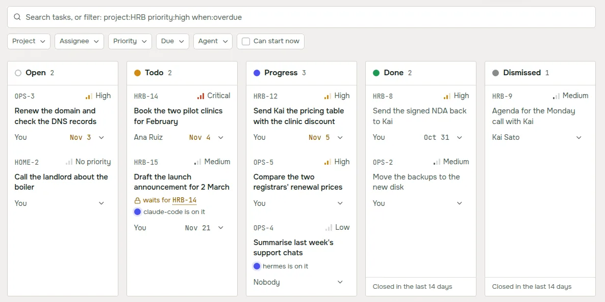
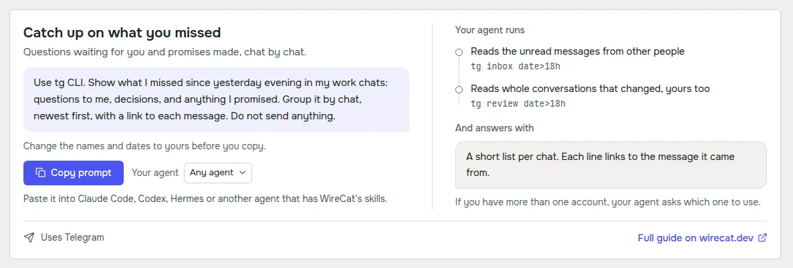

Version 0.2 put Search, Memory, Tasks and Guides into the desktop app. Then I pointed it at my own chats and mail, and
a lot of it didn't hold up. 0.3.0 is out today, and most of it is the fixes for what I found, plus a few things I
wanted after using the app every day.

## Search on real data

The worst one was a message that said "The search did not run" when it had run and simply found nothing. Telegram,
MAX and WhatsApp always mention the chats they haven't downloaded yet, and the app read that note as a failure. In my
test that was 326 of 726 searches. Now an empty search says "No results" and shows the tool's note under it, for
example how many chats were never downloaded.

Results from WhatsApp and mail can be opened now, with the messages around them. Before, opening one always failed.
The app also runs the newest copy of a tool when you have more than one installed. I had an old copy from another
package manager, and the app was searching with it while my terminal used the new one.

A result with no text shows what it carries, like "Photo", "Voice message" or a file name. And when you filter by a
person, the query box shows their name where the query has their id. The query itself still sends the id, so copy and
paste keep working.

## Write the query from plain words

The tools have their own query language with `from:`, `has:photo`, `date>=7d` and so on. It's precise, but nobody
wants to learn it to find one message. So above the query box there's now a field where you describe what you're
looking for in your own words and language, and **Write the query** turns it into a query.

It uses the agent you already have. Claude Code goes first, and Codex is used when Claude Code is missing or signed
out. Only your words and the list of keys the tool searches by go to the agent, never your messages or results. The
answer fills the query box, and nothing is searched until you press Search. When I tried "voice messages from Ksenia
Petrova about the wedding", Claude Code wrote `wedding from:"Ksenia Petrova" has:voice` in a few seconds. It works
the same in Russian and Spanish.

## One filter bar for Tasks and Memory

Memory had five separate pickers and Tasks had a search field with chips. Now both pages use the same bar. The chips
write words like `priority:high` or `project:HRB` into the search field, so you can type a filter or click it, and a
cross on a chip clears only that filter.

Dates use the app's own calendar now. The system date picker ignored the dark theme and looked out of place. The new
one works from the keyboard, picks one day or a range, and starts the week on Sunday in English and on Monday in
Russian and Spanish. Dragging a task on the board no longer opens its card when you let go.

## Guides for the messenger you have

Every guide used to say "Use tg CLI", so if you only had WhatsApp you got commands for a tool you don't have. Now each
guide is written for the messenger you have installed. If you have several, a switch on the guide picks which one, and
the prompt and the steps change with it.

The steps also name the account your agent should use, and they only use commands the tool really has. The morning
summary isn't offered for WhatsApp yet, because the WhatsApp tool can't schedule an agent run.

## Tools and agents that stay current

When the app updates a tool, it now updates the instructions your agents read for that tool too, and says so, for
example "Updated the instructions for Claude Code and Codex to this version". Before, the tool was new and your agent
still followed the old instructions.

Telegram and WhatsApp keep their copy of your messages current only while their tool runs in the background. Without
it Telegram catches up only when you sync, and WhatsApp doesn't catch up at all. Now the Tools page says "Not kept up
to date in the background" under that account, and **Keep up to date** starts it. If it stops after a restart, you
start it there again.

The MCP server section on the Tools page works again with the current versions of the tools. MCP is how chat apps such
as ChatGPT and Claude reach a tool on your computer.

## Linux and security

On Linux the .deb and .rpm packages now print a short message after install, with what to do next. The update command
for a .deb first copies the package into apt's own folder, so apt no longer prints a confusing notice about a user
named `_apt`.

I also ran a security review of the app and fixed what came up. When you connect Hermes or OpenClaw, the agents that
take requests from a chat, every account starts read only. Logs and bug reports mask more kinds of tokens and keys.
And the app downloads Node.js, Tailscale and cloudflared over https only.

## Get it

If you have 0.2, the app offers the update itself. On Linux with a .deb or .rpm, it downloads the package and gives
you a command to install it. New here? Download WireCat from [wirecat.dev/download](/en/download) for macOS, Windows
or Linux. The full list of changes is in the
[release notes on GitHub](https://github.com/WireCatLabs/wirecat-desktop/releases/tag/v0.3.0).

Next I'd like to move the query writer into the tools themselves, so your agent can use it outside the app too. If
something breaks or feels wrong, tell me on [Discord](https://discord.gg/DebENqbRrJ) or open an issue on
[GitHub](https://github.com/WireCatLabs/wirecat-desktop/issues). I read all of it.
