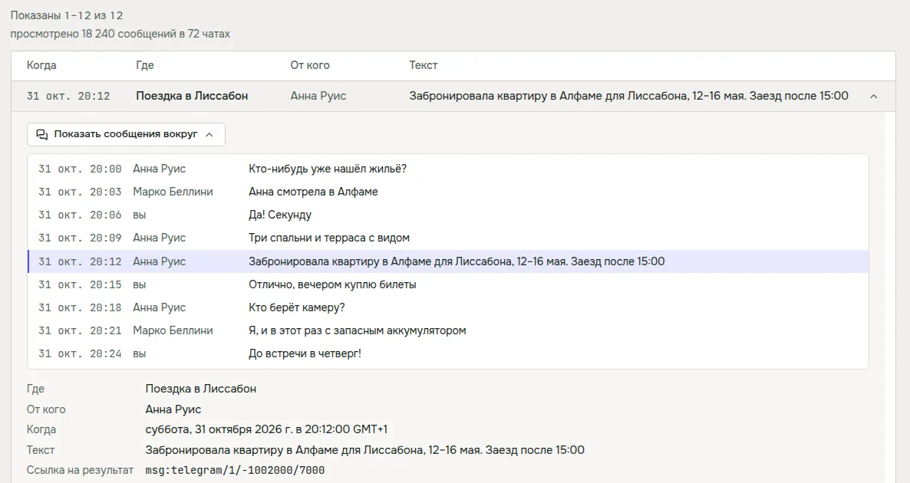
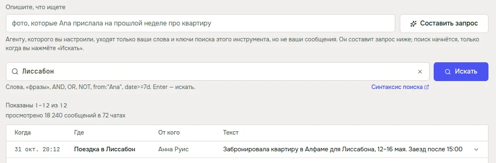
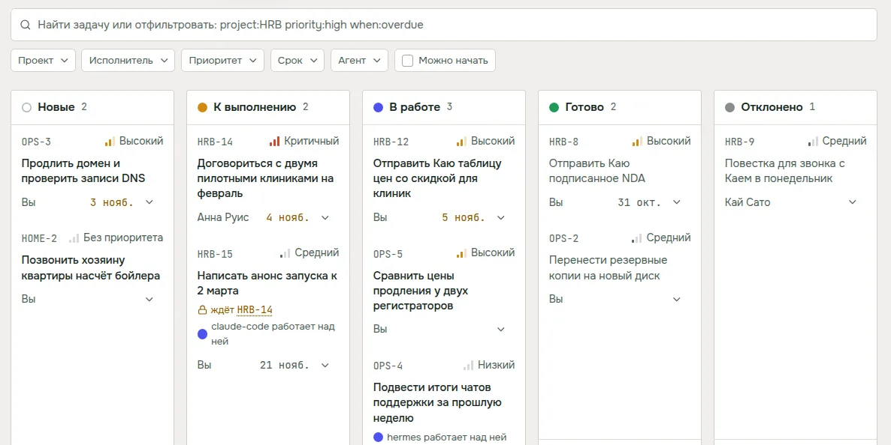
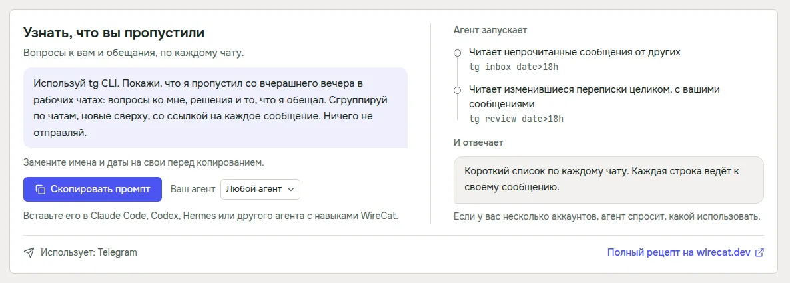

В версии 0.2 в приложении появились Поиск, Память, Задачи и Рецепты. Потом я запустил его на своих чатах и почте, и
многое не выдержало. Сегодня вышла 0.3.0. В основном это исправления того, что я нашёл, и несколько вещей, которых мне
не хватало, когда я стал пользоваться приложением каждый день.

## Поиск на настоящих данных

Хуже всего было сообщение «Поиск не выполнен», когда поиск выполнился и просто ничего не нашёл. Telegram, MAX и
WhatsApp всегда пишут, какие чаты ещё не скачаны, а приложение принимало эту заметку за ошибку. В моей проверке так
было в 326 поисках из 726. Теперь пустой поиск честно говорит, что ничего не найдено, и показывает под этим заметку
инструмента, например сколько чатов ещё не скачано.

Результаты из WhatsApp и почты теперь открываются, вместе с сообщениями вокруг. Раньше открыть такой результат не
получалось никогда. И если у вас установлено несколько копий инструмента, приложение запускает самую новую. У меня
была старая копия от другого менеджера пакетов, и приложение искало ею, пока терминал работал с новой.

Результат без текста показывает, что в нём есть, например «Фото», «Голосовое сообщение» или имя файла. А если вы
фильтруете по человеку, в строке запроса видно его имя там, где в запросе стоит его id. Сам запрос по-прежнему уходит
с id, так что копировать и вставлять его можно как раньше.

## Запрос по вашим словам

У инструментов свой язык запросов, с `from:`, `has:photo`, `date>=7d` и так далее. Он точный, но учить его ради
одного сообщения никто не хочет. Поэтому над строкой запроса теперь есть поле, где можно своими словами описать, что
вы ищете, и кнопка **Составить запрос** превращает это в запрос.

Запрос составляет агент, который у вас уже есть. Сначала Claude Code, а если его нет или вы из него вышли, то Codex.
Агенту уходят только ваши слова и список полей, по которым ищет инструмент, но никогда не ваши сообщения или
результаты. Ответ попадает в строку запроса, и ничего не ищется, пока вы не нажмёте «Искать». На фразу «фотографии
от Димы с дачи за прошлую неделю» Claude Code за пару секунд написал `дача from:"Дима" has:photo date>=7d`.
По-английски и по-испански это работает так же.

## Одна строка фильтров для Задач и Памяти

В Памяти было пять отдельных выпадающих списков, а в Задачах поле поиска с фильтрами. Теперь на обеих страницах одна и
та же строка. Фильтры пишут в поле поиска слова вроде `priority:high` или `project:HRB`, так что фильтр можно
напечатать или выбрать мышкой, а крестик на фильтре убирает только его.

Для дат теперь свой календарь. Системный выбор даты не слушался тёмной темы и выглядел чужим. Новый работает с
клавиатуры, выбирает день или диапазон и начинает неделю с понедельника, как у нас принято. И карточка задачи больше не
открывается, когда вы отпускаете её после перетаскивания.

## Рецепты под ваш мессенджер

Раньше каждый рецепт начинался с «Используй tg CLI», и если у вас был только WhatsApp или MAX, вы получали команды для
инструмента, которого у вас нет. Теперь каждый рецепт написан под установленный мессенджер. Если их несколько,
переключатель в рецепте выбирает нужный, и запрос с шагами меняются вместе с ним.

В шагах теперь видно, какой аккаунт должен взять агент, и в них только те команды, которые у инструмента правда есть.
Утреннюю сводку для WhatsApp пока не предлагаю, потому что инструмент WhatsApp не умеет запускать агента по
расписанию.

## Инструменты и агенты не устаревают

Когда приложение обновляет инструмент, оно теперь обновляет и инструкции, по которым агенты с ним работают, и пишет,
для каких агентов это сделано. Раньше инструмент был новый, а агент продолжал следовать старым инструкциям.

Telegram, MAX и WhatsApp держат копию ваших сообщений свежей, только пока их инструмент работает в фоне. Без этого
Telegram и MAX догоняют только при синхронизации, а WhatsApp не догоняет вообще. Теперь на странице Инструменты под
таким аккаунтом написано «Не обновляется в фоне», и кнопка **Обновлять в фоне** запускает его. Если после
перезагрузки он остановится, запустите его там же ещё раз.

Раздел MCP-сервера на странице Инструменты снова работает с текущими версиями инструментов. Через MCP чат-приложения
вроде ChatGPT и Claude обращаются к инструменту на вашем компьютере.

## Linux и безопасность

На Linux пакеты .deb и .rpm после установки пишут короткое сообщение, что делать дальше. Команда обновления для .deb
сначала копирует пакет в собственную папку apt, так что apt больше не пишет непонятное предупреждение про пользователя
`_apt`.

Ещё я провёл проверку безопасности приложения и исправил то, что она нашла. Когда вы подключаете Hermes или OpenClaw,
то есть агентов, которые принимают запросы из чата, каждый аккаунт начинает в режиме только для чтения. Журнал и
отчёты об ошибках скрывают больше видов токенов и ключей. А Node.js, Tailscale и cloudflared приложение скачивает
только по https.

## Где взять

Если у вас 0.2, приложение само предложит обновиться. На Linux с пакетом .deb или .rpm оно скачает пакет и даст
команду для установки. Если вы здесь впервые, скачайте WireCat на [wirecat.dev/ru/download](/ru/download), для macOS,
Windows и Linux. Полный список изменений в
[описании релиза на GitHub](https://github.com/WireCatLabs/wirecat-desktop/releases/tag/v0.3.0).

Дальше я бы перенёс составление запроса в сами инструменты, чтобы агент мог пользоваться им и без приложения. Если
что-то сломалось или кажется странным, напишите в [Telegram-чат](https://t.me/wirecatdev) или откройте issue на
[GitHub](https://github.com/WireCatLabs/wirecat-desktop/issues). Я всё читаю.
