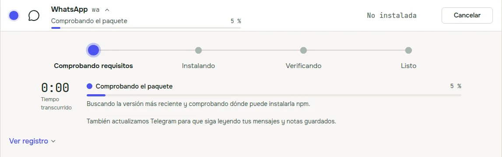
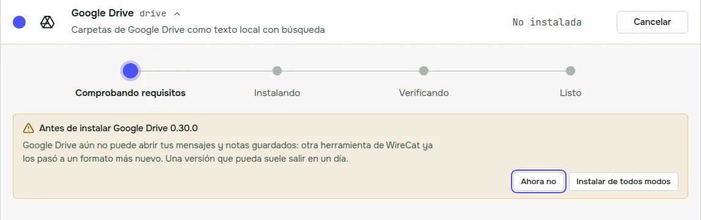
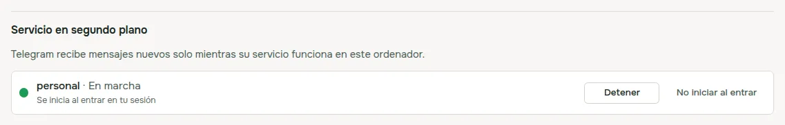

WireCat Desktop es la app que instala las herramientas de WireCat, inicia sesión por ti y le da a tu agente de IA tus
chats, correo, reuniones, documentos y notas, todo guardado en tu ordenador. La 0.5 es una versión pequeña con cosas
que quería desde hace tiempo. El instalador de Windows ahora está firmado, y antes de una actualización la app
comprueba que no va a romper tus otras herramientas. Y el servicio en segundo plano de Telegram y WhatsApp por fin
tiene sus propios controles.

## Un instalador firmado en Windows

Windows decía que el instalador de WireCat era una app de un editor desconocido, y la página de descarga tenía que
explicar cómo saltarse ese aviso. Ahora el instalador está firmado con un certificado Open Source Developer de
Certum, y Windows muestra **Open Source Developer Viacheslav Ptsarev** como editor. Ese soy yo.

La firma no quita de golpe la ventana azul de SmartScreen. SmartScreen confía en una app firmada solo cuando la han
instalado suficientes personas, y
[según Microsoft](https://learn.microsoft.com/es-es/windows/apps/package-and-deploy/smartscreen-reputation) eso puede
tardar semanas. Así que durante un tiempo aún puedes ver **Windows protegió su PC**. La diferencia es que **Más
información** ahora muestra mi nombre como editor. Si muestra otra cosa, no ejecutes el archivo. Los pasos están en
la [página de descarga](/es/download#first-launch).

Y una cosa más. Windows 11 tiene Control Inteligente de Aplicaciones (Smart App Control), que bloquea las apps sin
firma y no deja autorizar una sola. Con él activado, las versiones anteriores de WireCat no arrancaban.
[Las preguntas frecuentes de Microsoft](https://support.microsoft.com/es-es/windows/security/threat-malware-protection/smart-app-control-frequently-asked-questions)
dicen que deja arrancar una app con una firma válida, así que esta debería arrancar.

## Una comprobación antes de instalar o actualizar una herramienta

Todas las herramientas de WireCat guardan tus mensajes y notas en un almacenamiento compartido en tu ordenador. A
veces una versión nueva de una herramienta lo pasa a un formato más nuevo, y una herramienta que solo lee el formato
antiguo deja de funcionar hasta que también la actualizas. Antes te enterabas después de actualizar.

Ahora WireCat lo comprueba primero. Si otra herramienta necesita su versión nueva para seguir leyendo el
almacenamiento, la app la actualiza justo después de la que elegiste, y la línea de progreso lo dice.

Solo ves un aviso cuando todavía no hay nada a lo que actualizar. Pasa cuando otra herramienta aún no tiene una
versión nueva que lea el formato nuevo, o cuando la versión que elegiste no puede abrir tu almacenamiento. Eliges
**Ahora no** o **Actualizar de todos modos**. Para las herramientas de WireCat, una versión arreglada suele salir en
un día.

La misma comprobación se hace en la configuración inicial, donde se instalan la mayoría de las herramientas. Pide a
npm directamente la versión más nueva de cada herramienta, así que no trabaja con una lista vieja.

## El servicio en segundo plano, con controles

Telegram y WhatsApp reciben mensajes nuevos solo mientras su herramienta funciona en segundo plano. Antes, la página
Herramientas solo te decía que no estaba funcionando, con un botón para iniciarlo. Ahora cada una tiene una sección
**Servicio en segundo plano** en sus detalles. Lista todas las cuentas, muestra si el servicio funciona y si se
inicia al entrar en tu sesión, y tiene **Iniciar**, **Detener** y **No iniciar al entrar**.

Si el servicio falla, la sección dice por qué en una frase y ofrece un solo arreglo, por ejemplo **Iniciar sesión**
cuando la sesión de la cuenta caducó. Para WhatsApp además te recuerda mantener el teléfono conectado, porque tus
mensajes llegan a través de él.

## Actualizaciones desde un .deb o .rpm

Una copia instalada desde un paquete .deb o .rpm necesita tu contraseña para actualizarse, y la app nunca te la pide
ella misma. La ventana de actualización sigue abriendo el instalador de tu sistema y mostrando el comando para
copiarlo. Ahora también tiene **Abrir en la terminal**. Escribe ahí tu contraseña y reinicia WireCat cuando termine la
instalación.

## Cosas más pequeñas

- Cuando el agente de correo se salta una ejecución, el motivo ahora está en tu idioma.
- Las filas de la página Herramientas se quedan en su sitio cuando otras herramientas empiezan a actualizarse por
  encima de la que pulsaste.

## Desde el último post

No escribí sobre la 0.4.1 ni la 0.4.2, así que aquí va la versión corta.

- **Agente de correo.** En el panel Gestionar de Email, **Ejecutar con horario** activa el agente de correo de Memo.
  Lee el correo nuevo cada 5 minutos y propone tareas, facturas, pedidos y hechos para que los aceptes. Nunca envía
  nada. Necesita Memo y Claude Code.
- **Retirar un recuerdo de un agente.** En la página Memoria, **Deshacer aprobación** ahora también sirve para un
  hecho que escribió un agente, y lo devuelve a revisión.
- **Tailscale Funnel sin la app de Tailscale.** Si Tailscale no está instalado, WireCat usa su propia conexión pequeña
  para Funnel, y no necesita contraseña de administrador.
- **Actualizaciones que se explican.** Si una actualización falla, la app dice qué pasó, por ejemplo que no hay
  internet o no queda espacio en Descargas, y qué hacer.
- **Arreglos.** Actualizar una copia de .deb o .rpm vuelve a funcionar. Si la tuya es la 0.4.0 o anterior, instala una
  vez el paquete nuevo desde la página de descarga, y después las actualizaciones funcionan desde la app. En Windows,
  una herramienta ya no aparece como dos copias.
- La página Registros guarda los ajustes de ejecución tras **Ajustes de registros**, los menús funcionan con el
  teclado y la app arranca más rápido.

## Descárgala

Si tienes la 0.4, la app te ofrece la actualización ella sola. ¿Eres nuevo? Descarga WireCat en
[wirecat.dev/es/download](/es/download) para macOS, Windows o Linux. La lista completa de cambios está en las
[notas de la versión en GitHub](https://github.com/WireCatLabs/wirecat-desktop/releases/tag/v0.5.0).

Si usas Windows, me gustaría saber qué viste al instalarla. ¿Te paró SmartScreen? Cuéntamelo en
[Discord](https://discord.gg/DebENqbRrJ) o abre un issue en
[GitHub](https://github.com/WireCatLabs/wirecat-desktop/issues). Lo leo todo.
