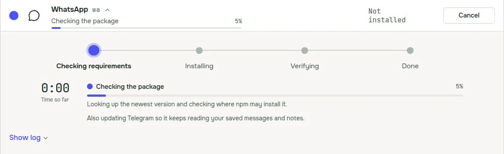
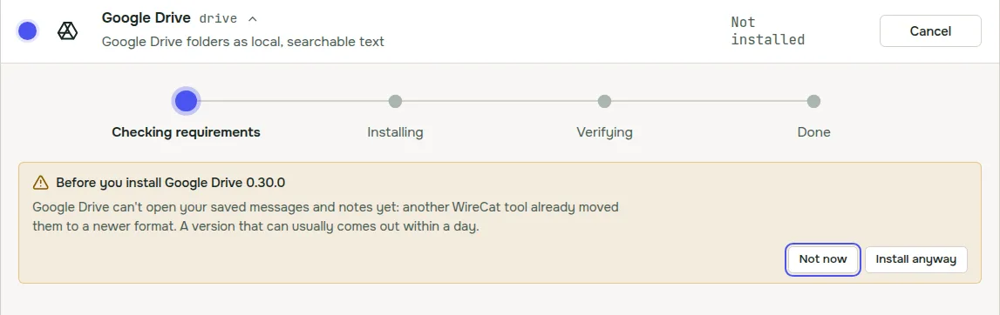
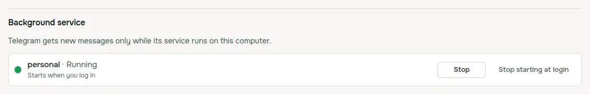

WireCat Desktop is the app that installs the WireCat tools, signs you in and gives your AI agent your chats, mail,
meetings, documents and notes, all kept on your computer. 0.5 is a small release with things I wanted for a while.
The Windows installer is signed now, and the app checks before an update that it won't break your other tools. And
the background service of Telegram and WhatsApp finally has its own controls.

## A signed installer on Windows

Windows used to call WireCat's installer an app from an unknown publisher, and the download page had to explain how
to click past that. Now the installer is signed with an Open Source Developer certificate from Certum, and
Windows shows **Open Source Developer Viacheslav Ptsarev** as the publisher. That's me.

A signature doesn't make the blue SmartScreen window go away at once. SmartScreen trusts a signed app only after
enough people have installed it, and
[Microsoft says](https://learn.microsoft.com/en-us/windows/apps/package-and-deploy/smartscreen-reputation) that can
take weeks. So for a while you may still see **Windows
protected your PC**. The difference is that **More info** now shows my name as the publisher. If it shows anything
else, don't run the file. The [download page](/en/download#first-launch) has the steps.

One more thing changes. Windows 11 has Smart App Control, which blocks unsigned apps and has no way to allow one. With
it on, earlier versions of WireCat couldn't start at all.
[Microsoft's FAQ](https://support.microsoft.com/en-us/windows/security/threat-malware-protection/smart-app-control-frequently-asked-questions)
says it lets an app with a valid signature run, so this one should.

## A check before you install or update a tool

All WireCat tools keep your messages and notes in one shared store on your computer. Sometimes a new version of a tool
moves that store to a newer format, and a tool that only reads the old format stops working until you update it too.
Before, you found out after the update.

Now WireCat checks first. When another tool needs its new version to keep reading the store, the app updates it right
after the one you asked for, and the progress line says so.

You see a warning only when there's nothing to update to yet. That's when another tool has no new version that reads
the new format, or the version you picked can't open your store. You choose **Not now** or **Update anyway**. For
WireCat's own tools a fixed version usually comes out within a day.

The same check runs in the first-run setup, where most installs happen. It asks npm directly for each tool's newest
version, so it doesn't work from a stale list.

## The background service, with controls

Telegram and WhatsApp get new messages only while their tool runs in the background. In 0.4 the Tools page only told
you when it wasn't running, and had one button to start it. Now each of them has a **Background service**
section in its details. It lists every account, shows whether the service runs and whether it starts when you log
in, and has **Start**, **Stop** and **Stop starting at login**.

When the service fails, the section says why in one sentence and offers one fix, for example **Sign in** when the
account was signed out. For WhatsApp it also reminds you to keep your phone online, because your messages come
through it.

## Updates from a .deb or .rpm

A copy installed from a .deb or .rpm package needs your password to update, and the app never asks for it itself. The
update window still opens your system's installer and shows the command to copy. Now it also has **Open in terminal**.
You type your password there, and restart WireCat when the install ends.

## Smaller things

- When the mail agent skips a run, the reason is now in your language.
- Rows on the Tools page stay in place when other tools start updating above the one you clicked.

## Since the last post

I didn't write about 0.4.1 and 0.4.2, so here's the short version.

- **Mail agent.** In Email's Manage panel, **Run on a schedule** starts Memo's mail agent. It reads new mail every 5
  minutes and proposes tasks, invoices, orders and facts for you to accept. It never sends anything. It needs Memo and
  Claude Code.
- **Take back an agent's memory.** On the Memory page, **Undo approval** now works for a fact an agent wrote too, and
  puts it back into review.
- **Tailscale Funnel without the Tailscale app.** If Tailscale isn't installed, WireCat uses its own small connection
  for Funnel, and it needs no administrator password.
- **Updates that explain themselves.** A failed update says what happened, for example no internet or no space in
  Downloads, and what to do.
- **Fixes.** Updating a .deb or .rpm copy works again. If yours is on 0.4.0 or older, install the new package from
  the download page once, and updates work from the app after that. On Windows, one tool no longer shows up as two
  copies.
- The Logs page keeps its run settings behind **Log settings**, menus work with the keyboard, and the app starts
  faster.

## Get it

If you have 0.4, the app offers the update itself. New here? Download WireCat from
[wirecat.dev/download](/en/download) for macOS, Windows or Linux. The full list of changes is in the
[release notes on GitHub](https://github.com/WireCatLabs/wirecat-desktop/releases/tag/v0.5.0).

If you're on Windows, I'd like to know what you saw when you installed it. Did SmartScreen still stop you? Tell me on
[Discord](https://discord.gg/DebENqbRrJ) or open an issue on
[GitHub](https://github.com/WireCatLabs/wirecat-desktop/issues). I read all of it.
