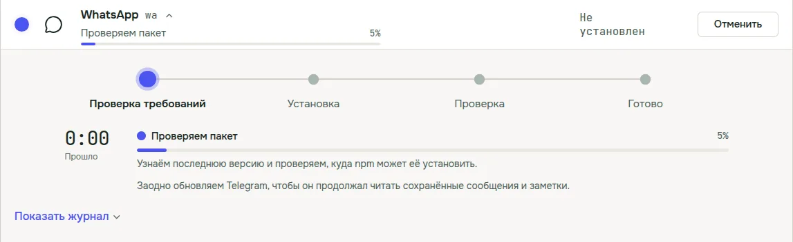
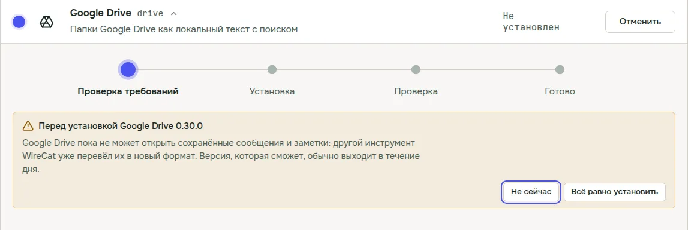

WireCat Desktop это приложение, которое ставит инструменты WireCat, входит в ваши аккаунты и дает вашему ИИ-агенту
чаты, почту, встречи, документы и заметки, и все это хранится на вашем компьютере. 0.5 небольшой релиз, в нем две
вещи, которые я давно хотел. Установщик для Windows теперь подписан, а перед обновлением приложение проверяет, что
оно не сломает остальные инструменты.

## Подписанный установщик для Windows

Раньше Windows называла установщик WireCat приложением неизвестного издателя, и на странице загрузки приходилось
объяснять, как это окно пройти. Теперь установщик подписан сертификатом Open Source Developer от Certum, и Windows
показывает издателя **Open Source Developer Viacheslav Ptsarev**. Это я.

Подпись не убирает синее окно SmartScreen сразу. SmartScreen доверяет подписанному приложению, только когда его
установит достаточно людей, и
[по словам Microsoft](https://learn.microsoft.com/ru-ru/windows/apps/package-and-deploy/smartscreen-reputation) это
может занять несколько недель. Так что какое-то время вы еще можете видеть **Система Windows защитила ваш
компьютер**. Разница в том, что по кнопке **Подробнее** теперь видно мое имя как издателя. Если там что-то другое, не
запускайте файл. Шаги есть на [странице загрузки](/ru/download#first-launch).

И еще одно. В Windows 11 есть Smart App Control, он блокирует неподписанные приложения, и разрешить одно нельзя. С
ним прежние версии WireCat вообще не запускались.
[В ответах Microsoft](https://support.microsoft.com/ru-ru/windows/security/threat-malware-protection/smart-app-control-frequently-asked-questions)
сказано, что приложение с действительной подписью он пропускает, так что эта версия должна запуститься.

## Проверка перед установкой или обновлением инструмента

Все инструменты WireCat хранят ваши сообщения и заметки в одном общем хранилище на компьютере. Иногда новая версия
инструмента переводит хранилище в новый формат, и инструмент, который читает только старый, перестает работать, пока
его тоже не обновишь. Раньше вы узнавали об этом уже после обновления.

Теперь WireCat сначала проверяет. Если другому инструменту нужна новая версия, чтобы и дальше читать хранилище,
приложение обновит его сразу после того, который вы выбрали, и напишет об этом в строке хода установки.

Предупреждение появляется, только когда обновляться пока не на что. Это когда у другого инструмента еще нет новой
версии, которая читает новый формат, или когда выбранная версия не может открыть ваше хранилище. Вы выбираете **Не
сейчас** или **Все равно обновить**. У собственных инструментов WireCat исправленная версия обычно выходит в течение
дня.

Проверка спрашивает у npm самую новую версию каждого инструмента напрямую, так что не смотрит в устаревший список.

## Обновление из .deb или .rpm

Копии из пакета .deb или .rpm для обновления нужен ваш пароль, а приложение никогда не спрашивает его само. Окно
обновления по-прежнему открывает установщик программ системы и показывает команду, которую можно скопировать. Теперь
в нем есть еще кнопка **Открыть в терминале**. Введите там пароль, а когда установка закончится,
перезапустите WireCat.

## По мелочи

- Когда почтовый агент пропускает запуск, причина теперь на вашем языке.
- Строки на странице Инструментов стоят на месте, когда другие инструменты над той, на которую вы нажали, начинают
  обновляться.

## С прошлого поста

Про 0.4.1 и 0.4.2 я не писал, так что коротко.

- **Почтовый агент.** В панели Управление у Email переключатель **Запускать по расписанию** включает почтового агента
  Memo. Он читает новую почту каждые 5 минут и предлагает задачи, счета, заказы и факты, которые вы принимаете сами.
  Он ничего не отправляет. Нужны Memo и Claude Code.
- **Забрать память агента.** На странице Памяти **Отменить одобрение** теперь работает и для факта, который записал
  агент, и возвращает его на проверку.
- **Tailscale Funnel без приложения Tailscale.** Если Tailscale не установлен, WireCat использует для Funnel свое
  небольшое соединение, и пароль администратора не нужен.
- **Понятные ошибки обновления.** Если обновление не удалось, приложение пишет, что случилось, например нет интернета
  или нет места в Загрузках, и что делать.
- **Исправления.** Обновление копии из .deb или .rpm снова работает. Если у вас 0.4.0 или старше, один раз установите
  новый пакет со страницы загрузки, дальше обновления работают из приложения. В Windows один инструмент больше не
  показывается как две копии.
- На странице Журнала настройки запусков спрятаны за кнопкой **Настройки журнала**, меню работают с клавиатуры, а
  приложение быстрее запускается.

## Где взять

Если у вас 0.4, приложение само предложит обновление. Впервые здесь? Скачайте WireCat на
[wirecat.dev/ru/download](/ru/download) для macOS, Windows или Linux. Полный список изменений в
[описании релиза на GitHub](https://github.com/WireCatLabs/wirecat-desktop/releases/tag/v0.5.0).

Если вы на Windows, мне интересно, что вы увидели при установке. Остановил ли вас SmartScreen? Напишите в
[Telegram-чат](https://t.me/wirecatdev) или откройте issue на
[GitHub](https://github.com/WireCatLabs/wirecat-desktop/issues). Я читаю все.
