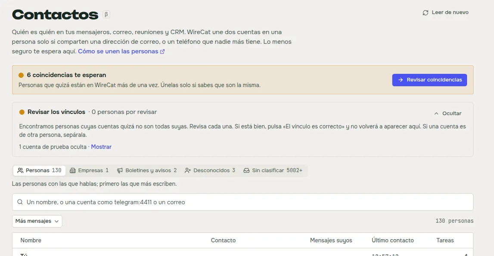
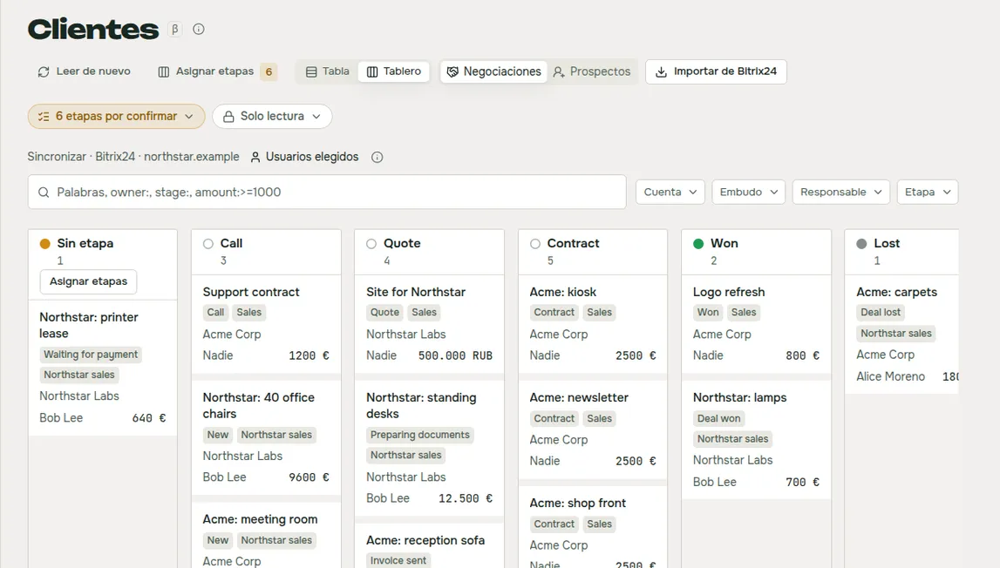
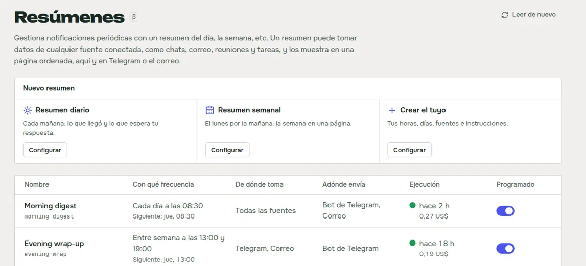
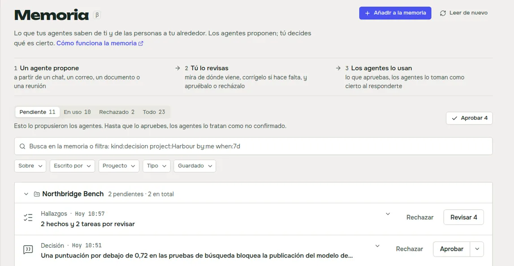

WireCat Desktop es la app que instala las herramientas de WireCat, inicia sesión por ti y le da a tu agente de IA tus
chats, correo, reuniones, documentos y notas, todo guardado en tu ordenador. Hasta ahora solo podía instalar las
herramientas que hago yo. Con la 0.6 puedes añadir cualquier herramienta hecha para WireCat, tuya, de un colega o de
cualquier otra persona. Para mí es el mayor cambio desde la primera versión. WireCat deja de ser un conjunto de mis
herramientas y pasa a ser un sitio donde también funcionan las herramientas de otros.

## Añade cualquier herramienta a WireCat

Imagina que tu empresa usa su propio CRM, o un servicio de soporte que no usa nadie más. Ahora tú o tu agente podéis
crear una herramienta de línea de comandos para él con las bibliotecas de WireCat, publicarla en npm y añadirla a la
app por su nombre. La forma más rápida de empezar es la
[plantilla](https://github.com/WireCatLabs/cli-template): `npx @wirecat/cli-template new <name>-cli --command <word>
--package <npm name> --owner <github owner>` te da una herramienta que funciona, con almacenamiento, búsqueda, la skill
para tus agentes y un servidor MCP, y pasa todas las comprobaciones de los estándares de WireCat. Después WireCat la instala, inicia su sesión, la sincroniza y se la da a tus agentes como Telegram o
Gmail. Sin reiniciar.

Una herramienta así se ejecuta como tú en tu ordenador y puede leer todo lo que guarda WireCat. Por eso, antes de
instalar nada, la app te muestra una revisión. Marca la herramienta como **Sin verificar** y dice con palabras
sencillas qué dice hacer la herramienta: qué datos lee y cambia, en el servicio y en tu ordenador, y con qué servidores
conecta. Enlaza a quien la publica, el repositorio y el commit exacto desde el que la compiló npm. Lista lo que conviene
revisar, como un paquete publicado la semana pasada o código que habla con servidores que no declara. Y te ofrece que
tu agente de IA lea el código primero. Nada de esto demuestra que una herramienta sea segura. Te da los datos para
decidir.

Para probarlo, activa **Permitir herramientas que WireCat no ha revisado** en Ajustes. Las herramientas que yo haya
revisado llegarán en una lista firmada de la comunidad, con su propio interruptor.
[Añadir tu propia herramienta](/es/docs/desktop/own-tools) tiene las dos partes, para quien añade una herramienta y
para quien la crea.

## Usa un modelo de IA que se queda en tu ordenador

Parte de lo que hace WireCat necesita un modelo de IA, por ejemplo leer el texto de una imagen o proponer hechos a
partir de un documento. Ahora puedes elegir ese modelo tú, en Ajustes, en **Modelo de IA**: un proveedor, un modelo y
una clave para todo. **Comprobar** te dice con palabras sencillas si funciona.

Lo que más me importa es que el modelo no tiene que estar en la nube de otro. Elige **OpenAI o compatible** y dale la
dirección de cualquier servidor que hable la interfaz de OpenAI. Puede ser un modelo que funciona en tu propio
ordenador, o en el servidor de tu empresa. Así las imágenes y los textos que lee se quedan contigo. Ollama en tu ordenador también funciona. Anthropic, OpenAI y servicios como OpenRouter están ahí si los
prefieres. [Usar WireCat con modelos locales](/es/docs/desktop/local-models) muestra cómo configurarlo para cada función y qué
sigue saliendo.

Dos ayudas de búsqueda pueden usar el mismo modelo, y las dos están desactivadas hasta que aceptas. Una añade otras
palabras a tus notas y correos, para que una pregunta hecha con otras palabras los encuentre. La otra reordena los
primeros resultados de una búsqueda cuando pulsas **Buscar a fondo**. Cada una muestra qué sale de tu ordenador,
adónde va y cuánto cuesta antes de que la actives.

## Ve en una lista a todas las personas con las que hablas

La misma persona a menudo te escribe por Telegram, te manda contratos por correo y está en tu CRM. Antes eso eran tres
personas para tu agente. Ahora ves a todos los de Telegram, MAX, WhatsApp, el correo, las reuniones y Bitrix24 en una
lista, repartidos en personas, empresas, boletines, desconocidos y sin clasificar, y puedes unir las cuentas de una
persona en una.

WireCat une dos cuentas por sí solo solo cuando comparten un correo, o un teléfono que nadie más tiene. Lo que es menos
seguro te espera como coincidencia, y la tarjeta dice qué coincidió. Puedes comparar a dos personas una junto a otra,
con sus negociaciones, tareas y últimos mensajes, y unirlas o mantenerlas separadas. Puedes deshacer una unión
equivocada, y responder a tu agente cuando cree que una persona son en realidad dos. Es la página **Contactos**.

## Mueve tus negociaciones del CRM en un tablero

Ahora puedes ver tus negociaciones y prospectos de Bitrix24 como tabla o como tablero por etapas, y arrastrar una
negociación a su siguiente etapa. El cambio llega también a Bitrix24. Si tu CRM nombra sus etapas a su manera, pones
cada una bajo una de las tuyas una vez, y las negociaciones de todos los CRM se alinean en un tablero. WireCat sugiere
adónde va cada etapa, y aceptas con un clic.

La sincronización copia solo las negociaciones de los usuarios del CRM que elijas, no todo el portal. En un CRM de
equipo, la mayoría de las negociaciones son de otras personas, y tu agente no las necesita. Es la página **Clientes**.

## Recibe un resumen cada mañana

Ahora puedes recibir un resumen breve de lo que llegó y lo que te espera, a partir de tus chats, correo, reuniones y
tareas, cada mañana o cada semana. Eliges cuándo se ejecuta, qué lee y adónde va: la app, un bot de Telegram o el
correo. Fijas un límite de gasto, así que un día con mucho movimiento no te da sorpresas. Puedes pedir uno ahora mismo,
cambiar qué recoge y cómo se ve con una vista previa, y crear los resúmenes de días pasados para leerlos en la app.

Claude Code escribe los resúmenes, así que necesitas tenerlo instalado. Es la página **Resúmenes**.

## Decide qué recuerdan tus agentes, con la fuente delante

Los agentes conectados a WireCat guardan lo que aprenden sobre ti y las personas de tu entorno, y nada cuenta hasta que
lo apruebas. En la página **Memoria** renovada ahora ves, para cada sugerencia, de dónde viene, qué sabrán los agentes
y qué cambian Aprobar y Rechazar. Puedes editar una sugerencia antes de aprobarla, y ver cuándo su fuente cambió o
desapareció.

También puedes añadir a la memoria tú mismo: pega una nota, da un enlace, un archivo o una imagen. WireCat lo guarda
como un documento en el que puedes buscar, propone hechos a partir de él y se queda con los que marcas.

## Cosas más pequeñas

- **Inicia sesión en cada herramienta de la misma forma.** Cada inicio de sesión dice qué tener a mano, muestra sus
  pasos y tiene Atrás. Un fallo dice qué pasó y una forma de arreglarlo. Puedes entrar en MAX con un token, en WhatsApp
  con un número de teléfono y un código, y en Gmail directamente con Google, sin configurar nada tuyo en Google Cloud.
- **Quita una cuenta** desde su menú, y elige si conservar o borrar sus datos. Las cuentas de Telegram, por ahora,
  solo cierran la sesión.
- **Abre un enlace `wirecat://`** a un chat, un mensaje, una tarea o un resumen, y la app abierta lo muestra.
- **Busca actualizaciones** desde el menú Ayuda.
- **Importa registros** desde un archivo CSV o JSON en Almacenamiento, con una comprobación que lista cada línea
  rechazada.
- **Ve las tareas que Memo encontró en tus chats** en una página Tareas más tranquila.
- **Abre las páginas mucho más rápido.** Una página que abriste en el último minuto aparece al momento.

## Descárgala

Si tienes la 0.5, la app te ofrece la actualización ella sola. ¿Eres nuevo? Descarga WireCat en
[wirecat.dev/es/download](/es/download) para macOS, Windows o Linux. La [guía de Desktop](/es/docs/desktop) cubre
cada página, y la lista completa de cambios está en las
[notas de la versión en GitHub](https://github.com/WireCatLabs/wirecat-desktop/releases/tag/v0.6.0).

Contactos, Clientes, Resúmenes, Memoria y Tareas están marcadas como beta, con una β pequeña junto al nombre. Si creas
una herramienta para WireCat, o Contactos une a las personas equivocadas, cuéntamelo en
[Discord](https://discord.gg/DebENqbRrJ) o abre un issue en
[GitHub](https://github.com/WireCatLabs/wirecat-desktop/issues). Lo leo todo.
