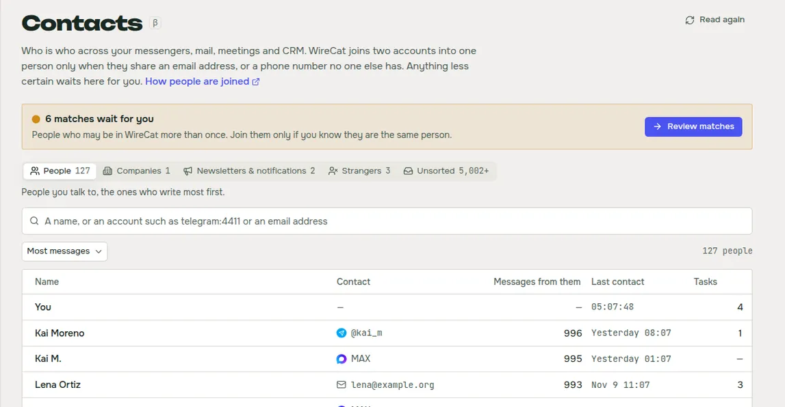
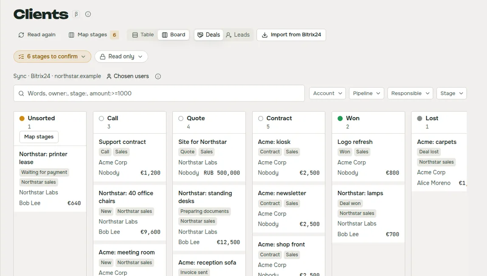
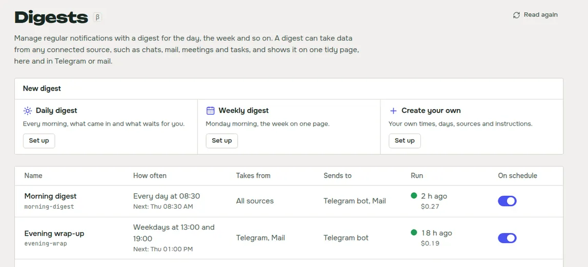
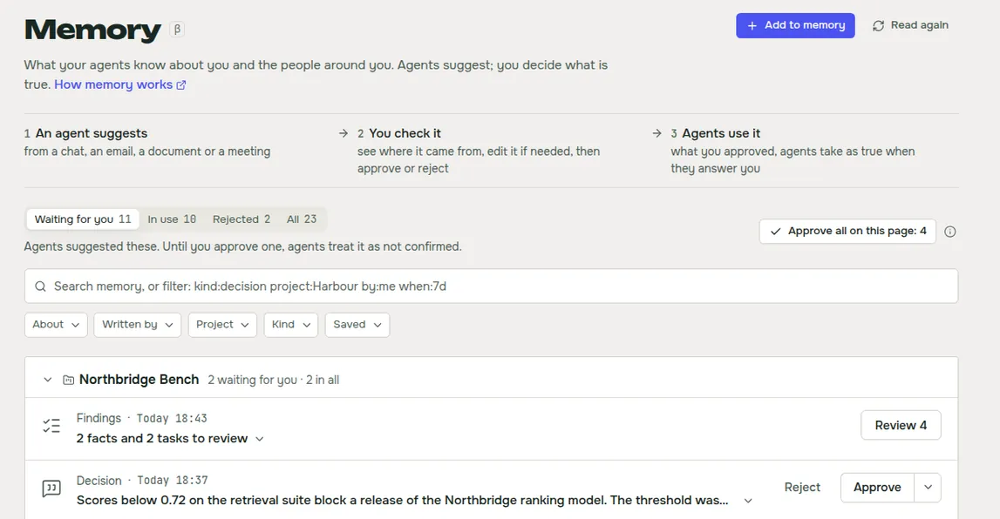

WireCat Desktop is the app that installs the WireCat tools, signs you in and gives your AI agent your chats, mail,
meetings, documents and notes, all kept on your computer. Until now it could only install the tools I make. With 0.6
you can add any tool built for WireCat, by you, a colleague or anyone else. For me this is the biggest change since
the first release. WireCat stops being a set of my tools and becomes a place where other people's tools work too.

## Add any tool to WireCat

Say your company runs its own CRM, or a helpdesk nobody else uses. You or your agent can now build a command-line tool
for it on WireCat's libraries, publish it to npm and add it to the app by its name. The quickest start is the
[template](https://github.com/WireCatLabs/cli-template): `npx @wirecat/cli-template new <name>-cli --command <word>
--package <npm name> --owner <github owner>` gives you a working tool with storage, search, the skill for your agents
and an MCP server, and it passes every WireCat standards check. WireCat then installs it, signs
it in, syncs it and gives it to your agents like Telegram or Gmail. No restart.

Such a tool runs as you on your computer and can read everything WireCat keeps. So before anything installs, the app
shows you a review. It marks the tool **Not verified** and says in plain words what the tool says it does: which data
it reads and changes, in the service and on your computer, and which servers it contacts. It links the publisher, the
repository and the exact commit npm built it from. It lists the things worth a second look, such as a package
published last week or code that talks to servers it doesn't declare. And it offers to let your AI agent read the
code first. None of this proves a tool is safe. It gives you the facts to decide.

To try it, turn on **Allow tools WireCat has not checked** in Settings. Tools I have reviewed will come as a signed
community list, with their own switch. [Add your own tool](/en/docs/desktop/own-tools) has both parts, for the people
who add a tool and for the people who build one.

## Use an AI model that stays on your computer

Some of what WireCat does needs an AI model, for example reading the text in a picture or suggesting facts from a
document. You can now choose that model yourself, in Settings, under **AI model**: one provider, one model and one
key for everything. **Check** tells you in plain words if it works.

The part I care about most is that the model doesn't have to be in someone else's cloud. Choose **OpenAI or
compatible** and give it the address of any server that speaks the OpenAI interface. That can be a model running on
your own computer, or on your company's server. Then the pictures and texts it reads stay with you. Ollama on your computer works too. Anthropic, OpenAI and services like OpenRouter are there if you prefer
them. [Run WireCat on local models](/en/docs/desktop/local-models) shows how to set it up for each feature, and what still
goes out.

Two search helpers can use the same model, and both are off until you agree. One adds other words to your notes and
emails, so a question in different words finds them. The other reorders the top results of one search when you press
**Search harder**. Each shows what leaves your computer, where it goes and what it costs before you turn it on.

## See everyone you talk to in one list

The same person often writes to you in Telegram, sends contracts by email and sits in your CRM. Before, that was three
people for your agent. Now you can see everyone from Telegram, MAX, WhatsApp, email, meetings and Bitrix24 in one
list, sorted into people, companies, newsletters, strangers and unsorted, and join one person's accounts into one.

WireCat joins two accounts by itself only when they share an email, or a phone number no one else has. Anything less
sure waits for you as a match, and the card says what matched. You can compare two people side by side, with their
deals, tasks and latest messages, and join them or keep them apart. You can undo a wrong join, and answer your agent
when it thinks one person is really two. This is the **Contacts** page.

## Move your CRM deals on a board

You can now see your Bitrix24 deals and leads as a table or as a board by stage, and drag a deal to its next stage.
The change goes to Bitrix24 too. If your CRM names its stages its own way, you put each of them under one of yours
once, and deals from every CRM line up on one board. WireCat suggests where each stage goes, and you accept with one
click.

The sync copies only the deals of the CRM users you choose, not the whole portal. In a team CRM most deals are other
people's, and your agent doesn't need them. This is the **Clients** page.

## Get a digest every morning

You can now get one short summary of what came in and what waits for you, from your chats, mail, meetings and tasks,
every morning or every week. You pick when it runs, what it reads, and where it goes: the app, a Telegram bot or mail.
You set a cost limit, so a busy day can't surprise you. You can get one right now, change what it collects and how it
looks with a preview, and build the digests of past days to read in the app.

Claude Code writes the digests, so you need it installed. This is the **Digests** page.

## Decide what your agents remember, with the source in front of you

Agents connected to WireCat save what they learn about you and the people around you, and nothing counts until you
approve it. On the refreshed **Memory** page you can now see, for each suggestion, where it came from, what agents
will know, and what Approve and Reject change. You can edit a suggestion before you approve it, and see when its
source changed or went away.

You can also add to memory yourself: paste a note, give a link, a file or a picture. WireCat keeps it as a document
you can search, suggests facts from it, and keeps the ones you tick.

## Smaller things

- **Sign in to every tool the same way.** Each sign-in says what to have at hand, shows its steps and has a Back. A
  failure says what happened and one way to fix it. You can sign in to MAX with a token, to WhatsApp with a phone
  number and a code, and to Gmail with Google directly, with no Google Cloud setup of your own.
- **Remove an account** from its menu, and choose to keep or delete its data. Telegram accounts are only signed out
  for now.
- **Open a `wirecat://` link** to a chat, a message, a task or a digest, and the running app shows it.
- **Check for updates** from the Help menu.
- **Import records** from a CSV or JSON file in Storage, with a check that lists each refused line.
- **See the tasks Memo found in your chats** on a calmer Tasks page.
- **Open pages much faster.** A page you opened in the last minute shows at once.

## Get it

If you have 0.5, the app offers the update itself. New here? Download WireCat from
[wirecat.dev/download](/en/download) for macOS, Windows or Linux. The [Desktop guide](/en/docs/desktop) covers each
page, and the full list of changes is in the
[release notes on GitHub](https://github.com/WireCatLabs/wirecat-desktop/releases/tag/v0.6.0).

Contacts, Clients, Digests, Memory and Tasks are marked beta, with a small β beside the name. If you build a tool for
WireCat, or Contacts joins the wrong people, tell me on [Discord](https://discord.gg/DebENqbRrJ) or open an issue on
[GitHub](https://github.com/WireCatLabs/wirecat-desktop/issues). I read all of it.
