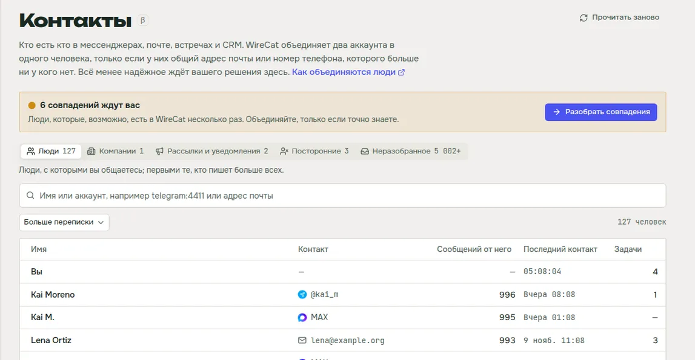
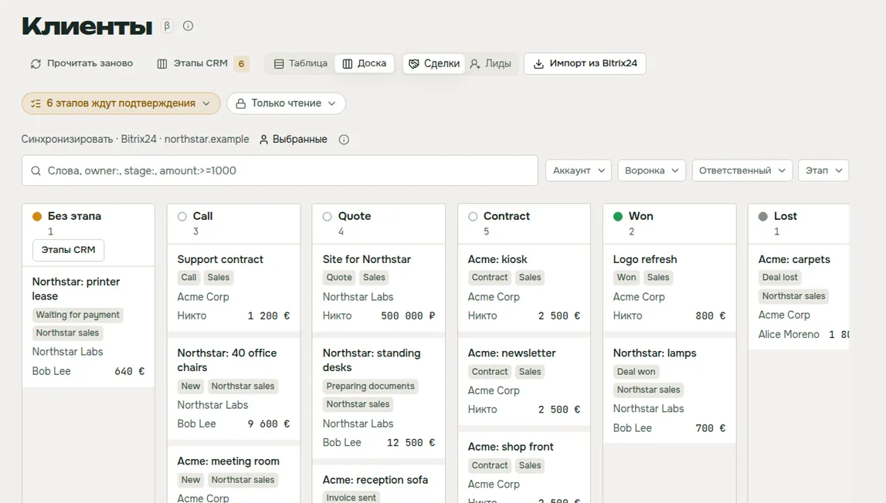
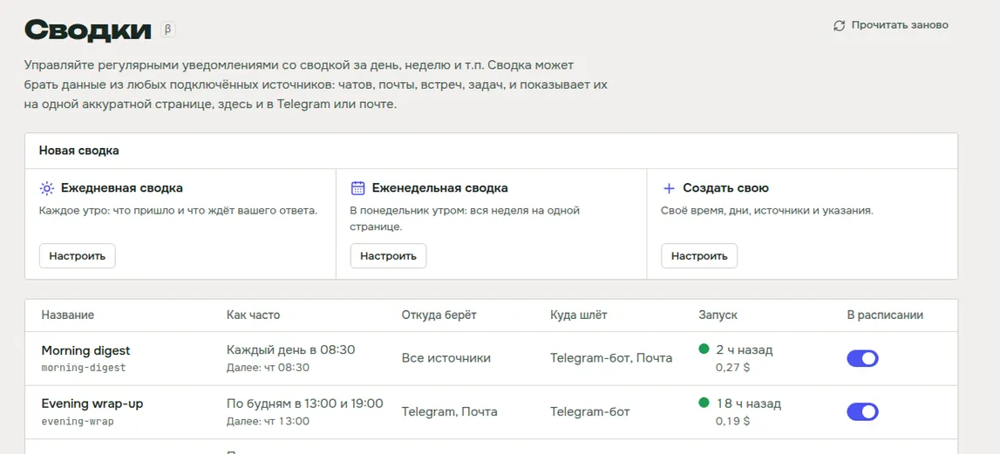
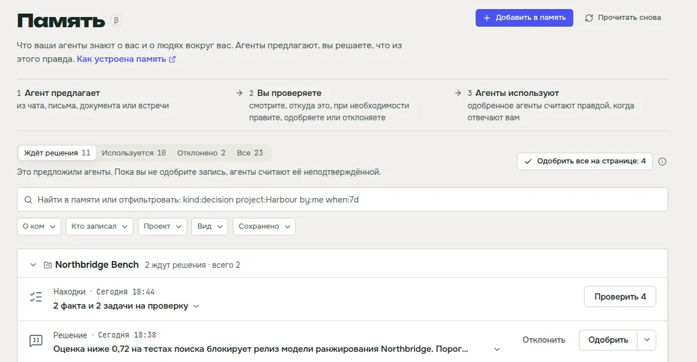

WireCat Desktop это приложение, которое ставит инструменты WireCat, входит в ваши аккаунты и дает вашему ИИ-агенту
чаты, почту, встречи, документы и заметки, и все это хранится на вашем компьютере. С 0.6 вы можете добавить любой
инструмент, сделанный для WireCat, вами, коллегой или кем угодно, и я думаю, это самое большое изменение с первого
релиза. WireCat теперь платформа, и чужие инструменты работают в нем так же, как мои.

## Добавьте в WireCat любой инструмент

Допустим, в вашей компании своя CRM или служба поддержки, которой больше никто не пользуется. Теперь вы или ваш агент
можете сделать для нее инструмент командной строки на библиотеках WireCat, опубликовать его в npm и добавить в
приложение по имени. Быстрее всего начать с [шаблона](https://github.com/WireCatLabs/cli-template):
`npx @wirecat/cli-template new <name>-cli --command <word> --package <npm name> --owner <github owner>` дает
работающий инструмент с хранилищем, поиском, навыком для агентов и MCP-сервером, и он проходит все проверки
стандартов WireCat. Дальше WireCat его ставит, входит в аккаунт, синхронизирует и дает вашим агентам, как Telegram
или Gmail. Без перезапуска.

Такой инструмент работает от вашего имени на вашем компьютере и может прочитать все, что хранит WireCat. Поэтому до
любой установки приложение показывает проверку. Она отмечает инструмент меткой **Не проверен** и простыми словами
пересказывает, что инструмент говорит о себе: какие данные он читает и меняет, в сервисе и на вашем компьютере, и к
каким серверам обращается. Она дает ссылки на автора, репозиторий и точный коммит, из которого npm собрал пакет. Она
перечисляет, на что стоит посмотреть внимательнее, например пакет, опубликованный на прошлой неделе, или код, который
ходит на серверы, о которых не говорит. И предлагает сначала дать вашему ИИ-агенту прочитать код. Ничто из этого не
доказывает, что инструмент безопасен. Это факты, чтобы вы решили сами.

Чтобы попробовать, включите в настройках **Разрешить инструменты, которые WireCat не проверял**. Инструменты, которые
проверил я, будут приходить подписанным списком сообщества, со своим переключателем. На странице
[Добавить свой инструмент](/ru/docs/desktop/own-tools) есть обе части: для тех, кто добавляет инструмент, и для тех,
кто его делает.

## Модель ИИ, которая остается на вашем компьютере

Части того, что делает WireCat, нужна модель ИИ, например чтобы прочитать текст на картинке или предложить факты из
документа. Теперь вы выбираете эту модель сами, в настройках, в разделе **Модель ИИ**: один провайдер, одна модель и
один ключ для всего. **Проверить** простыми словами говорит, работает ли она.

Больше всего мне здесь важно, что модель не обязана жить в чужом облаке. Выберите **OpenAI или совместимый** и укажите
адрес любого сервера, который говорит на языке OpenAI. Это может быть модель на вашем компьютере или на сервере вашей
компании. Тогда картинки и тексты, которые она читает, остаются у вас. Ollama на вашем компьютере
тоже подходит. Anthropic, OpenAI и сервисы вроде OpenRouter тоже есть, если они вам удобнее. Как настроить это для каждой
функции и что все еще уходит наружу, показывает страница
[Запустить WireCat на локальных моделях](/ru/docs/desktop/local-models).

Эту же модель могут использовать два помощника поиска, и оба выключены, пока вы не согласитесь. Один добавляет к
заметкам и письмам другие слова, чтобы вопрос, заданный иначе, все равно их находил. Другой переставляет первые
результаты одного поиска, когда вы нажимаете **Искать тщательнее**. Прежде чем вы их включите, каждый показывает, что
уходит с компьютера, куда и сколько это стоит.

## Все, с кем вы общаетесь, одним списком

Один и тот же человек часто пишет вам в Telegram, присылает договоры на почту и есть в вашей CRM. Раньше для агента это
были три разных человека. Теперь вы видите всех из Telegram, MAX, WhatsApp, почты, встреч и Битрикс24 одним списком,
разложенным на людей, компании, рассылки, посторонних и неразобранное, и можете объединить аккаунты одного человека.

Сам WireCat объединяет два аккаунта, только когда у них общий адрес почты или номер телефона, которого больше ни у кого
нет. Все менее надежное ждет вас как совпадение, и карточка говорит, что совпало. Вы можете сравнить двух людей рядом,
с их сделками, задачами и последними сообщениями, и объединить их или оставить раздельно. Ошибочное объединение можно
отменить, а агенту можно ответить, когда он считает, что один человек на самом деле два. Это страница **Контакты**.

## Сделки CRM на доске

Теперь вы видите сделки и лиды из Битрикс24 таблицей или доской по этапам и перетаскиваете сделку на следующий этап.
Изменение уходит и в Битрикс24. Если ваша CRM называет этапы по-своему, вы один раз ставите каждый из них под один из
ваших, и сделки из всех CRM выстраиваются на одной доске. WireCat подсказывает, куда идет каждый этап, а вы принимаете
одним щелчком.

Синхронизация копирует только сделки выбранных вами пользователей CRM, а не весь портал. В командной CRM большинство
сделок чужие, и вашему агенту они не нужны. Это страница **Клиенты**.

## Сводка каждое утро

Теперь вы можете получать одну короткую сводку о том, что пришло и что ждет вас, из чатов, почты, встреч и задач,
каждое утро или каждую неделю. Вы выбираете, когда она запускается, что читает и куда приходит: в приложение, в
Telegram-бота или на почту. Вы задаете лимит расходов, чтобы загруженный день не стал сюрпризом. Сводку можно получить
прямо сейчас, поменять, что она собирает и как выглядит, с предпросмотром, и собрать сводки за прошлые дни, чтобы
прочитать их в приложении.

Сводки пишет один из ваших агентов, и вы сами выбираете какой: Claude Code, Gemini CLI, OpenCode или Codex после предупреждения. Это страница **Сводки**.

## Решайте, что помнят агенты, глядя на источник

Агенты, подключенные к WireCat, сохраняют то, что узнали о вас и о людях вокруг, и ничто не считается, пока вы это не
одобрите. На обновленной странице **Память** вы теперь видите у каждого предложения, откуда оно, что будут знать
агенты и что меняют **Одобрить** и **Отклонить**. Предложение можно поправить до одобрения и увидеть, когда его
источник изменился или пропал.

В память можно добавлять и самому: вставьте заметку, дайте ссылку, файл или картинку. WireCat сохранит это как
документ, который находится поиском, предложит из него факты и оставит те, что вы отметите.

## Мелочи

- **Входите во все инструменты одинаково.** Каждый вход говорит, что понадобится, показывает шаги и дает вернуться
  назад. Если что-то не получилось, он говорит, что случилось, и предлагает одно исправление. В MAX можно войти по
  токену, в WhatsApp по номеру телефона и коду, а в Gmail сразу через Google, без своей настройки Google Cloud.
- **Удаляйте аккаунт** из его меню и выбирайте, оставить его данные или удалить. Аккаунты Telegram пока только выходят
  из системы.
- **Открывайте ссылки `wirecat://`** на чат, сообщение, задачу или сводку, и запущенное приложение их показывает.
- **Проверяйте обновления** из меню Помощь.
- **Импортируйте записи** из файла CSV или JSON в Хранилище, с проверкой, которая называет каждую отклоненную строку.
- **Смотрите задачи, которые Memo нашел в ваших чатах**, на более спокойной странице Задачи.
- **Страницы открываются намного быстрее.** Страница, которую вы открывали в последнюю минуту, показывается сразу.

## Как получить

Если у вас 0.5, приложение само предложит обновление. Вы здесь впервые? Скачайте WireCat на
[wirecat.dev/download](/ru/download) для macOS, Windows или Linux. [Руководство по Desktop](/ru/docs/desktop)
описывает каждую страницу, а полный список изменений есть в
[заметках о выпуске на GitHub](https://github.com/WireCatLabs/wirecat-desktop/releases/tag/v0.6.0).

Контакты, Клиенты, Сводки, Память и Задачи отмечены как бета, маленьким знаком β рядом с названием. Если вы делаете
инструмент для WireCat или Контакты объединили не тех людей, напишите мне в [Discord](https://discord.gg/DebENqbRrJ)
или откройте issue на [GitHub](https://github.com/WireCatLabs/wirecat-desktop/issues). Я читаю все.
