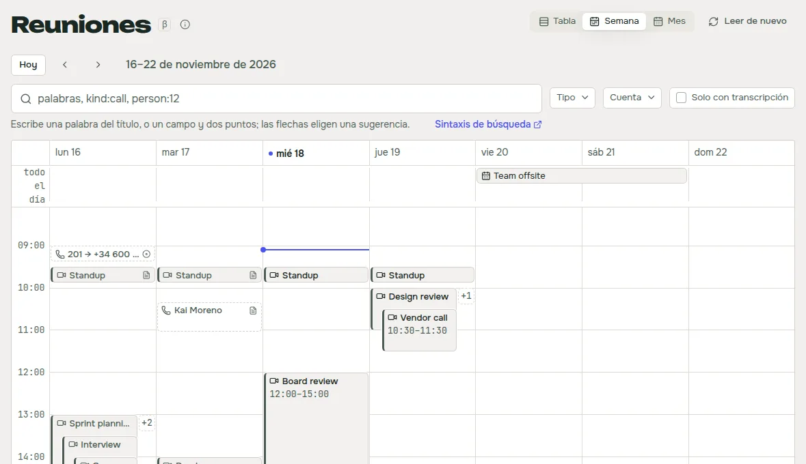
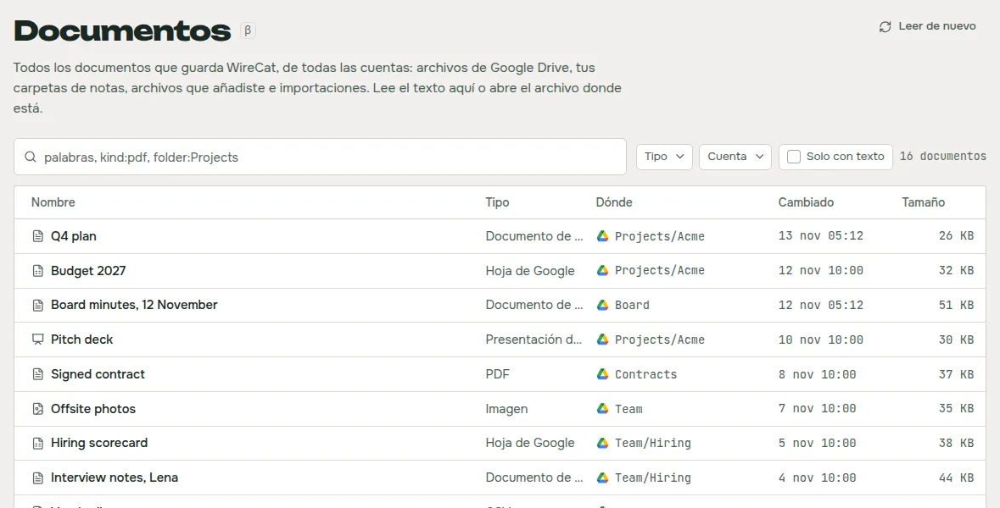

WireCat Desktop instala las herramientas de WireCat, inicia sesión por ti y le da a tu agente de IA tus chats, correo, reuniones, documentos y notas. Todo queda en tu ordenador. En la 0.7 las reuniones y llamadas están junto a tus chats y tu CRM: las ves todas en una página, y una negociación de Bitrix24 muestra las llamadas de sus personas, con la grabación a un clic.

## Ve todas tus reuniones y llamadas en una página

La nueva página **Reuniones** muestra tus reuniones, llamadas y eventos del calendario juntos, por semana, por mes o
como tabla. Las reuniones a la misma hora se colocan una al lado de otra, como en Google Calendar, y un campo de
búsqueda encuentra una reunión por sus palabras.

Abre una reunión para ver quién aceptó la invitación y quién la rechazó, los enlaces para unirse, el resumen y la
transcripción, donde puedes buscar cualquier palabra. La ficha también muestra los archivos de Drive adjuntos al
evento del calendario, y un botón abre el propio evento en Google Calendar.

Google Meet guarda sus transcripciones y las notas de Gemini en el Drive de quien organiza, a menudo fuera de las
carpetas que elegiste para WireCat. Ahora, después de iniciar sesión en Drive, WireCat te pregunta si quieres
añadirlas.

## Escucha tus llamadas junto a tus clientes

WireCat ya puede instalar la herramienta de Asterisk. Conecta tu centralita Asterisk y cada llamada se guarda como una
reunión, con su grabación, y con su transcripción cuando la hay. Le dices en qué países están tus líneas, así que quien
llama sin prefijo de país llega igualmente al contacto correcto.

La ficha de una negociación o un lead de Bitrix24 muestra las llamadas de las personas que aparecen en ella. Cada
llamada dice si fue entrante o saliente, quién era el gestor y el número del cliente. Una llamada con la grabación en
tu ordenador tiene un botón **Escuchar**, y la oyes en la misma ficha. La empresa de una negociación se abre en su
propia ficha, con sus personas, sus negociaciones y leads abiertos y cuántas llamadas tuvieron sus personas.

## Busca en tus páginas de Notion

Notion viene incluido ahora. Inicia sesión con un token de Notion, y WireCat copia a tu ordenador las páginas y bases
de datos que ese token puede ver, para que puedas buscar en ellas y tu agente pueda leerlas.

## Trae tus notas y documentos

La ficha de notas tiene ahora **Conectar una bóveda de Obsidian**, y muestra las bóvedas que Obsidian ya conoce, cada
una con su botón para conectarla.

La nueva página **Documentos** muestra todos los documentos que guarda WireCat, de Drive, de tus carpetas de notas y de
tus importaciones, en una tabla que puedes filtrar por cuenta o por carpeta. Abre uno para leer su texto y ver las
personas y reuniones que menciona.

## Instala y actualiza todas las herramientas de una vez

La página Herramientas ahora agrupa las herramientas según quién las hace, primero las incluidas y después las
herramientas adicionales de WireCat. **Instalar todo** instala todas las herramientas incluidas que aún no tienes, y
**Actualizar todo** actualiza todas las instaladas que tienen una versión nueva. Las herramientas que añadiste tú
quedan fuera, porque cada una de sus actualizaciones pasa por su propia revisión.

## Cosas más pequeñas

- **Ve tus reglas de correo.** El menú de una cuenta de Email tiene **Reglas de correo**, con lo que detecta cada
  regla y lo que hace.
- **Instala sin aceptar la licencia.** La imagen de disco de macOS y el instalador de Windows ya no te piden aceptar
  la licencia. La licencia sigue viniendo con la app.
- **Cuenta los avisos sin leer en Ubuntu.** El icono del dock muestra cuántos avisos de la campana no has leído.

## Descárgala

Si tienes la 0.6, la app te ofrece la actualización ella sola. ¿Eres nuevo? Descarga WireCat en
[wirecat.dev/es/download](/es/download) para macOS, Windows o Linux. La [guía de Desktop](/es/docs/desktop) cubre
cada página, y cada versión de la 0.6.2 a la 0.7.0 tiene sus propias
[notas de la versión en GitHub](https://github.com/WireCatLabs/wirecat-desktop/releases).

Reuniones y Documentos están marcadas como beta, con una β pequeña junto al nombre. Las ideas de qué hacer después van
en [la página de ideas](/es/ideas), y las preguntas en [Discord](https://discord.gg/DebENqbRrJ) o en
[GitHub](https://github.com/WireCatLabs/wirecat-desktop/issues). Lo leo todo.
