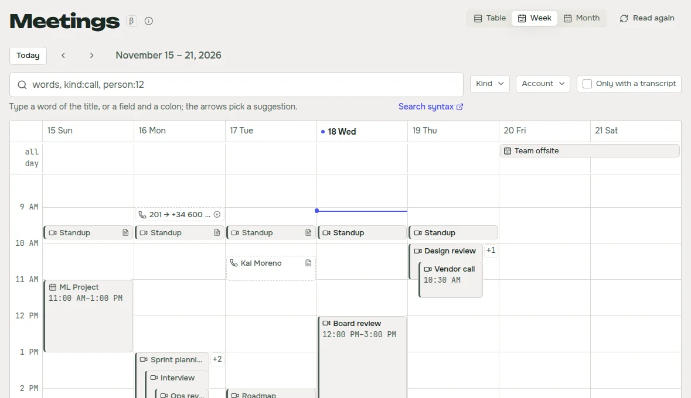
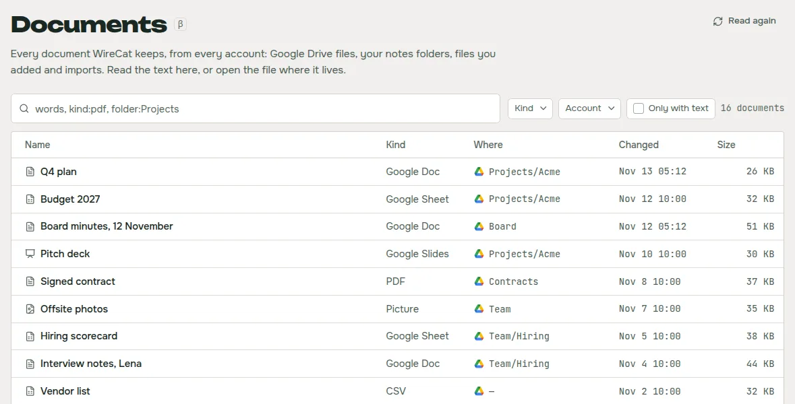

WireCat Desktop is the app that installs the WireCat tools, signs you in and gives your AI agent your chats, mail,
meetings, documents and notes, all kept on your computer. With 0.7 your meetings and calls sit next to your chats and
your CRM. You see every meeting and call on one page, and a Bitrix24 deal shows the calls of its people, so you can
listen to a recording without leaving the card.

## See every meeting and call on one page

The new **Meetings** page shows your meetings, calls and calendar events together, by week, by month or as a table.
Meetings at the same time sit side by side, as in Google Calendar, and a search field finds a meeting by its words.

Open a meeting to see who accepted the invitation and who declined, the join links, the summary and the transcript,
where you can find any word. The card also lists the files attached to the calendar event in Drive, and **Open in
Google Calendar** takes you to the event itself.

Google Meet keeps its transcripts and Gemini notes in the organizer's Drive, often outside the folders you picked for
WireCat. After you sign in to Drive, WireCat now asks whether to add them.

## Hear your calls next to your clients

WireCat can now install the Asterisk tool. Connect your Asterisk phone system and each call is kept as a meeting, with
its recording, and its transcript when there is one. You tell it which countries your phone lines are in, so a caller
without a country code still lands on the right contact.

A Bitrix24 deal or lead card lists the calls of the people on it. Each call says whether it was incoming or outgoing,
who the manager was and the client's number. A call with a recording on your computer has a **Listen** button, so you
hear it right in the card. The company of a deal opens in its own card, with its people, its open deals and leads, and
how many calls its people had.

## Search your Notion pages

Notion is built in now. Sign in with a Notion token, and WireCat copies the pages and databases that the token can see
to your computer, so you can search them and your agent can read them.

## Bring in your notes and documents

The notes card now has **Connect an Obsidian vault**, and it lists the vaults Obsidian already knows, each with its
own Connect button.

The new **Documents** page shows every document WireCat keeps, from Drive, your notes folders and your imports, in one
table you can narrow to an account or a folder. Open one to read its text and see the people and meetings it names.

## Install and update every tool at once

The Tools page now sorts tools into groups by who makes them, with built-in tools first and additional WireCat tools
next. **Install all** installs every built-in tool you don't have yet, and **Update all** updates every installed tool
that has a newer version. Tools you added yourself stay out of Update all, because each of their updates goes through
its own review.

## Smaller things

- **See your mail rules.** An Email account's menu has **Mail rules**, with what each rule matches and what it does.
- **Install without a license prompt.** The macOS disk image and the Windows installer no longer ask you to accept
  the license. The license still comes with the app.
- **Count unread notices on Ubuntu.** The dock icon shows how many notices in the bell you haven't read.

## Get it

If you have 0.6, the app offers the update itself. New here? Download WireCat from
[wirecat.dev/download](/en/download) for macOS, Windows or Linux. The [Desktop guide](/en/docs/desktop) covers each
page, and every version from 0.6.2 to 0.7.0 has its own
[release notes on GitHub](https://github.com/WireCatLabs/wirecat-desktop/releases).

Meetings and Documents are marked beta, with a small β beside the name. Ideas for what to build next go on
[the ideas page](/en/ideas), and questions to [Discord](https://discord.gg/DebENqbRrJ) or
[GitHub](https://github.com/WireCatLabs/wirecat-desktop/issues). I read all of it.
