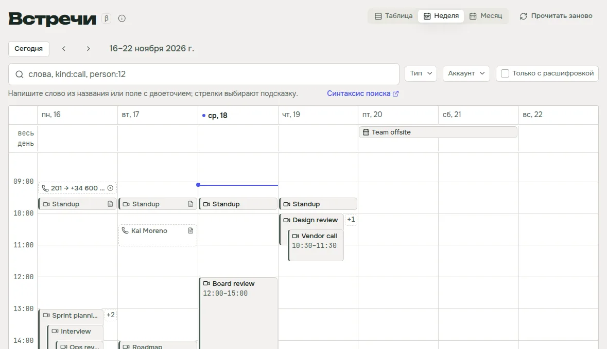
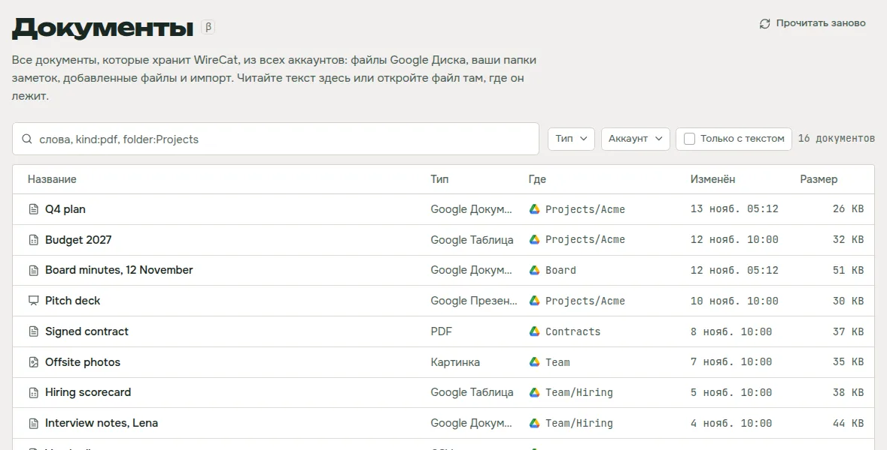

WireCat Desktop это приложение, которое ставит инструменты WireCat, входит в ваши аккаунты и дает вашему ИИ-агенту
чаты, почту, встречи, документы и заметки, и все это хранится на вашем компьютере. С 0.7 встречи и звонки теперь
рядом с перепиской и CRM. Все встречи и звонки видны на одной странице, а сделка в Битрикс24 показывает звонки ее
людей, и запись можно послушать, не уходя из карточки.

## Все встречи и звонки на одной странице

Новая страница **Встречи** показывает встречи, звонки и события календаря вместе, по неделям, по месяцам или
таблицей. Встречи в одно время стоят рядом, как в Google Календаре, а поле поиска находит встречу по словам.

В карточке встречи видно, кто принял приглашение и кто отказался, ссылки для входа, итоги и расшифровку, в которой
можно найти любое слово. Там же файлы, прикрепленные к событию календаря на Drive, а одна кнопка открывает само
событие в Google Календаре.

Google Meet хранит расшифровки и заметки Gemini на Drive организатора, часто вне папок, которые вы выбрали для
WireCat. Теперь после входа в Drive WireCat спрашивает, добавить ли их.

## Звонки рядом с клиентами

WireCat теперь ставит инструмент для Asterisk. Подключите свою АТС Asterisk, и каждый звонок сохранится как встреча,
с записью и с расшифровкой, если она есть. Вы указываете, в каких странах ваши линии, и звонящий без кода страны все
равно попадает к нужному контакту.

Карточка сделки или лида в Битрикс24 показывает звонки людей из нее. У каждого звонка видно, входящий он или
исходящий, кто был менеджером и номер клиента. Если запись звонка есть на вашем компьютере, у него есть кнопка
**Слушать**, и запись играет прямо в карточке. Компания сделки открывается своей карточкой, с ее людьми, открытыми
сделками и лидами и тем, сколько звонков было у ее людей.

Для облачной АТС Билайна есть отдельный инструмент beeline. Он забирает звонки и записи, расшифровывает их у вас на
компьютере и связывает с клиентами в Битрикс24 по номеру телефона. Он пока не встроен в WireCat, его ставят как
дополнительный инструмент WireCat. На странице Инструменты нажмите **Добавить свой инструмент** и введите
`@wirecat/beeline-cli`. С 0.7 его звонки открываются из карточки клиента и со страницы Встречи, а с 0.7.1 для него не
нужно разрешать в настройках инструменты, которые WireCat не проверял.

## Поиск по страницам Notion

Notion теперь встроен. Войдите по токену Notion, и WireCat скопирует на ваш компьютер страницы и базы, которые видит
этот токен, чтобы вы могли искать по ним, а агент мог их читать.

## Заметки и документы

В карточке заметок теперь есть **Подключить хранилище Obsidian**, и там же список хранилищ, которые уже знает
Obsidian, у каждого своя кнопка подключения.

Новая страница **Документы** показывает все документы, которые хранит WireCat, с Drive, из папок с заметками и из
импорта, одной таблицей, которую можно сузить до аккаунта или папки. Откройте документ, чтобы прочитать текст
и увидеть людей и встречи, которые в нем упоминаются.

## Все инструменты ставятся и обновляются разом

Страница Инструменты теперь разбивает инструменты на группы по тому, кто их делает, сначала встроенные, потом
дополнительные инструменты WireCat. **Установить все** ставит все встроенные инструменты, которых у вас еще нет, а
**Обновить все** обновляет все установленные, для которых вышла новая версия. Инструменты, которые вы добавили сами,
в это не входят, потому что каждое их обновление проходит свою проверку.

## Мелочи

- **Правила почты видны.** В меню почтового аккаунта есть **Правила почты**, там
  видно, что ловит каждое правило и что оно делает.
- **Установщик не просит принять лицензию.** Ни образ диска для macOS, ни установщик для Windows больше об этом не
  спрашивают. Лицензия по-прежнему идет вместе с приложением.
- **Значок в доке Ubuntu считает уведомления.** Он показывает, сколько уведомлений в колокольчике вы не прочитали.

## Как получить

Если у вас 0.6, приложение само предложит обновление. Вы здесь впервые? Скачайте WireCat на
[wirecat.dev/download](/ru/download) для macOS, Windows или Linux. [Руководство по Desktop](/ru/docs/desktop)
описывает каждую страницу, а у каждой версии с 0.6.2 до 0.7.0 есть свои
[заметки о выпуске на GitHub](https://github.com/WireCatLabs/wirecat-desktop/releases).

Встречи и Документы отмечены как бета, маленьким знаком β рядом с названием. Идеи, что сделать дальше, оставляйте на
[странице идей](/ru/ideas), а вопросы в [Discord](https://discord.gg/DebENqbRrJ) или на
[GitHub](https://github.com/WireCatLabs/wirecat-desktop/issues). Я читаю все.
