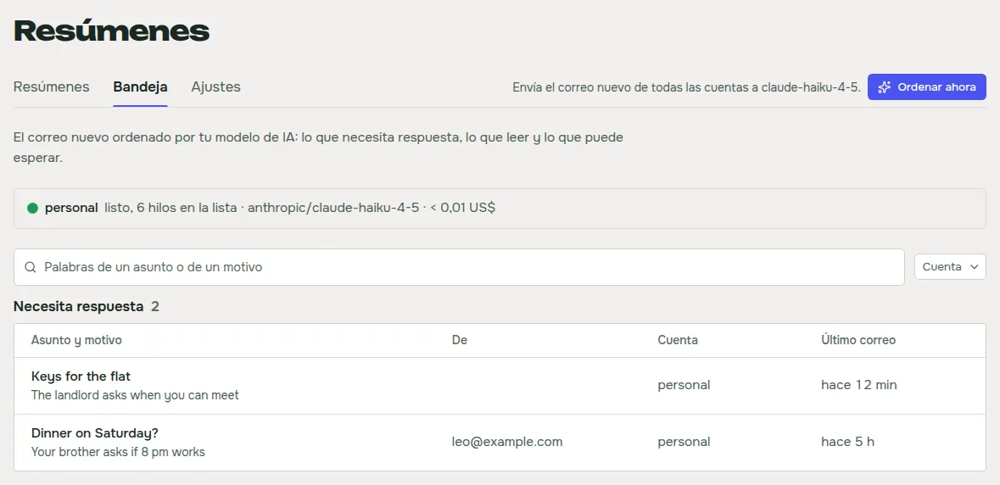
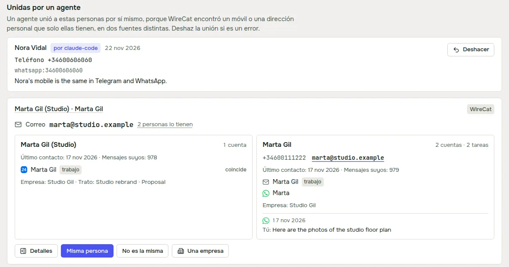

WireCat Desktop instala las herramientas de WireCat, inicia sesión por ti y le da a tu agente de IA tus chats, correo, reuniones, documentos y notas. Todo queda en tu ordenador. En la 0.8 tu modelo de IA ordena el correo nuevo en lo que necesita respuesta, lo que leer y lo que puede esperar, y ves cuánto costó cada ordenación. Además, cuando dos contactos pueden ser la misma persona tienes más datos para decidir, y puedes deshacer lo que unió un agente.

## Ve qué correo necesita respuesta

La página Resúmenes tiene una pestaña nueva, **Bandeja**. Pulsa **Ordenar ahora** y el modelo de IA que elegiste en Ajustes ordena el correo nuevo de todas tus cuentas de correo en tres grupos: necesita respuesta, para leer y puede esperar. Cada hilo muestra quién lo escribió, la cuenta y un motivo corto del modelo, y un clic abre el hilo.

Una ordenación terminada nombra el modelo y su coste, así sabes lo que cuesta ordenar tu correo. Cuando el modelo funciona fuera de tu ordenador, WireCat te dice antes cuántos correos y tokens enviaría, y adónde, y no envía nada hasta que dices que sí. Si prefieres no pulsar el botón cada vez, la pestaña Ajustes de Resúmenes ordena cada cuenta según un horario. Una ordenación programada envía el correo sin preguntar.

## Decide quién es quién con más datos delante

Cuando dos contactos pueden ser la misma persona, cada lado de la coincidencia muestra ahora sus últimos mensajes o llamadas, su empresa y su negociación. Dos fichas llamadas Marta Gil dicen poco, pero lo último que escribió cada una y en qué negociación está suelen resolverlo.

Un agente de IA también puede unir a dos personas por sí mismo, cuando encuentra un número o una dirección personal que solo ellas comparten en dos fuentes distintas. Estas uniones aparecen en **Unidas por un agente** en la página de revisión, con el motivo del agente y el número en que se basó, y **Deshacer** revierte una equivocada. Una coincidencia que te espera dice por qué el agente la dejó, por ejemplo una línea de empresa que comparten varias personas.

La [guía de Contactos](/es/docs/desktop/contacts) explica cómo se unen las personas.

## Inicia sesión en tus propias herramientas en la ventana

Una herramienta que añadiste tú por su nombre de npm, como beeline, ahora inicia sesión en la propia ventana de WireCat, sin terminal. La herramienta describe su inicio de sesión, WireCat muestra lo que pide y comprueba que solo ejecuta los comandos de la propia herramienta. Su menú de cuenta también tiene **Cerrar sesión** y **Quitar cuenta**, en cuanto la versión de la herramienta describe esos pasos. beeline ya lo hace.

Una herramienta del espacio de npm de WireCat ya no necesita que actives **Permitir herramientas que WireCat no ha revisado**. Las herramientas de otros autores lo siguen necesitando. La [guía de herramientas propias](/es/docs/desktop/own-tools) tiene los detalles.

## Una nota honesta sobre Preguntar antes

Si pones un grupo de comandos en **Preguntar antes**, un agente en una terminal te pregunta antes de cada cambio. A un agente conectado mediante MCP no se le pregunta, porque no hay nadie en una terminal para decir que sí, así que sus cambios pasan. Ya funcionaba así, pero la app lo decía de forma confusa. Ahora una nota bajo cada grupo en **Preguntar antes** lo dice claro. Para impedir esos cambios, elige **Solo lectura** o **Bloquear**.

## Cosas más pequeñas

- **Google Calendar se sincroniza desde la app.** Su cuenta tiene un botón para sincronizar y muestra cuándo se sincronizó por última vez, como las demás herramientas.
- **Ajustes en dos pestañas.** **WireCat** guarda las preferencias de la app y **Ajustes de las herramientas** los de cada herramienta. La opción Ajustes del menú de una herramienta abre su pestaña.
- **Elige cuánto correo antiguo se sincroniza.** Los ajustes del correo ofrecen los últimos 30 días, 90 días o un año, y **Otro…** acepta una fecha. Con una ventana más amplia, la siguiente sincronización lee el correo más antiguo.
- **Las reglas del correo en un diálogo.** El botón **Reglas** de una cuenta de correo muestra cuántas reglas tiene y las abre en un diálogo con búsqueda, así una lista larga ya no estira la página.
- **Actualizaciones en Ubuntu y Debian con el Actualizador de software.** El .deb ahora añade el repositorio apt de WireCat en apt.wirecat.dev, así que las versiones nuevas llegan con tus otras actualizaciones, y App Center muestra a WireCat como desarrollador.
- **Herramientas nuevas de WireCat sin actualizar la app.** La app lee las herramientas oficiales de WireCat de una lista firmada en wirecat.dev, así que una herramienta nueva puede aparecer con su icono y sus textos en tu idioma antes de la próxima versión de Desktop.

El catálogo también creció, y la página Herramientas ya instala Attio, HubSpot, Linear, WordPress, amoCRM y Yandex Disk.

## Cómo conseguirla

Si tienes la 0.7, la app te ofrece la actualización ella sola. ¿Eres nuevo? Descarga WireCat en [wirecat.dev/es/download](/es/download) para macOS, Windows o Linux. La [guía de Desktop](/es/docs/desktop) cubre cada página, y cada versión de la 0.7.1 a la 0.8.0 tiene sus propias [notas de la versión en GitHub](https://github.com/WireCatLabs/wirecat-desktop/releases).

Las ideas de qué hacer después van en [la página de ideas](/es/ideas), y las preguntas en [Discord](https://discord.gg/DebENqbRrJ) o en [GitHub](https://github.com/WireCatLabs/wirecat-desktop/issues). Lo leo todo.
