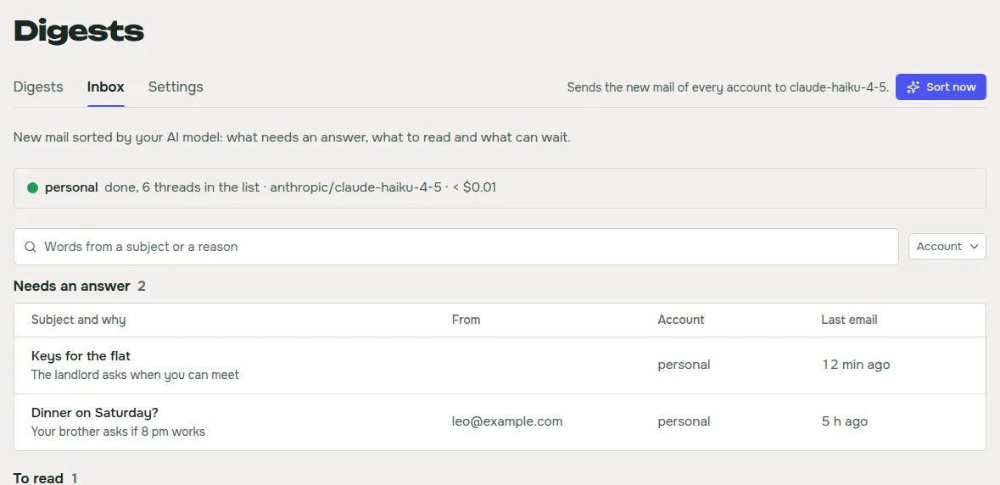
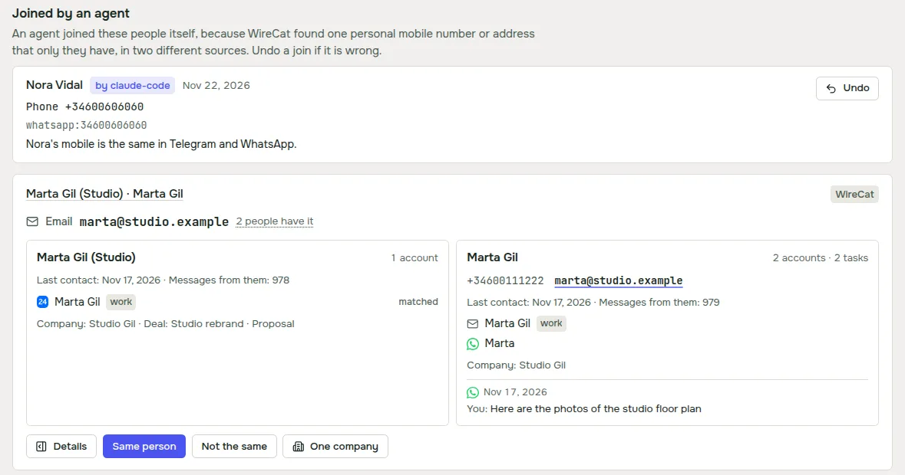

WireCat Desktop installs the WireCat tools, signs you in and gives your AI agent your chats, mail, meetings, documents and notes. It all stays on your computer. In 0.8 your AI model sorts your new mail into what needs an answer, what to read and what can wait, and you see what each run cost. You also get more to go on when two contacts may be one person, and you can undo what an agent joined.

## See which mail needs an answer

The Digests page has a new **Inbox** tab. Press **Sort now**, and the AI model you chose in Settings sorts the new mail of every Email account into three groups: needs an answer, to read and can wait. Each thread shows who wrote it, the account and a short reason from the model, and a click opens the thread.

A finished run names the model and its cost, so you know what sorting your mail takes. By default, when the model runs outside your computer, WireCat first tells you how many emails and tokens it would send, and where, and sends nothing until you say yes. If you'd rather not press the button every time, the Settings tab of Digests sorts each account on a schedule. A scheduled run sends the mail without asking.

## Decide who is who with more in front of you

When two contacts may be one person, each side of the match now shows its last messages or calls, its company and its deal. Two cards named Marta Gil say little, but what each one last wrote and which deal she is on usually settle it.

An AI agent can also join two people itself, when it finds a personal number or address that only they share in two different sources. These joins sit in **Joined by an agent** on the review page, with the agent's reason and the number it rested on, and **Undo** takes a wrong one back. A match that waits for you says why the agent left it, for example a company's phone line that several people share.

The [Contacts guide](/en/docs/desktop/contacts) explains how people are joined.

## Sign in to your own tools in the window

A tool you added yourself by its npm name, such as beeline, can now sign in right in the WireCat window, with no terminal. The tool describes its sign-in, WireCat shows what it asks for, and it checks that the sign-in runs only the tool's own commands. Its account menu also gets **Sign out** and **Remove account**, once the tool's own version describes these steps. beeline already does.

A tool from WireCat's own npm scope no longer needs **Allow tools WireCat has not checked** to be turned on. Tools from other authors still need it. The [own tools guide](/en/docs/desktop/own-tools) has the details.

## An honest note about Ask first

If you set a group of commands to **Ask first**, an agent in a terminal asks you before each change. An agent connected over MCP is not asked, because nobody is at a terminal to say yes, so its changes go through. It already worked this way, but the app used to say it vaguely. Now a note under every group set to **Ask first** says it plainly. To stop those changes, choose **Read only** or **Block**.

## Smaller things

- **Google Calendar syncs from the app.** Its account has a Sync button and shows when it last synced, like the other tools.
- **Settings in two tabs.** **WireCat** holds the app's own preferences, and **Tool settings** holds each tool's settings. A tool's Settings item opens its tab.
- **Choose how far back mail syncs.** Email's settings offer the last 30 days, 90 days or a year, and **Other…** takes a date. A wider window reads older mail on the next sync.
- **Mail rules in a dialog.** The **Rules** button on an Email account shows how many rules it has and opens them in a dialog with search, so a long list no longer stretches the page.
- **Updates on Ubuntu and Debian through Software Updater.** The .deb now adds WireCat's apt repository at apt.wirecat.dev, so new versions arrive with your other updates, and App Center shows WireCat as the developer.
- **New WireCat tools without an app update.** The app reads WireCat's official tools from a signed list on wirecat.dev, so a new tool can show up with its icon and its texts in your language before the next Desktop version.

The catalog grew too, and the Tools page now installs Attio, HubSpot, Linear and a few more.

## Get it

If you have 0.7, the app offers the update itself. New here? Download WireCat from [wirecat.dev/download](/en/download) for macOS, Windows or Linux. The [Desktop guide](/en/docs/desktop) covers each page, and every version from 0.7.1 to 0.8.0 has its own [release notes on GitHub](https://github.com/WireCatLabs/wirecat-desktop/releases).

Ideas for what to build next go on [the ideas page](/en/ideas), and questions to [Discord](https://discord.gg/DebENqbRrJ) or [GitHub](https://github.com/WireCatLabs/wirecat-desktop/issues). I read all of it.
