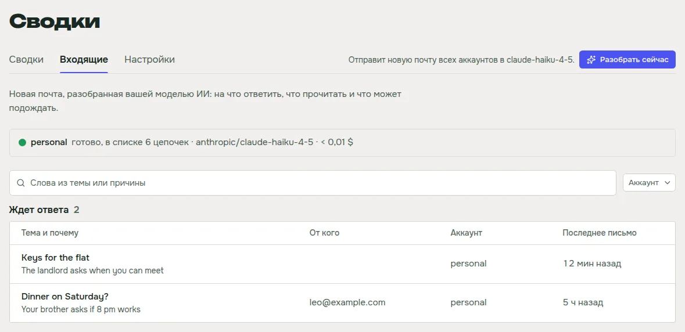
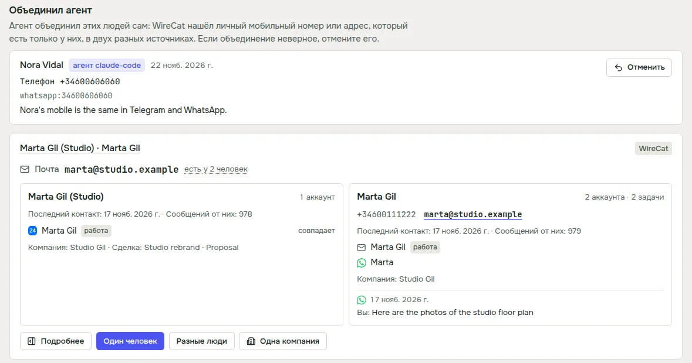

WireCat Desktop ставит инструменты WireCat, входит в ваши аккаунты и дает вашему ИИ-агенту чаты, почту, встречи, документы и заметки. Все это хранится на вашем компьютере. В 0.8 ваша модель ИИ разбирает новую почту на то, что ждет ответа, что прочитать и что может подождать, и видно, сколько стоил каждый разбор. А когда два контакта похожи на одного человека, решать проще, и то, что объединил агент, можно отменить.

## Сразу видно, на что ответить

На странице Сводки появилась вкладка **Входящие**. Нажмите **Разобрать сейчас**, и модель ИИ, которую вы выбрали в настройках, разложит новую почту всех почтовых аккаунтов на три группы: ждет ответа, прочитать и может подождать. У каждой цепочки видно, от кого она, из какого аккаунта и коротко почему модель ее туда положила, а щелчок открывает саму переписку.

Законченный разбор называет модель и его цену, так что видно, во что обходится разбор почты. Если модель работает не на вашем компьютере, WireCat сначала говорит, сколько писем и токенов уйдет и куда, и ничего не отправляет, пока вы не согласитесь. Если не хочется каждый раз жать кнопку, на вкладке Настройки в Сводках можно разбирать каждый аккаунт по расписанию. Разбор по расписанию отправляет почту без вопросов.

## Кто есть кто, когда видно больше

Когда два контакта могут быть одним человеком, у каждой стороны совпадения теперь видны последние сообщения или звонки, компания и сделка. Две карточки Marta Gil сами по себе мало что говорят, а вот что каждая писала последней и в какой она сделке, обычно все решает.

ИИ-агент теперь может и сам объединить двух людей, если нашел личный номер или адрес, который есть только у них, в двух разных источниках. Такие объединения собраны в разделе **Объединил агент** на странице разбора, с причиной агента и номером, на который он опирался, а **Отменить** откатывает ошибочное. Совпадение, которое ждет вас, говорит, почему агент его не тронул, например это общий телефон компании, который есть у нескольких людей.

Как WireCat объединяет людей, описано в [руководстве по Контактам](/ru/docs/desktop/contacts).

## Вход в свои инструменты прямо в окне

Инструмент, который вы добавили сами по имени в npm, например beeline, теперь входит в аккаунт прямо в окне WireCat, без терминала. Инструмент сам описывает свой вход, WireCat показывает, что он просит, и проверяет, что вход запускает только команды самого инструмента. В меню аккаунта появляются **Выйти** и **Удалить аккаунт**, когда новая версия инструмента описывает и эти шаги. У beeline это уже есть.

Инструменту из npm-пространства самого WireCat больше не нужна настройка **Разрешить инструменты, которые WireCat не проверял**. Инструментам других авторов она по-прежнему нужна. Подробности в [руководстве по своим инструментам](/ru/docs/desktop/own-tools).

## Честно про уровень Спрашивать

Если для группы команд выбран уровень **Спрашивать**, агент в терминале спрашивает вас перед каждым изменением. Агента, подключенного через MCP, никто не спрашивает, потому что у терминала нет никого, кто сказал бы да, и его изменения проходят. Так было и раньше, но приложение говорило об этом туманно. Теперь под каждой группой с уровнем **Спрашивать** об этом написано прямо. Чтобы такие изменения не проходили, выберите **Только чтение** или **Запретить**.

## Мелочи

- **Google Календарь синхронизируется из приложения.** У его аккаунта есть кнопка синхронизации и видно, когда она была последний раз, как у других инструментов.
- **Настройки на двух вкладках.** На **WireCat** собраны настройки самого приложения, на **Настройки инструментов** настройки каждого инструмента. Пункт Настройки в меню инструмента открывает его вкладку.
- **Сколько почты синхронизировать.** В настройках почты можно выбрать последние 30 дней, 90 дней или год, а **Другое…** принимает дату. С окном шире следующая синхронизация дочитает старую почту.
- **Правила почты в отдельном окне.** Кнопка **Правила** у почтового аккаунта показывает, сколько их, и открывает их в окне с поиском, так что длинный список больше не растягивает страницу.
- **Обновления на Ubuntu и Debian через Обновление приложений.** Пакет .deb теперь добавляет apt-репозиторий WireCat на apt.wirecat.dev, так что новые версии приходят вместе с остальными обновлениями, а App Center показывает WireCat как разработчика.
- **Новые инструменты WireCat без обновления приложения.** Приложение читает официальные инструменты WireCat из подписанного списка на wirecat.dev, так что новый инструмент может появиться со своим значком и текстами на вашем языке еще до следующей версии Desktop.

Каталог тоже вырос, и страница Инструменты теперь ставит Attio, HubSpot, Linear, WordPress, amoCRM и Яндекс Диск.

## Как получить

Если у вас 0.7, приложение само предложит обновление. Вы здесь впервые? Скачайте WireCat на [wirecat.dev/download](/ru/download) для macOS, Windows или Linux. [Руководство по Desktop](/ru/docs/desktop) описывает каждую страницу, а у каждой версии с 0.7.1 до 0.8.0 есть свои [заметки о выпуске на GitHub](https://github.com/WireCatLabs/wirecat-desktop/releases).

Идеи, что сделать дальше, оставляйте на [странице идей](/ru/ideas), а вопросы в [Discord](https://discord.gg/DebENqbRrJ) или на [GitHub](https://github.com/WireCatLabs/wirecat-desktop/issues). Я читаю все.
