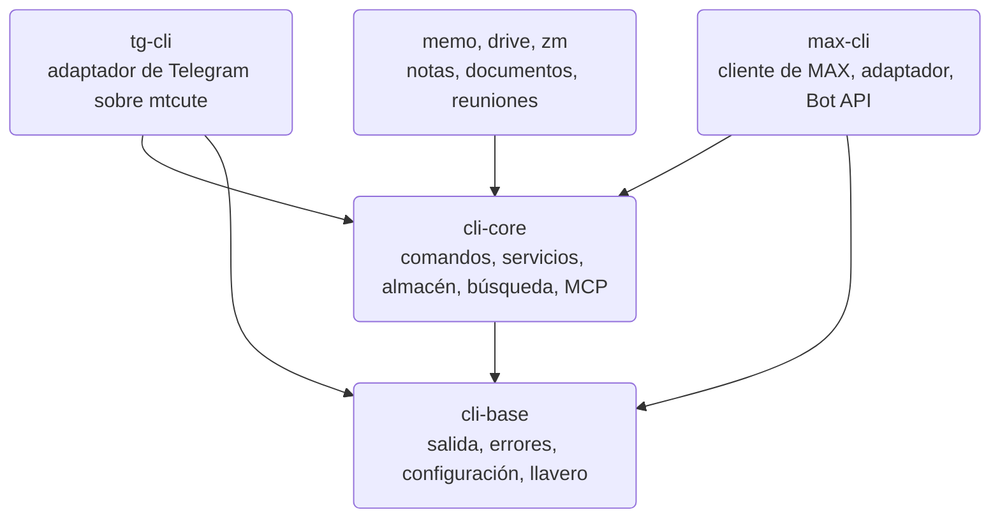
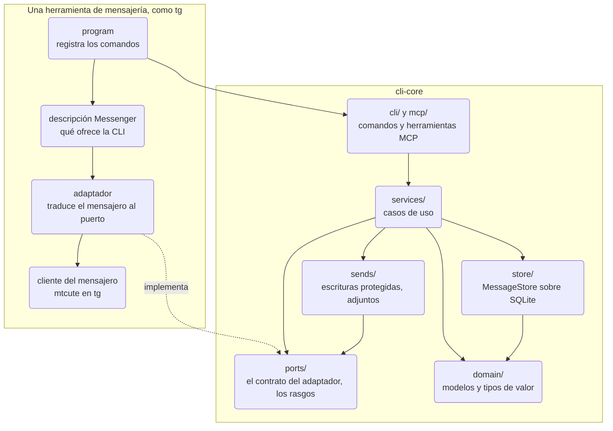
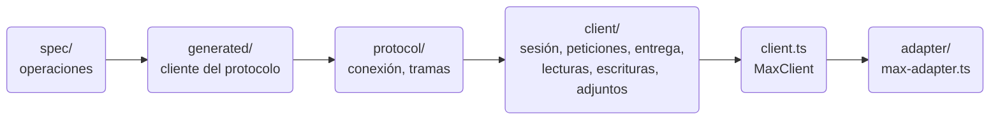
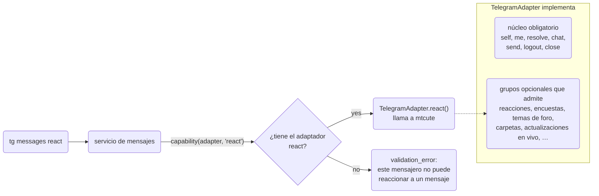
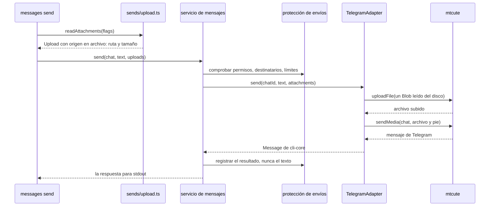

Esta página explica cómo está organizado el código de `tg`, `max` y las demás herramientas de WireCat:
qué capa puede llamar a cuál, cómo un módulo habla con el resto a través de una interfaz y qué hay que
cambiar para sustituir una parte. Léela antes de cambiar el núcleo compartido, de escribir un adaptador
para un mensajero nuevo o de juzgar si un cambio encaja en el diseño. [Arquitectura](./architecture.mdx)
cuenta con más detalle los paquetes y el recorrido de un comando en ejecución; esta página trata de la
estructura del código y de cómo se mantiene.

Dos términos aparecen en todo el texto.

- Un **puerto** es la lista de métodos que el núcleo compartido necesita de un mensajero, escrita una vez en
  cli-core como una interfaz de TypeScript: `resolve(chat)` encuentra un chat, `send(chatId, text)` envía un
  mensaje, etcétera. El núcleo solo llama a estos métodos y nunca ve la API propia de Telegram ni de otro
  mensajero.
- Un **adaptador** es la clase de una herramienta que rellena esos métodos para un mensajero.
  `TelegramAdapter` de tg implementa `send` llamando a la biblioteca de Telegram mtcute y convierte su
  respuesta en el `Message` de cli-core.

Así, `messages send` se escribe una vez en cli-core y funciona en todas las herramientas: el comando llama
al puerto y cada herramienta conecta su propio adaptador. Para admitir un mensajero nuevo se escribe un
adaptador nuevo, sin cambiar el núcleo.

La página describe el código leído el 14 de octubre de 2026, en
[cli-core a3b5b3c](https://github.com/WireCatLabs/cli-core/tree/a3b5b3c47792d5e2df6529642e907ee32783e66a),
[max-cli 0536988](https://github.com/WireCatLabs/max-cli/tree/0536988bb3a9ae5aed40cdd12e572a72dd2564a1) y
[tg-cli faea191](https://github.com/WireCatLabs/tg-cli/tree/faea191a76ea40f3159e865cf5c17f99163c4104).
Los recuentos de archivos y líneas son de esos commits.

## Paquetes



Las dependencias van en un solo sentido. `cli-base` no sabe nada de mensajería. `cli-core` contiene todo lo
de mensajería que no pertenece a un solo mensajero. Cada herramienta fija una versión exacta de ambos, así
que un cambio en el núcleo llega a los usuarios solo cuando una herramienta actualiza esa versión. Una
herramienta que aún no lo ha hecho sigue funcionando con la versión fijada.

## Capas

Una capa puede llamar a las capas inferiores y nunca a las superiores. El diagrama muestra `cli-core` y una
herramienta; la flecha punteada es la implementación de un puerto, no una llamada.



| Capa | Su función | Tamaño | Qué no puede importar |
| --- | --- | --- | --- |
| `domain/` | Tipos y valores independientes del mensajero: `Chat`, `Message`, `Person`, localizadores, tramos de formato, los conjuntos de valores de hechos, memoria y tareas. Ningún comportamiento que necesite red o archivos. Está casi abajo del todo: toma dos tipos de `search/` y los tipos de tarea de `tasks/`. | 29 archivos | `cli/`, ninguna biblioteca de mensajero ni adaptador. |
| `ports/` | El contrato que implementa cada mensajero (`messenger.ts`), lo que un servicio lee del mensajero (`traits.ts`) y quién es la aplicación (`app.ts`). | 3 archivos | Lo mismo. |
| `store/` | El archivo local: una interfaz `MessageStore`, abierta por `openStore`, sobre módulos SQLite, migraciones e índices de búsqueda. | 101 archivos | Nada fuera de `store/` puede importar un módulo de `store/sqlite/`. |
| `services/` | Casos de uso: mensajes, chats, personas, búsqueda, vectores, menciones, moderación. | 87 archivos | Commander, cualquier cosa de `cli/`, un módulo SQLite. Lo mismo vale para `replies/`, `attachments/`, `moderation/`, `models/` y `analysis/`. |
| `sends/` | Toda escritura: la protección de envíos, los identificadores de operación, el registro de envíos, los adjuntos. | 14 archivos | Lo mismo que los servicios. |
| `cli/`, `mcp/` | Presentación: comandos, el sobre JSON, configuración y perfiles; herramientas MCP sobre los mismos servicios. | 168 + 51 archivos | Un módulo SQLite. |
| `meetings/`, `tasks/` | Módulos autónomos con sus propios puertos. | 46 + 4 archivos | Cualquier otra parte de cli-core, una base de datos o el sistema de archivos. |
| `readers/`, `images/` | Lectores de documentos y descriptores de imágenes, elegidos de un registro. | 13 + 6 archivos | El almacén, los servicios, los comandos y las herramientas MCP. |

La última columna no es una recomendación. Cada fila es una regla de lint en el
[biome.json de cli-core](https://github.com/WireCatLabs/cli-core/blob/a3b5b3c47792d5e2df6529642e907ee32783e66a/biome.json),
y una importación que la cruza hace fallar el pull request con una frase que nombra la regla.

### Dentro de una herramienta

**max** no tiene biblioteca oficial, así que el cliente forma parte de la herramienta. Sus capas son una
especificación del protocolo, un cliente generado a partir de ella, la conexión WebSocket, 22 fábricas de
recursos en `src/client/` y la raíz que las une en
[src/client.ts](https://github.com/WireCatLabs/max-cli/blob/0536988bb3a9ae5aed40cdd12e572a72dd2564a1/src/client.ts).
[max-adapter.ts](https://github.com/WireCatLabs/max-cli/blob/0536988bb3a9ae5aed40cdd12e572a72dd2564a1/src/adapter/max-adapter.ts)
traduce ese cliente al puerto. Las reglas de lint mantienen el protocolo, la especificación y el código
generado detrás de `src/client.ts`, separan la parte de la Bot API oficial de la sesión de la cuenta
personal e impiden que la sesión y `max serve` importen comandos.



**tg** usa [mtcute](https://github.com/mtcute/mtcute). Solo `src/telegram/` puede importarlo, y los comandos
no pueden acceder directamente a su traducción de tipos ni a la de errores. El adaptador es una sola clase
en
[telegram/adapter.ts](https://github.com/WireCatLabs/tg-cli/blob/faea191a76ea40f3159e865cf5c17f99163c4104/src/telegram/adapter.ts).

## Cómo habla un módulo con el resto

### El contrato del mensajero

El puerto de los mensajeros es `MessengerAdapter`, en `ports/messenger.ts`. Tiene dos partes:

- **Un núcleo obligatorio de siete métodos** que todo mensajero tiene: `self`, `me`, `resolve`, `chat`,
  `send`, `logout` y `close`. Un adaptador al que le falte alguno no compila.
- **39 grupos opcionales** para funciones que solo tienen algunos mensajeros: `MessagePolls` (encuestas),
  `ForumControl` (temas de foro), `ChatFolders`, `LiveUpdates` y otros. Un adaptador implementa los grupos
  que admite su mensajero y omite el resto.



El código que necesita un método opcional lo pide por su nombre:

```ts
const react = capability(connection, "react", "react to a message")
```

`capability()` devuelve el método o falla con `validation_error` y el texto «this messenger cannot react to
a message» si el adaptador no lo tiene. Una opción que el mensajero no puede cumplir se rechaza de la
misma manera, nunca se descarta en silencio.

### La descripción

Cada herramienta entrega también al núcleo un objeto `Messenger`: el nombre de la aplicación, cómo
conectarse, cómo paginar el historial y opciones como `pollQuiz`, `topicShow` y `stickers`. Los comandos
leen esas opciones al registrar sus parámetros, así que `polls create --quiz` solo existe en una
herramienta cuyo mensajero tiene cuestionarios.

Los servicios ven solo una parte. [`MessengerTraits`](https://github.com/WireCatLabs/cli-core/blob/80616b3813ca8264d8f9edca3e8e0fcce7a1e81e/src/ports/traits.ts), en `ports/traits.ts`, reúne los 14 campos que lee un
servicio, como el nombre de la aplicación, cómo se pagina el historial y si el mensajero busca en su
servidor. `Messenger` lo amplía con lo que solo usa la CLI: `connect`, la configuración, el gancho de la
protección de envíos y el diagnóstico de `doctor`. Un servicio no puede llegar a un comando, a un objeto de
commander ni a una opción que no se le haya dado.

### Los servicios y sus dependencias

Un servicio es una función que recibe un objeto de dependencias y devuelve el caso de uso:
`messagesService(deps)`, `chatsService(deps)`. No hay clases ni contenedor. El objeto de dependencias,
[`ServiceDeps`](https://github.com/WireCatLabs/cli-core/blob/a3b5b3c47792d5e2df6529642e907ee32783e66a/src/services/deps.ts),
lleva la descripción del mensajero, la protección de envíos y funciones que abren recursos de forma
perezosa:

```ts
connection: () => Promise<MessengerAdapter>
store: () => Promise<MessageStore>
account: () => Promise<AccountKey>
```

Nada se abre hasta que un servicio lo pide, así que una lectura que responde el almacén local nunca se
conecta.
[`servicesFor(deps)`](https://github.com/WireCatLabs/cli-core/blob/a3b5b3c47792d5e2df6529642e907ee32783e66a/src/services/index.ts#L145)
crea los servicios sobre un objeto de dependencias: un comando los crea para su ejecución, una herramienta
MCP para su llamada. Ambos llaman a las mismas funciones de servicio, así que un caso de uso tiene una sola
implementación para los dos.

Una herramienta puede sustituir un servicio sin copiar el núcleo. `Messenger.services` recibe los
servicios compartidos y devuelve sustitutos, por ejemplo su propia forma de encontrar un chat para la
moderación.

### Módulos autónomos

`meetings/` y `tasks/` definen sus propios puertos: un proveedor implementa `MeetingSource` en su propio
paquete, y el almacén implementa `MeetingStore` y `TaskStore`. El resto de cli-core los importa solo a
través de su `index.ts`, y ellos no importan nada más de cli-core. Un proveedor de reuniones como Zoom se
conecta sin que el núcleo sepa que existe.

### Registros

Los lectores de documentos y los descriptores de imágenes se registran con `registerReader` y
`registerImageProvider`, con una posición opcional. Añadir un motor de PDF o un modelo de imágenes
consiste en registrarlo; el código que llama a los lectores no cambia.

## Una escritura de principio a fin

`tg messages send <chat> --file report.pdf`. El archivo se comprueba al empezar el comando y solo se lee
mientras se sube, así que un archivo grande nunca se guarda entero en memoria.



Si la subida se corta, el adaptador vuelve a abrir el archivo y lo intenta de nuevo. El adaptador de max hace lo
mismo con su propio cliente. Un adaptador cuya biblioteca necesita los bytes en memoria llama a
`uploadBytes`, que rechaza un archivo de más de 256 MiB.

## Patrones en uso

| Patrón | Dónde | Qué aporta |
| --- | --- | --- |
| Puertos y adaptadores | `ports/messenger.ts`, `meetings/source.ts`, `tasks/store.ts` | El núcleo nunca importa un proveedor; un proveedor puede cambiar sin tocar el núcleo. |
| Grupos de capacidades | `MessengerAdapter`, `capability()` | Un mensajero implementa lo que tiene; una función que falta es un rechazo claro, no un fallo. |
| Opciones de la descripción | `Messenger` | Los parámetros aparecen solo donde funcionan. |
| Funciones fábrica sobre un objeto de dependencias | `xService(deps)`, `ServiceDeps` | Funciones simples, fáciles de probar con un sustituto; la apertura perezosa abarata los comandos de una sola ejecución. |
| Raíces de composición | `servicesFor`, `MaxClient`, el contexto del comando | Un solo lugar construye el grafo de objetos y cierra lo que abrió. |
| Punto de sustitución | `Messenger.services` | Una herramienta cambia un caso de uso a la vez para sus comandos y sus herramientas MCP. |
| Traducción protectora | `max-adapter.ts`, `telegram/map.ts` | Los tipos y errores del proveedor se convierten en tipos del dominio y códigos de error tipados en un solo archivo por herramienta. |
| Proxy envolvente | `throughWrapper` en `ports/messenger.ts` | El registro de la ejecución y la caché envuelven el adaptador; un método nuevo del adaptador pasa sin tocar los envoltorios. |
| Registros | `readers/registry.ts`, `images/registry.ts` | Los motores nuevos se conectan sin cambiar a quienes los llaman. |
| Cliente generado | max: de `spec/` a `generated/` | Las operaciones de MAX se declaran una vez; una prueba falla si los archivos generados se desvían. |

## Qué se puede sustituir y a qué coste

Una parte se puede sustituir cuando el código que está por encima depende de una interfaz y no de la parte,
y una regla de lint o una prueba lo mantiene así.

| Parte | Coste | Cómo |
| --- | --- | --- |
| La biblioteca de Telegram | Acotado | Reescribir `src/telegram/`; nada más importa mtcute. |
| El protocolo de MAX | Acotado | Cambiar la especificación y regenerar; solo el cliente llega al protocolo. |
| Un caso de uso en una herramienta | Pequeño | `Messenger.services`. |
| Lectores de documentos, descriptores de imágenes, modelos de vectores | Pequeño | Registrar un lector o proveedor; elegir un modelo local o remoto. |
| Un proveedor de reuniones | Pequeño | Implementar `MeetingSource` en el paquete del proveedor. |
| Un mensajero nuevo | Moderado | Implementar `MessengerCore` y los grupos que tenga el mensajero, y escribir una descripción. Los comandos, las herramientas MCP, el almacén, la búsqueda y la protección de envíos vienen con el núcleo. |
| Una interfaz nueva junto a la CLI y MCP | Moderado | Construir `ServiceDeps`, llamar a `servicesFor(deps)` y mostrar la respuesta. Los servicios no importan nada de `cli/`; la interfaz nueva escribe su propia forma de conectarse y de leer la configuración. |
| El motor de almacenamiento | Difícil | Reimplementar `MessageStore`: unos 140 métodos, incluidas la búsqueda de texto completo, las raíces de palabras y la búsqueda por vectores. El límite se respeta, pero la interfaz es una sola superficie amplia. |

## Cómo se mantiene el diseño

La mayor parte del diseño la comprueban máquinas. El lint y la comprobación de tipos, y en la mayoría de las
herramientas el lint de comandos, se ejecutan en cada pull request, así que un cambio que los rompe falla antes de la
revisión. Parity, los contratos de comandos y las pruebas de archivos generados se ejecutan en la validación completa
tras cada fusión en `main` ([reglas de CI](https://github.com/WireCatLabs/cli-base/blob/main/docs/standards/ci.md)), así que un fallo ahí aparece justo después de la fusión, no en la
siguiente versión.

| Comprobación | Qué detiene | Dónde |
| --- | --- | --- |
| Importaciones restringidas | Una importación que cruza un límite de capa de la tabla anterior o los límites de una herramienta, o un SDK de proveedor importado fuera del módulo al que pertenece. | El `biome.json` de cada repositorio, ejecutado por `pnpm lint`. |
| Ciclos de importación | Dos módulos que se importan entre sí en ejecución, directamente o a través de otros. Las importaciones solo de tipos están permitidas. | `noImportCycles` en las reglas de nivel superior del lint de cli-core y de cada herramienta. |
| Tamaño de archivo | Un archivo de más de 1000 líneas (zoom fija 500). Un archivo que ya las supera, o que se ha dividido, no puede crecer: su excepción está limitada a su tamaño actual. Las pruebas y el código generado están exentos. | `noExcessiveLinesPerFile` en el `biome.json` de cli-core y de cada herramienta. |
| Parity | Un cambio del núcleo que rompe la compilación de cualquiera de las herramientas. Una rama con el mismo nombre en una herramienta permite que un cambio incompatible pase las comprobaciones antes de que las herramientas lo adopten. | El workflow Parity de cli-core. |
| Contrato de comandos | La forma de `commands --json`, los efectos declarados en cada comando, la captura de la ayuda. | `contracts:check` y `cli-dev lint` de cada herramienta. |
| Comprobación de tipos | Código, pruebas y scripts como tres proyectos. | `pnpm typecheck`. |
| Archivos generados | Ediciones manuales de las páginas de comandos generadas o del cliente del protocolo de max. | Pruebas que comparan con `pnpm generate`. |

Biome construye el grafo de importaciones para `noImportCycles` solo cuando la regla está activada en las
reglas de nivel superior. Dentro de una entrada `overrides` no informa de nada, así que la regla se queda
arriba.

Cada mes, el registro de [comprobaciones de arquitectura](https://github.com/WireCatLabs/cli-testing/blob/main/performance/engineering/architecture-checks/README.md) vuelve a medir estas reglas en cli-core y
en cada herramienta, lista los archivos de más de 500 líneas con un veredicto sobre cada uno y guarda la tendencia.

Convenciones para el código nuevo:

1. **Una función nueva del mensajero** es un grupo opcional en `ports/messenger.ts`, al que se accede con
   `capability()` y que se ofrece mediante una opción de la descripción. `MessengerCore` no crece.
2. **Un caso de uso nuevo** es un servicio que recibe la dependencia más estrecha que necesita. Un caso de uso
   que solo lee el almacén recibe la parte que lee (`Pick<MessageStore, …>`, o un almacén y una cuenta), como
   la mayoría de los servicios de reuniones y de búsqueda: es más fácil de probar y de mover. Uno que además
   necesita el mensajero, la protección de envíos o la apertura perezosa recibe `ServiceDeps`. De los 87
   archivos de servicios, 25 reciben solo el almacén y 36 reciben `ServiceDeps`. Lo llaman el comando y la
   herramienta MCP; un archivo de comando no contiene lógica de negocio.
3. **Una consulta nueva al almacén** es un módulo en `store/sqlite/`, expuesto solo a través de `store.ts`.
   Un servicio lee con `accountStore(deps)`; una lectura deliberada de varias cuentas se identifica con
   `crossAccount(deps, reason)`.
4. **Toda escritura** pasa por la protección de envíos: comprobada antes, registrada después, con un
   identificador de operación.
5. **Un tipo del proveedor** no pasa del adaptador.
6. **Un cambio incompatible del núcleo** aparece en su registro de cambios en «Changed — may break callers»,
   con ramas del mismo nombre en las herramientas para que Parity compile su adopción.
7. **Dividir un archivo** requiere una costura: una dependencia que elimina, un ciclo que rompe o una parte
   que se puede probar o sustituir por separado. Su longitud por sí sola no es motivo.

## Límites del diseño actual

- **El almacén es una sola interfaz amplia.** `MessageStore` tiene unos 140 métodos sobre un único
  `openStore`, y `store.ts` tiene 2042 líneas. Casi todas las funciones lo tocan. Dividirlo solo sirve
  siguiendo una costura real: recursos que se abren y cierran por separado.
- **Las partes de `Messenger` que solo usa la CLI reciben un `Command` de commander.** `connect`,
  `accountOf`, `guard` y `diagnose` leen ellas mismas las opciones del comando. Los servicios no las ven,
  pero una segunda interfaz tendría que escribir las suyas.
- **El adaptador de tg es una clase grande**: 2312 líneas y unos 110 métodos, legible método a método, pero
  es el lugar donde acaba cada función de Telegram.
- **`client/values.ts` de max** tiene 59 exportaciones que usan 20 módulos.
- **Algunos archivos grandes todavía hacen varias cosas.** El lint impide que crezcan los de más de 1000
  líneas; el registro de [comprobaciones de arquitectura](https://github.com/WireCatLabs/cli-testing/blob/main/performance/engineering/architecture-checks/README.md) nombra la costura por la que dividir cada uno.

Para ver dónde encajan en estas capas la búsqueda, los vectores y el grafo de conversaciones, sigue con la
[arquitectura de búsqueda](./search-architecture.mdx).
