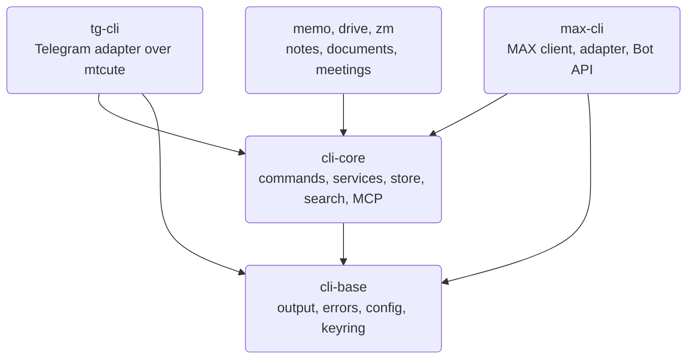
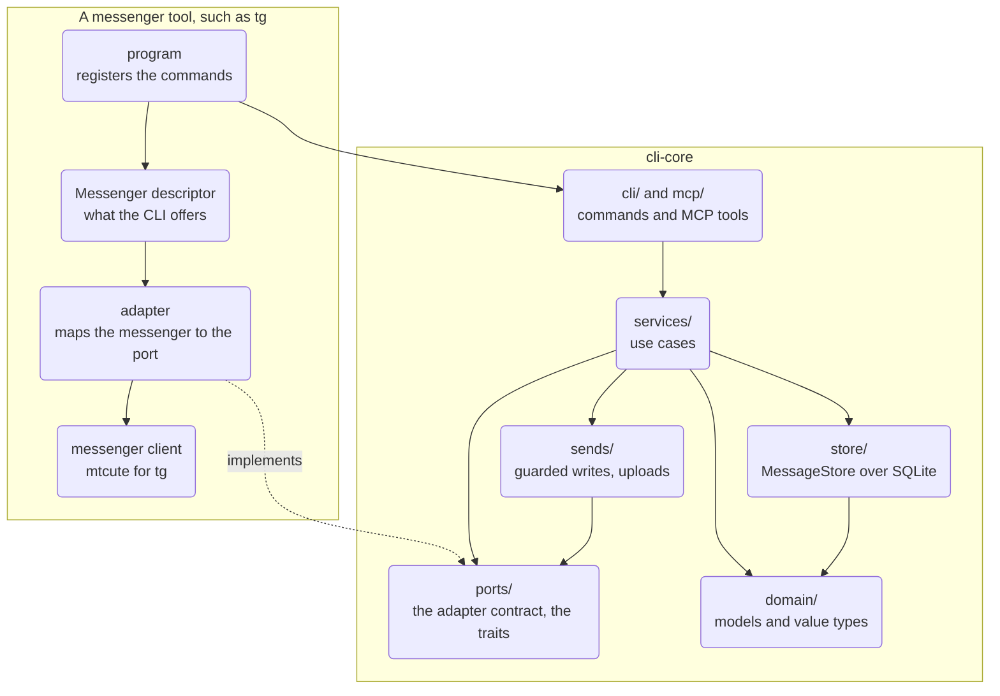
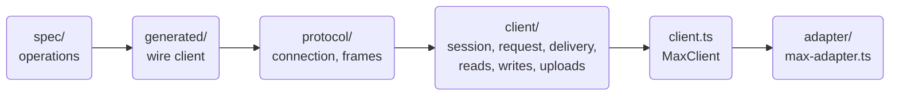
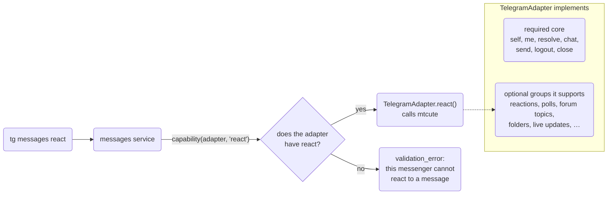
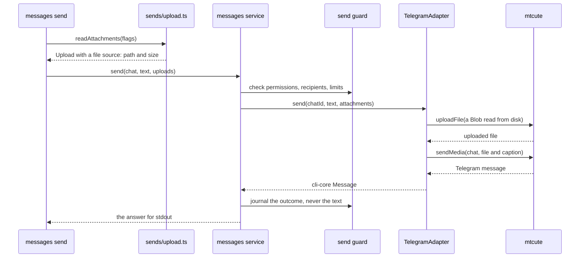

This page explains how the code behind `tg`, `max` and the other WireCat tools is organised: which
layer may call which, how a module talks to the rest through an interface, and what has to change to
replace one part. Read it before changing the shared core, writing a new messenger adapter or
judging whether a change fits the design. [Architecture](./architecture.mdx) covers the packages and
the runtime path of a command in more detail; this page is about the structure of the code and how it
is kept.

Two terms come up throughout.

- A **port** is the list of methods the shared core needs from a messenger, written once in cli-core as a
  TypeScript interface: `resolve(chat)` finds a chat, `send(chatId, text)` sends a message, and so on.
  The core calls only these methods. It never sees Telegram's or any other messenger's own API.
- An **adapter** is the class in one tool that fills in those methods for one messenger. tg's
  `TelegramAdapter` implements `send` by calling the Telegram library mtcute and turning its answer into
  cli-core's `Message`.

So `messages send` is written once in cli-core and works in every tool: the command calls the port, and
each tool plugs in its own adapter. Supporting a new messenger means writing a new adapter, not changing
the core.

The page describes the code as read on 14 October 2026, at
[cli-core a3b5b3c](https://github.com/WireCatLabs/cli-core/tree/a3b5b3c47792d5e2df6529642e907ee32783e66a),
[max-cli 0536988](https://github.com/WireCatLabs/max-cli/tree/0536988bb3a9ae5aed40cdd12e572a72dd2564a1) and
[tg-cli faea191](https://github.com/WireCatLabs/tg-cli/tree/faea191a76ea40f3159e865cf5c17f99163c4104).
Counts of files and lines are from those commits. The store, the tg adapter and the limits at the end were
read again on 17 October 2026, at [cli-core 9be2271](https://github.com/WireCatLabs/cli-core/tree/9be227198793fabf506ee946b10aaad94d84d519), [tg-cli 868b433](https://github.com/WireCatLabs/tg-cli/tree/868b43356065170eeb923c648082e8ee03b0f349) and [max-cli 606bba4](https://github.com/WireCatLabs/max-cli/tree/606bba4a4fadd989e1b9300f273789487b8a9063).

## Packages



Dependencies point one way. `cli-base` knows nothing about messaging. `cli-core` holds everything about
messaging that is not one messenger. Each tool pins an exact version of both, so a change in the core
reaches users only when a tool moves its pin. A tool that has not moved yet keeps working on the version
it pinned.

## Layers

A layer may call the layers below it and never the ones above. The diagram shows `cli-core` and one
tool; the dotted edge is an implementation of a port, not a call.



| Layer | Its job | Size | What it may not import |
| --- | --- | --- | --- |
| `domain/` | Messenger-neutral types and values: `Chat`, `Message`, `Person`, locators, formatting spans, the fact, memory and task value sets. No behaviour that needs a network or a file. It sits almost at the bottom: it reads two types from `search/` and the task kinds from `tasks/`. | 29 files | `cli/`, any messenger library or adapter. |
| `ports/` | The contract every messenger implements (`messenger.ts`), what a service reads of the messenger (`traits.ts`) and who the app is (`app.ts`). | 3 files | Same as above. |
| `store/` | The local archive: `MessageStore`, opened by `openStore`, is 31 areas such as `messages`, `chats`, `people` and `mail`, each its own file built on first use, over SQLite table modules, migrations and the search indexes. | 150 files (17 October) | A command, a service, a send or an MCP tool may not import a table module under `store/sqlite/`; it goes through `store.ts`. |
| `services/` | Use cases: messages, chats, people, search, embeddings, mentions, moderation. | 87 files | Commander, anything under `cli/`, a SQLite module. The same holds for `replies/`, `attachments/`, `moderation/`, `models/` and `analysis/`. |
| `sends/` | Every write: the send guard, operation ids, the send journal, uploads. | 14 files | Same as services. |
| `cli/`, `mcp/` | Presentation: commands, the JSON envelope, settings and profiles; MCP tools over the same services. | 168 + 51 files | A SQLite module. |
| `meetings/`, `tasks/` | Self-contained modules with their own ports. | 46 + 4 files | Anything else in cli-core, a database or the file system. |
| `readers/`, `images/` | Document readers and image describers, picked from a registry. | 13 + 6 files | The store, services, commands and MCP tools. |

The last column is not a guideline. Each row is a lint rule in
[cli-core's biome.json](https://github.com/WireCatLabs/cli-core/blob/a3b5b3c47792d5e2df6529642e907ee32783e66a/biome.json),
and an import across it fails the pull request with a sentence naming the rule.

### Inside a tool

**max** has no official library, so the client is part of the tool. Its layers are a protocol
specification, a wire client generated from it, the WebSocket connection, 22 resource factories in
`src/client/` and the root that wires them in
[src/client.ts](https://github.com/WireCatLabs/max-cli/blob/0536988bb3a9ae5aed40cdd12e572a72dd2564a1/src/client.ts).
[max-adapter.ts](https://github.com/WireCatLabs/max-cli/blob/0536988bb3a9ae5aed40cdd12e572a72dd2564a1/src/adapter/max-adapter.ts)
maps that client onto the port. Lint rules keep the protocol, the specification and the generated code
behind `src/client.ts`, keep the official Bot API part away from the personal-account session, and stop
the session and `max serve` from importing commands.



**tg** uses [mtcute](https://github.com/mtcute/mtcute). Only `src/telegram/` may import it, and commands
may not reach its mapping or error translation directly. The class in
[telegram/adapter.ts](https://github.com/WireCatLabs/tg-cli/blob/868b43356065170eeb923c648082e8ee03b0f349/src/telegram/adapter.ts)
delegates each port method to a feature module beside it: `messages.ts`, `chats.ts`, `groups.ts`, `topics.ts`,
`polls.ts` and six more, which share one context from `feature.ts`.

## How a module talks to the rest

### The messenger contract

The port for messengers is `MessengerAdapter` in `ports/messenger.ts`. It has two parts:

- **A required core of seven methods** that every messenger has: `self`, `me`, `resolve`, `chat`, `send`,
  `logout` and `close`. An adapter without one of them does not compile.
- **39 optional groups** for features only some messengers have, such as `MessagePolls` (polls),
  `ForumControl` (forum topics), `ChatFolders` and `LiveUpdates`. An adapter implements the groups its
  messenger supports and leaves out the rest.



Code that needs an optional method asks for it by name:

```ts
const react = capability(connection, "react", "react to a message")
```

`capability()` returns the method, or fails with `validation_error` and "this messenger cannot react to
a message" when the adapter has none. An option the messenger cannot honour is refused the same way,
never dropped.

### The descriptor

Each tool also hands the core a `Messenger` object: the app's name, how to connect, how to page history,
and flags such as `pollQuiz`, `topicShow` and `stickers`. Commands read the flags when they register their
options, so `polls create --quiz` exists only in a tool whose messenger has quizzes.

Services see only part of it. [`MessengerTraits`](https://github.com/WireCatLabs/cli-core/blob/80616b3813ca8264d8f9edca3e8e0fcce7a1e81e/src/ports/traits.ts) in `ports/traits.ts` holds the 14 fields a service reads,
such as the app's name, how history is paged and whether the messenger searches on its server. `Messenger`
extends it with what only the CLI uses: `connect`, settings, the guard hook and `doctor`'s diagnosis. A
service cannot reach a command, a commander object or a setting it was not given.

### Services and their dependencies

A service is a function that takes one dependency object and returns the use case: `messagesService(deps)`,
`chatsService(deps)`. There are no classes and no container. The dependency object,
[`ServiceDeps`](https://github.com/WireCatLabs/cli-core/blob/a3b5b3c47792d5e2df6529642e907ee32783e66a/src/services/deps.ts),
carries the messenger descriptor, the send guard and lazy openers:

```ts
connection: () => Promise<MessengerAdapter>
store: () => Promise<MessageStore>
account: () => Promise<AccountKey>
```

Nothing opens until a service asks, so a read answered from the local store never connects.
[`servicesFor(deps)`](https://github.com/WireCatLabs/cli-core/blob/a3b5b3c47792d5e2df6529642e907ee32783e66a/src/services/index.ts#L145)
builds the services over one dependency object: a command builds them for its run, an MCP tool for its
call. Both call the same service functions, so a use case has one implementation for both.

A tool can replace one service without forking the core. `Messenger.services` receives the shared
services and returns replacements, for example its own way of finding a chat for moderation.

### Self-contained modules

`meetings/` and `tasks/` define their own ports: a provider implements `MeetingSource` in its own package,
and the store implements `MeetingStore` and `TaskStore`. The rest of cli-core imports them only through
their `index.ts`, and they import nothing else from cli-core. A meeting provider such as Zoom plugs in
without the core knowing it exists.

### The store from a tool

A tool reaches the shared store only through cli-core's store areas. It writes no SQL against the shared file, so
the next migration cannot break it ([WC-STORE-5](https://github.com/WireCatLabs/cli-base/blob/main/docs/standards/store.md#wc-store-5--a-cli-writes-no-sql-against-the-shared-store)).
Tables only one tool needs, such as checkpoints and caches, live in that tool's own SQLite file next to the shared
store, opened with `openCache` from `@wirecat/cli-core/store`; they refer to shared rows by id only, and no other tool
reads them ([WC-DATA-1](https://github.com/WireCatLabs/cli-base/blob/main/docs/standards/data-model.md)).

### Registries

Document readers and image describers register themselves with `registerReader` and
`registerImageProvider`, with an optional position. Adding a PDF engine or an image model means
registering one; the code that calls readers does not change.

## One write, end to end

`tg messages send <chat> --file report.pdf`. The file is checked when the command starts and read only
while it uploads, so a large file is never held in memory.



If the upload drops, the adapter opens the file again and retries. max's adapter does the same with its
own client. An adapter whose library needs the bytes in memory calls `uploadBytes`, which refuses a file
over 256 MiB.

## Patterns in use

| Pattern | Where | What it buys |
| --- | --- | --- |
| Ports and adapters | `ports/messenger.ts`, `meetings/source.ts`, `tasks/store.ts` | The core never imports a provider; a provider can change without touching the core. |
| Capability groups | `MessengerAdapter`, `capability()` | A messenger implements what it has; a missing feature is a clear refusal, not a crash. |
| Descriptor flags | `Messenger` | Options appear only where they work. |
| Factory functions over one dependency object | `xService(deps)`, `ServiceDeps` | Plain functions, easy to test with a fake; lazy openers keep one-shot commands cheap. |
| Composition roots | `servicesFor`, `MaxClient`, the command context | One place builds the object graph and closes what it opened. |
| Override hook | `Messenger.services` | A tool changes one use case for both its commands and its MCP tools. |
| Anti-corruption mapping | `max-adapter.ts`, `telegram/map.ts` | Provider types and errors become domain types and typed error codes in one file per tool. |
| Decorating proxy | `throughWrapper` in `ports/messenger.ts` | Recording and caching wrap the adapter; a new adapter method passes through without editing the wrappers. |
| Registries | `readers/registry.ts`, `images/registry.ts` | New engines plug in without editing their callers. |
| Generated client | max `spec/` to `generated/` | MAX operations are declared once; a test fails when generated files drift. |

## What can be replaced, and at what cost

A part is replaceable when the code above it depends on an interface rather than on the part, and a lint
rule or a test keeps it that way.

| Part | Cost | How |
| --- | --- | --- |
| The Telegram library | Contained | Rewrite `src/telegram/`; nothing else imports mtcute. |
| MAX's wire protocol | Contained | Change the specification and regenerate; only the client reaches the protocol. |
| One use case in one tool | Small | `Messenger.services`. |
| Document readers, image describers, embedding models | Small | Register a reader or provider; choose a local or remote model. |
| A meeting provider | Small | Implement `MeetingSource` in the provider's package. |
| A new messenger | Moderate | Implement `MessengerCore` and the groups the messenger has, and write a descriptor. The commands, MCP tools, store, search and send guard come with the core. |
| A new front end beside the CLI and MCP | Moderate | Build `ServiceDeps`, call `servicesFor(deps)` and render. Services import nothing from `cli/`; the front end writes its own way to connect and resolve settings. |
| The storage engine | Hard | Reimplement every area of `MessageStore`, including full-text, stemming and vector search. Callers depend on the area interfaces, but all 31 areas are built on the same SQLite context, so the engine changes in all of them at once. |

## Keeping the shape

The rules themselves, with their ids, are in the [WireCat CLI standards handbook](https://github.com/WireCatLabs/cli-base/blob/main/docs/standards/README.md); this section
shows how cli-core and the tools check them. Most of the design is checked by machines. Lint and type checks, and in most tools the command lint, run on every
pull request, so a change that breaks them fails before review. Parity, the command contracts and the generated-file
tests run in full validation on each merge to `main` ([CI rules](https://github.com/WireCatLabs/cli-base/blob/main/docs/standards/ci.md)), so a break there shows up right after the merge,
not at the next release.

| Check | What it stops | Where |
| --- | --- | --- |
| Restricted imports | An import across a layer boundary in the table above or across a tool's boundaries, or a provider SDK imported outside the module that owns it. | Each repository's `biome.json`, run by `pnpm lint`. |
| Import loops | Two modules that import each other at run time, directly or through others. Type-only imports are allowed. | `noImportCycles` in the top-level lint rules of cli-core and every tool. |
| File size | A file over 1,000 lines (zoom sets 500). A file already over it, or one that was split, may not grow: its exception is capped at its current size. Tests and generated code are exempt. | `noExcessiveLinesPerFile` in the `biome.json` of cli-core and every tool. |
| Parity | A core change that breaks either tool's build. A branch of the same name in a tool lets a breaking change go green before the tools adopt it. | cli-core's Parity workflow. |
| Command contract | The `commands --json` shape, declared effects on every command, the help snapshot. | Each tool's `contracts:check` and `cli-dev lint`. |
| Type checks | Code, tests and scripts as three projects. | `pnpm typecheck`. |
| Generated files | Hand edits to generated command pages or to max's wire client. | Tests that compare against `pnpm generate`. |

Biome builds the import graph for `noImportCycles` only when the rule is switched on in the top-level
rules. Inside an `overrides` entry it reports nothing, so the rule stays at the top level.

Each month the [architecture checks](https://github.com/WireCatLabs/cli-testing/blob/main/performance/engineering/architecture-checks/README.md) record re-measures these rules in cli-core and every tool, lists
the files over 500 lines with a verdict on each, and keeps the trend.

Conventions for new code:

1. **A new messenger feature** is an optional group in `ports/messenger.ts`, reached through `capability()`
   and offered through a descriptor flag. `MessengerCore` does not grow.
2. **A new use case** is a service that takes the narrowest dependency it needs. A use case that only reads the
   store takes the store part it reads (`Pick<MessageStore, …>`, or a store and an account), as most meeting
   and search services do: it is the easier one to test and to move. One that also needs the messenger, the
   send guard or lazy opening takes `ServiceDeps`. Of the 87 service files, 25 take only the store and 36 take
   `ServiceDeps`. The command and the MCP tool both call the service; a command file holds no business logic.
3. **A new kind of record** is a new store area: its own file under `store/`, built on first use, with its SQL in
   table modules under `store/sqlite/` ([WC-STORE-2](https://github.com/WireCatLabs/cli-base/blob/main/docs/standards/store.md)). A service of one account reads through
   `accountStore(deps)`; a read across accounts on purpose names itself with `crossAccount(deps, reason)`.
4. **Every write** goes through the send guard: checked before, journaled after, with an operation id.
5. **A provider type** stops at the adapter.
6. **A breaking change to the core** is listed under "Changed — may break callers" in its changelog, with
   branches of the same name in the tools so Parity can build their adoption.
7. **Splitting a file** needs a seam: a dependency it removes, a loop it cuts, or a part that can be tested or
   replaced alone. Its length alone is not a reason.

## Limits of the current design

The [handbook](https://github.com/WireCatLabs/cli-base/blob/main/docs/standards/README.md) states the rules; this list says where the code stands against them on 17 October
2026.

- **The store is split into areas, but one engine runs them all.** `MessageStore` is 31 areas, such as `messages`,
  `chats`, `people`, `mail` and `meetings`. Each is built on first use from its own file, so a new kind of
  record becomes a new area instead of more methods on one interface ([WC-STORE-2](https://github.com/WireCatLabs/cli-base/blob/main/docs/standards/store.md)).
  [`store.ts`](https://github.com/WireCatLabs/cli-core/blob/9be227198793fabf506ee946b10aaad94d84d519/src/store/store.ts) only wires the areas: it is 301 lines, and lint caps it at 438 so it does
  not grow back. Every area runs on the same SQLite context, so changing the storage engine still means changing
  all of them.
- **Binding a service to one account is half done.** `store.forAccount(key)` binds the 12 areas that hold one
  account's data, so a call through it cannot reach another account's row. Five service files work through the
  bound store; 24 still pair `deps.store()` with `deps.account()` ([WC-STORE-3](https://github.com/WireCatLabs/cli-base/blob/main/docs/standards/store.md)).
- **The CLI-only parts of `Messenger` take a commander `Command`.** `connect`, `accountOf`, `guard` and
  `diagnose` read the command's options themselves. Services never see them, but a second front end would
  write its own versions.
- **The tg adapter is a thin class over feature modules.** [telegram/adapter.ts](https://github.com/WireCatLabs/tg-cli/blob/868b43356065170eeb923c648082e8ee03b0f349/src/telegram/adapter.ts)
  is 625 lines: each port method is one line that calls one of 11 feature modules, so a new Telegram feature
  lands in its module, not in the class. Error hints name a check, and tg's commands turn it into words, so
  nothing below the commands names a command ([WC-ARCH-16](https://github.com/WireCatLabs/cli-base/blob/main/docs/standards/architecture.md)). The largest file left is
  `map.ts`, 576 lines that turn mtcute's types into cli-core's.
- **Search queries compile one field at a time.** Each field of the query language has its own compiler in
  `store/sqlite/lucene-fields.ts`, and a test keeps that list equal to the registry of fields. `lucene.ts` is
  still 710 lines.
- **The import rules hold only while each override is complete.** Biome does not merge two `overrides`
  entries that set `noRestrictedImports`: for a file both match, the later one replaces the earlier one. So
  every entry carries the whole list for its paths, and an entry that leaves part of it out turns those rules off
  without an error. That happened in cli-core until [cli-core #1467](https://github.com/WireCatLabs/cli-core/pull/1467)
  ([WC-TOOL-15](https://github.com/WireCatLabs/cli-base/blob/main/docs/standards/toolchain.md)).
- **MCP tools are still written by hand beside the commands.** A command and its MCP tool are two pieces of code
  over the same service. Generating the tools from the command tree, so that a call runs the command itself, is
  approved and being built in cli-core; until a release says it is done, the [MCP rules](https://github.com/WireCatLabs/cli-base/blob/main/docs/standards/mcp.md) describe what
  runs.
- **max's `client/values.ts`** holds 59 exports used by 20 modules.
- **Some large files still hold several jobs.** Lint stops the ones over 1,000 lines from growing; the
  [architecture checks](https://github.com/WireCatLabs/cli-testing/blob/main/performance/engineering/architecture-checks/README.md) record names the seam each would split along.

To see where search, embeddings and the conversation graph sit in these layers, continue with
[search architecture](./search-architecture.mdx).
