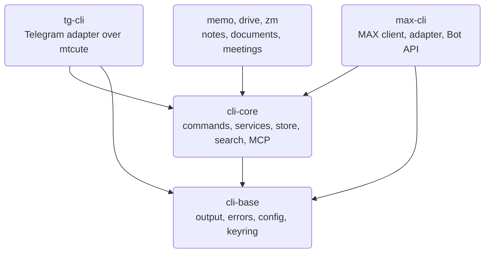
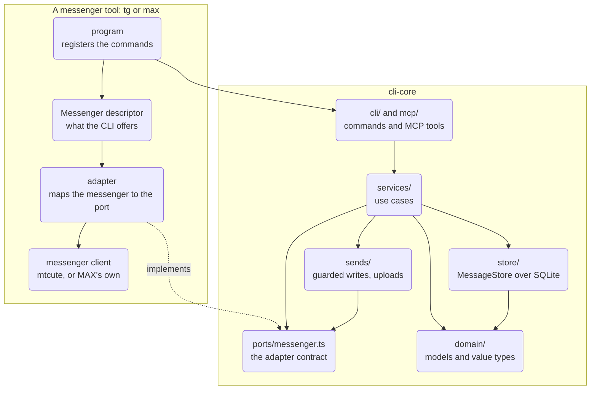
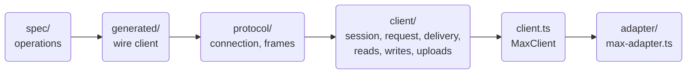
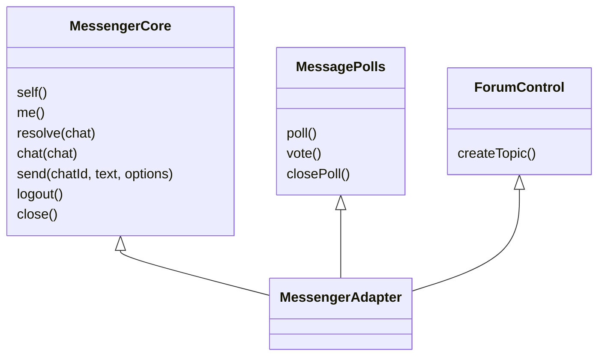
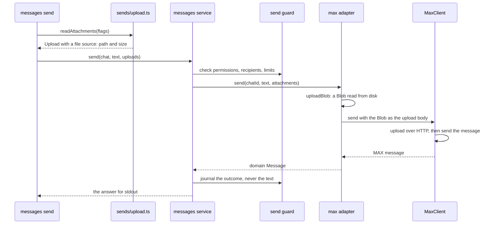

This page explains how the code behind `tg`, `max` and the other WireCat tools is organised: which
layer may call which, how a module talks to the rest through an interface, and what has to change to
replace one part. Read it before changing the shared core, writing a new messenger adapter or
judging whether a change fits the design. [Architecture](./architecture.mdx) covers the packages and
the runtime path of a command in more detail; this page is about the structure of the code and how it
is kept.

Two terms come up throughout. A **port** is an interface the shared core defines and depends on. An
**adapter** is the code in one tool that implements a port for one messenger or provider. The core
calls the port and never imports the adapter.

The page describes the code as read on 14 October 2026, at
[cli-core a3b5b3c](https://github.com/WireCatLabs/cli-core/tree/a3b5b3c47792d5e2df6529642e907ee32783e66a),
[max-cli 0536988](https://github.com/WireCatLabs/max-cli/tree/0536988bb3a9ae5aed40cdd12e572a72dd2564a1) and
[tg-cli faea191](https://github.com/WireCatLabs/tg-cli/tree/faea191a76ea40f3159e865cf5c17f99163c4104).
Counts of files and lines are from those commits.

## Packages



Dependencies point one way. `cli-base` knows nothing about messaging. `cli-core` holds everything about
messaging that is not one messenger. Each tool pins an exact version of both, so a change in the core
reaches users only when a tool moves its pin. A tool that has not moved yet keeps working on the version
it pinned.

## Layers

A layer may call the layers below it and never the ones above. The diagram shows `cli-core` and one
tool; the dotted edge is an implementation of a port, not a call.



| Layer | Its job | Size | What it may not import |
| --- | --- | --- | --- |
| `domain/` | Messenger-neutral types: `Chat`, `Message`, `Person`, locators, formatting spans. No behaviour that needs a network or a file. | 24 files | Any messenger library or adapter. |
| `ports/messenger.ts` | The contract every messenger implements. | 1 file, 663 lines | Same as above. |
| `store/` | The local archive: one `MessageStore` interface, opened by `openStore`, over SQLite modules, migrations and the search indexes. | 101 files | Nothing outside `store/` may import a module under `store/sqlite/`. |
| `services/` | Use cases: messages, chats, people, search, embeddings, mentions, moderation. | 81 files | Commander, a command module, a SQLite module. |
| `sends/` | Every write: the send guard, operation ids, the send journal, uploads. | 14 files | Same as services. |
| `cli/`, `mcp/` | Presentation: commands, the JSON envelope, settings and profiles; MCP tools over the same services. | 168 + 51 files | A SQLite module. |
| `meetings/`, `tasks/` | Self-contained modules with their own ports. | 46 + 4 files | Anything else in cli-core, a database or the file system. |
| `readers/`, `images/` | Document readers and image describers, picked from a registry. | 13 + 6 files | The store, services, commands and MCP tools. |

The last column is not a guideline. Each row is a lint rule in
[cli-core's biome.json](https://github.com/WireCatLabs/cli-core/blob/a3b5b3c47792d5e2df6529642e907ee32783e66a/biome.json),
and an import across it fails the pull request with a sentence naming the rule.

### Inside a tool

**max** has no official library, so the client is part of the tool. Its layers are a protocol
specification, a wire client generated from it, the WebSocket connection, 22 resource factories in
`src/client/` and the root that wires them in
[src/client.ts](https://github.com/WireCatLabs/max-cli/blob/0536988bb3a9ae5aed40cdd12e572a72dd2564a1/src/client.ts).
[max-adapter.ts](https://github.com/WireCatLabs/max-cli/blob/0536988bb3a9ae5aed40cdd12e572a72dd2564a1/src/adapter/max-adapter.ts)
maps that client onto the port. Lint rules keep the protocol, the specification and the generated code
behind `src/client.ts`, keep the official Bot API part away from the personal-account session, and stop
the session and `max serve` from importing commands.



**tg** uses [mtcute](https://github.com/mtcute/mtcute). Only `src/telegram/` may import it, and commands
may not reach its mapping or error translation directly. The adapter is one class in
[telegram/adapter.ts](https://github.com/WireCatLabs/tg-cli/blob/faea191a76ea40f3159e865cf5c17f99163c4104/src/telegram/adapter.ts).

## How a module talks to the rest

### The messenger contract

`MessengerAdapter` is a required core plus optional groups. `MessengerCore` has seven methods: `self`,
`me`, `resolve`, `chat`, `send`, `logout` and `close`. Everything else comes in 39 optional groups such
as `MessagePolls`, `ForumControl`, `ChatFolders` and `LiveUpdates`.



Code that needs an optional method asks for it by name:

```ts
const react = capability(connection, "react", "react to a message")
```

`capability()` returns the method, or fails with `validation_error` and "this messenger cannot react to
a message" when the adapter has none. An option the messenger cannot honour is refused the same way,
never dropped.

### The descriptor

Each tool also hands the core a `Messenger` object of 47 fields: the app's name, how to connect, how to
page history, and flags such as `pollQuiz`, `topicShow` and `stickers`. Commands read the flags when
they register their options, so `polls create --quiz` exists only in a tool whose messenger has quizzes.

### Services and their dependencies

A service is a function that takes one dependency object and returns the use case: `messagesService(deps)`,
`chatsService(deps)`. There are no classes and no container. The dependency object,
[`ServiceDeps`](https://github.com/WireCatLabs/cli-core/blob/a3b5b3c47792d5e2df6529642e907ee32783e66a/src/services/deps.ts),
carries the messenger descriptor, the send guard and lazy openers:

```ts
connection: () => Promise<MessengerAdapter>
store: () => Promise<MessageStore>
account: () => Promise<AccountKey>
```

Nothing opens until a service asks, so a read answered from the local store never connects.
[`servicesFor(deps)`](https://github.com/WireCatLabs/cli-core/blob/a3b5b3c47792d5e2df6529642e907ee32783e66a/src/services/index.ts#L145)
builds every service once; the commands and the MCP tools take them from there, so both give the same
answer and the same error for the same input.

A tool can replace one service without forking the core. `Messenger.services` receives the shared
services and returns replacements; max uses it to give moderation its own way of finding a chat.

### Self-contained modules

`meetings/` and `tasks/` define their own ports: a provider implements `MeetingSource` in its own package,
and the store implements `MeetingStore` and `TaskStore`. The rest of cli-core imports them only through
their `index.ts`, and they import nothing else from cli-core. A meeting provider such as Zoom plugs in
without the core knowing it exists.

### Registries

Document readers and image describers register themselves with `registerReader` and
`registerImageProvider`, with an optional position. Adding a PDF engine or an image model means
registering one; the code that calls readers does not change.

## One write, end to end

`max messages send <chat> --file report.pdf`. The file is checked when the command starts and read only
while it uploads, so a large file is never held in memory.



In tg the adapter hands the same Blob to mtcute and opens the file again for each retry. An adapter
whose library needs the bytes in memory calls `uploadBytes`, which refuses a file over 256 MiB.

## Patterns in use

| Pattern | Where | What it buys |
| --- | --- | --- |
| Ports and adapters | `ports/messenger.ts`, `meetings/source.ts`, `tasks/store.ts` | The core never imports a provider; a provider can change without touching the core. |
| Capability groups | `MessengerAdapter`, `capability()` | A messenger implements what it has; a missing feature is a clear refusal, not a crash. |
| Descriptor flags | `Messenger` | Options appear only where they work. |
| Factory functions over one dependency object | `xService(deps)`, `ServiceDeps` | Plain functions, easy to test with a fake; lazy openers keep one-shot commands cheap. |
| Composition roots | `servicesFor`, `MaxClient`, the command context | One place builds the object graph and closes what it opened. |
| Override hook | `Messenger.services` | A tool changes one use case for both its commands and its MCP tools. |
| Anti-corruption mapping | `max-adapter.ts`, `telegram/map.ts` | Provider types and errors become domain types and typed error codes in one file per tool. |
| Decorating proxy | `throughWrapper` in `ports/messenger.ts` | Recording and caching wrap the adapter; a new adapter method passes through without editing the wrappers. |
| Registries | `readers/registry.ts`, `images/registry.ts` | New engines plug in without editing their callers. |
| Generated client | max `spec/` to `generated/` | MAX operations are declared once; a test fails when generated files drift. |

## What can be replaced, and at what cost

A part is replaceable when the code above it depends on an interface rather than on the part, and a lint
rule or a test keeps it that way.

| Part | Cost | How |
| --- | --- | --- |
| The Telegram library | Contained | Rewrite `src/telegram/`; nothing else imports mtcute. |
| MAX's wire protocol | Contained | Change the specification and regenerate; only the client reaches the protocol. |
| One use case in one tool | Small | `Messenger.services`. |
| Document readers, image describers, embedding models | Small | Register a reader or provider; choose a local or remote model. |
| A meeting provider | Small | Implement `MeetingSource` in the provider's package. |
| A new messenger | Moderate | Implement `MessengerCore` and the groups the messenger has, and write a descriptor. The commands, MCP tools, store, search and send guard come with the core. |
| A new front end beside the CLI and MCP | Moderate | Call `servicesFor(deps)` and render. Services still import some helpers from `cli/` (settings, failure helpers, list queries), so those move with it. |
| The storage engine | Hard | Reimplement `MessageStore`: about 140 methods, including full-text, stemming and vector search. The boundary holds, but the interface is one wide surface. |

## Keeping the shape

Most of the design is checked by machines, so a change that breaks it fails before review.

| Check | What it stops | Where |
| --- | --- | --- |
| Restricted imports | An import across a layer boundary in the table above, or across a tool's boundaries. | Each repository's `biome.json`, run by `pnpm lint`. |
| Import loops | Two modules that import each other at run time, directly or through others. Type-only imports are allowed. | `noImportCycles` in cli-core's top-level lint rules. |
| Parity | A core change that breaks either tool's build. A branch of the same name in a tool lets a breaking change go green before the tools adopt it. | cli-core's Parity workflow. |
| Command contract | The `commands --json` shape, declared effects on every command, the help snapshot. | Each tool's `contracts:check` and `cli-dev lint`. |
| Type checks | Code, tests and scripts as three projects. | `pnpm typecheck`. |
| Generated files | Hand edits to generated command pages or to max's wire client. | Tests that compare against `pnpm generate`. |

Biome builds the import graph for `noImportCycles` only when the rule is switched on in the top-level
rules. Inside an `overrides` entry it reports nothing, so the rule stays at the top level.

Conventions for new code:

1. **A new messenger feature** is an optional group in `ports/messenger.ts`, reached through `capability()`
   and offered through a descriptor flag. `MessengerCore` does not grow.
2. **A new use case** is a service that takes `ServiceDeps`. The command and the MCP tool both call it; a
   command file holds no business logic.
3. **A new store query** is a module under `store/sqlite/`, exposed only through `store.ts`. A service reads
   through `accountStore(deps)`; a read across accounts on purpose names itself with
   `crossAccount(deps, reason)`.
4. **Every write** goes through the send guard: checked before, journaled after, with an operation id.
5. **A provider type** stops at the adapter.
6. **A breaking change to the core** is listed under "Changed — may break callers" in its changelog, with
   branches of the same name in the tools so Parity can build their adoption.
7. **Splitting a file** needs a seam: a dependency it removes, a loop it cuts, or a part that can be tested or
   replaced alone. Its length alone is not a reason.

## Limits of the current design

- **The store is one wide interface.** `MessageStore` has about 140 methods over one `openStore`, and
  `store.ts` is 2,042 lines. Most features touch it. A split is useful only along a real seam: resources
  that open and close separately.
- **Services still know a little about the CLI.** They import the `Messenger` descriptor as a type and a
  handful of runtime helpers from `cli/`.
- **The tg adapter is one large class**: 2,312 lines and about 110 methods, readable per method but the
  place every Telegram feature lands.
- **max's `client/values.ts`** holds 59 exports used by 20 modules.
- **Only cli-core enforces the import-loop rule.** tg and max have no import loops today, but their lint does
  not stop a new one.

To see where search, embeddings and the conversation graph sit in these layers, continue with
[search architecture](./search-architecture.mdx).
