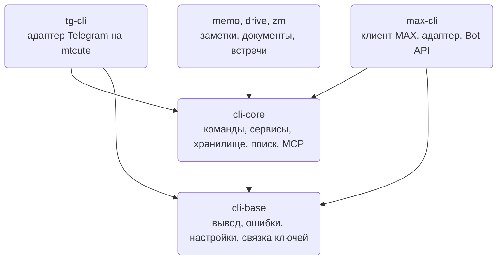
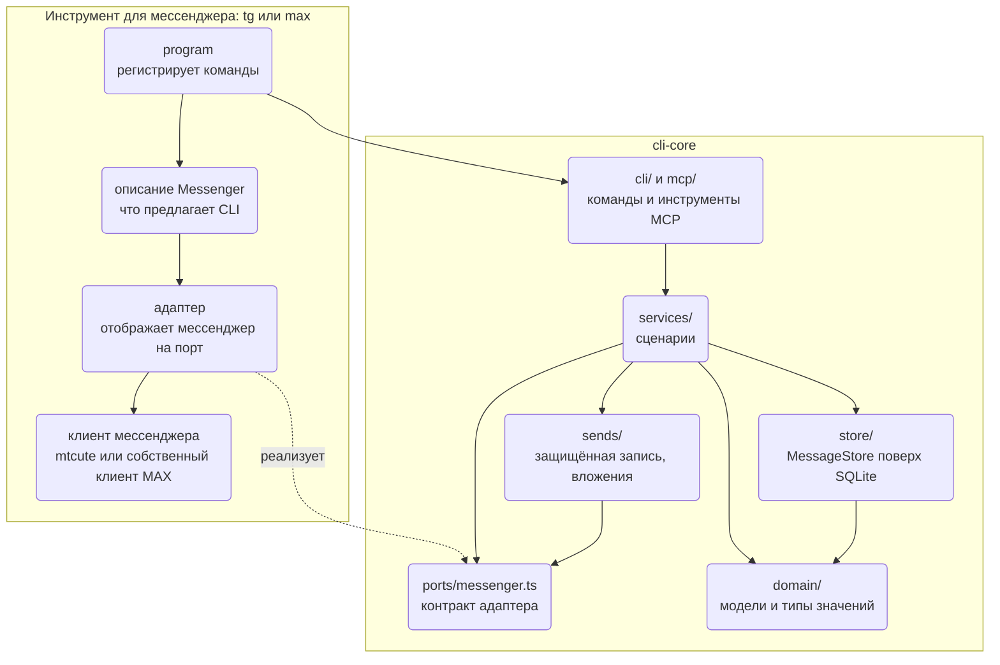
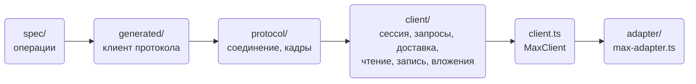
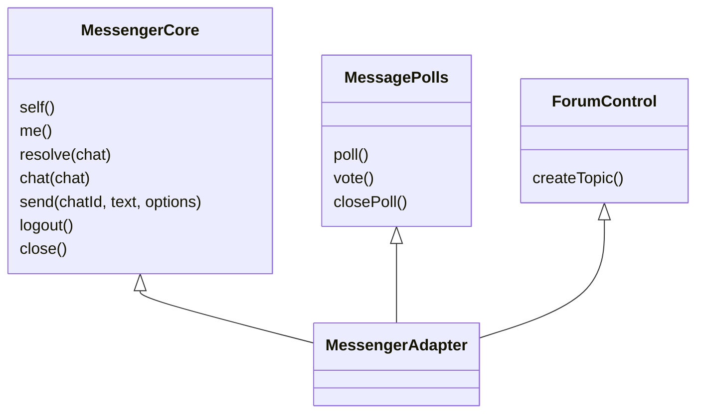
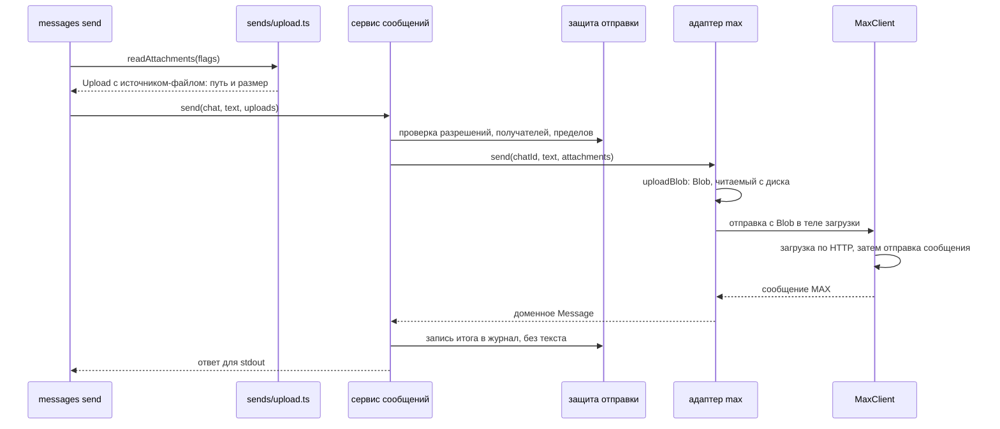

Здесь описано, как устроен код `tg`, `max` и других инструментов WireCat: какой слой может вызывать
какой, как модуль общается с остальными через интерфейс и что придётся изменить, чтобы заменить одну
часть. Прочитайте страницу перед изменением общего ядра, перед написанием нового адаптера мессенджера
или когда нужно понять, вписывается ли изменение в устройство. [Архитектура](./architecture.mdx)
подробнее рассказывает о пакетах и о пути команды во время работы; эта страница — о строении кода и о
том, как оно сохраняется.

Два слова встречаются повсюду. **Порт** — интерфейс, который определяет общее ядро и от которого оно
зависит. **Адаптер** — код в одном инструменте, который реализует порт для одного мессенджера или
поставщика. Ядро вызывает порт и никогда не импортирует адаптер.

Описан код, прочитанный 14 октября 2026 года, на коммитах
[cli-core a3b5b3c](https://github.com/WireCatLabs/cli-core/tree/a3b5b3c47792d5e2df6529642e907ee32783e66a),
[max-cli 0536988](https://github.com/WireCatLabs/max-cli/tree/0536988bb3a9ae5aed40cdd12e572a72dd2564a1) и
[tg-cli faea191](https://github.com/WireCatLabs/tg-cli/tree/faea191a76ea40f3159e865cf5c17f99163c4104).
Число файлов и строк взято с этих коммитов.

## Пакеты



Зависимости направлены в одну сторону. `cli-base` ничего не знает о переписке. `cli-core` содержит всё о
переписке, что не относится к одному мессенджеру. Каждый инструмент закрепляет точную версию обоих, поэтому
изменение в ядре доходит до пользователей только тогда, когда инструмент переходит на новую версию.
Инструмент, который ещё не перешёл, продолжает работать на закреплённой версии.

## Слои

Слой может вызывать слои ниже себя и никогда — выше. На схеме — `cli-core` и один инструмент; пунктирная
стрелка означает реализацию порта, а не вызов.



| Слой | Задача | Размер | Что ему нельзя импортировать |
| --- | --- | --- | --- |
| `domain/` | Типы, не привязанные к мессенджеру: `Chat`, `Message`, `Person`, локаторы, участки форматирования. Никакого поведения, которому нужна сеть или файл. | 24 файла | Библиотеку мессенджера или адаптер. |
| `ports/messenger.ts` | Контракт, который реализует каждый мессенджер. | 1 файл, 663 строки | То же. |
| `store/` | Локальный архив: один интерфейс `MessageStore`, который открывает `openStore`, поверх модулей SQLite, миграций и поисковых индексов. | 101 файл | Ничему вне `store/` нельзя импортировать модуль из `store/sqlite/`. |
| `services/` | Сценарии: сообщения, чаты, люди, поиск, векторы, упоминания, модерация. | 81 файл | Commander, модуль команды, модуль SQLite. |
| `sends/` | Любая запись: защита отправки, идентификаторы операций, журнал отправок, вложения. | 14 файлов | То же, что сервисам. |
| `cli/`, `mcp/` | Представление: команды, конверт JSON, настройки и профили; инструменты MCP поверх тех же сервисов. | 168 + 51 файл | Модуль SQLite. |
| `meetings/`, `tasks/` | Самостоятельные модули со своими портами. | 46 + 4 файла | Что-либо ещё из cli-core, базу данных или файловую систему. |
| `readers/`, `images/` | Чтение документов и описание картинок, выбираются из реестра. | 13 + 6 файлов | Хранилище, сервисы, команды и инструменты MCP. |

Последний столбец — не пожелание. Каждая строка — правило линтера в
[biome.json cli-core](https://github.com/WireCatLabs/cli-core/blob/a3b5b3c47792d5e2df6529642e907ee32783e66a/biome.json),
и импорт через границу проваливает pull request с фразой, которая называет правило.

### Внутри инструмента

У **max** нет официальной библиотеки, поэтому клиент — часть инструмента. Его слои: спецификация
протокола, сгенерированный по ней клиент, соединение WebSocket, 22 фабрики ресурсов в `src/client/` и
корень, который их собирает, —
[src/client.ts](https://github.com/WireCatLabs/max-cli/blob/0536988bb3a9ae5aed40cdd12e572a72dd2564a1/src/client.ts).
[max-adapter.ts](https://github.com/WireCatLabs/max-cli/blob/0536988bb3a9ae5aed40cdd12e572a72dd2564a1/src/adapter/max-adapter.ts)
отображает этот клиент на порт. Правила линтера держат протокол, спецификацию и сгенерированный код за
`src/client.ts`, отделяют часть для официального Bot API от сессии личного аккаунта и не дают сессии и
`max serve` импортировать команды.



**tg** использует [mtcute](https://github.com/mtcute/mtcute). Импортировать его может только
`src/telegram/`, а командам нельзя напрямую обращаться к его отображению и переводу ошибок. Адаптер — один
класс в
[telegram/adapter.ts](https://github.com/WireCatLabs/tg-cli/blob/faea191a76ea40f3159e865cf5c17f99163c4104/src/telegram/adapter.ts).

## Как модуль общается с остальными

### Контракт мессенджера

`MessengerAdapter` — обязательное ядро и необязательные группы. В `MessengerCore` семь методов: `self`,
`me`, `resolve`, `chat`, `send`, `logout` и `close`. Всё остальное разбито на 39 необязательных групп,
например `MessagePolls`, `ForumControl`, `ChatFolders` и `LiveUpdates`.



Код, которому нужен необязательный метод, просит его по имени:

```ts
const react = capability(connection, "react", "react to a message")
```

`capability()` возвращает метод или завершается ошибкой `validation_error` с текстом «this messenger
cannot react to a message», если у адаптера его нет. Параметр, который мессенджер не может выполнить,
отклоняется так же, а не отбрасывается молча.

### Описание инструмента

Каждый инструмент передаёт ядру ещё и объект `Messenger` из 47 полей: имя приложения, как подключаться,
как листать историю, и флаги вроде `pollQuiz`, `topicShow` и `stickers`. Команды читают флаги, когда
регистрируют свои параметры, поэтому `polls create --quiz` есть только в инструменте, где мессенджер
умеет викторины.

### Сервисы и их зависимости

Сервис — функция, которая принимает один объект зависимостей и возвращает сценарий:
`messagesService(deps)`, `chatsService(deps)`. Классов и контейнера нет. Объект зависимостей,
[`ServiceDeps`](https://github.com/WireCatLabs/cli-core/blob/a3b5b3c47792d5e2df6529642e907ee32783e66a/src/services/deps.ts),
несёт описание мессенджера, защиту отправки и ленивые открыватели:

```ts
connection: () => Promise<MessengerAdapter>
store: () => Promise<MessageStore>
account: () => Promise<AccountKey>
```

Ничего не открывается, пока сервис не попросит, поэтому чтение, на которое отвечает локальное хранилище,
никогда не подключается к сети.
[`servicesFor(deps)`](https://github.com/WireCatLabs/cli-core/blob/a3b5b3c47792d5e2df6529642e907ee32783e66a/src/services/index.ts#L145)
собирает все сервисы один раз; команды и инструменты MCP берут их оттуда, поэтому на одинаковый ввод дают
одинаковый ответ и одинаковую ошибку.

Инструмент может заменить один сервис, не копируя ядро. `Messenger.services` получает общие сервисы и
возвращает замены; max так даёт модерации свой способ находить чат.

### Самостоятельные модули

`meetings/` и `tasks/` определяют свои порты: поставщик реализует `MeetingSource` в своём пакете, а
хранилище реализует `MeetingStore` и `TaskStore`. Остальной cli-core импортирует их только через
`index.ts`, а сами они ничего не импортируют из cli-core. Поставщик встреч вроде Zoom подключается так,
что ядро о нём не знает.

### Реестры

Чтение документов и описание картинок регистрируются через `registerReader` и `registerImageProvider`,
с необязательной позицией. Добавить движок для PDF или модель для картинок — значит зарегистрировать их;
код, который вызывает чтение, не меняется.

## Одна запись от начала до конца

`max messages send <chat> --file report.pdf`. Файл проверяется при запуске команды и читается только во
время загрузки, поэтому большой файл никогда не держится в памяти целиком.



В tg адаптер передаёт тот же Blob в mtcute и открывает файл заново при каждой повторной попытке. Адаптер,
чьей библиотеке нужны байты в памяти, вызывает `uploadBytes`, который отклоняет файл больше 256 MiB.

## Приёмы

| Приём | Где | Что даёт |
| --- | --- | --- |
| Порты и адаптеры | `ports/messenger.ts`, `meetings/source.ts`, `tasks/store.ts` | Ядро никогда не импортирует поставщика; поставщик меняется без правок ядра. |
| Группы возможностей | `MessengerAdapter`, `capability()` | Мессенджер реализует то, что у него есть; отсутствующая функция — понятный отказ, а не падение. |
| Флаги описания | `Messenger` | Параметры появляются только там, где они работают. |
| Фабрики над одним объектом зависимостей | `xService(deps)`, `ServiceDeps` | Простые функции, их легко проверять с подделкой; ленивые открыватели делают разовые команды дешёвыми. |
| Корни сборки | `servicesFor`, `MaxClient`, контекст команды | Граф объектов строится в одном месте, и там же закрывается всё открытое. |
| Точка замены | `Messenger.services` | Инструмент меняет один сценарий сразу и для команд, и для инструментов MCP. |
| Защитное отображение | `max-adapter.ts`, `telegram/map.ts` | Типы и ошибки поставщика превращаются в доменные типы и типизированные коды ошибок в одном файле на инструмент. |
| Оборачивающий прокси | `throughWrapper` в `ports/messenger.ts` | Запись хода и кэш оборачивают адаптер; новый метод адаптера проходит без правок обёрток. |
| Реестры | `readers/registry.ts`, `images/registry.ts` | Новые движки подключаются без правок тех, кто их вызывает. |
| Сгенерированный клиент | max: из `spec/` в `generated/` | Операции MAX описаны один раз; тест падает, если сгенерированные файлы разошлись. |

## Что можно заменить и какой ценой

Часть можно заменить, если код над ней зависит от интерфейса, а не от самой части, и это держит правило
линтера или тест.

| Часть | Цена | Как |
| --- | --- | --- |
| Библиотека Telegram | Локально | Переписать `src/telegram/`; больше никто не импортирует mtcute. |
| Протокол MAX | Локально | Изменить спецификацию и перегенерировать; к протоколу обращается только клиент. |
| Один сценарий в одном инструменте | Мало | `Messenger.services`. |
| Чтение документов, описание картинок, модели векторов | Мало | Зарегистрировать читатель или поставщика; выбрать локальную или удалённую модель. |
| Поставщик встреч | Мало | Реализовать `MeetingSource` в пакете поставщика. |
| Новый мессенджер | Средне | Реализовать `MessengerCore` и те группы, что есть у мессенджера, и написать описание. Команды, инструменты MCP, хранилище, поиск и защита отправки приходят вместе с ядром. |
| Новый интерфейс рядом с CLI и MCP | Средне | Вызвать `servicesFor(deps)` и отрисовать ответ. Сервисы всё ещё импортируют несколько помощников из `cli/` (настройки, помощники ошибок, запросы списков), и они переезжают вместе. |
| Движок хранилища | Сложно | Заново реализовать `MessageStore`: около 140 методов, включая полнотекстовый поиск, основы слов и поиск по векторам. Граница держится, но интерфейс — одна широкая поверхность. |

## Как сохранить устройство

Большую часть устройства проверяют машины, поэтому изменение, которое его ломает, падает ещё до ревью.

| Проверка | Что она останавливает | Где |
| --- | --- | --- |
| Запрещённые импорты | Импорт через границу слоёв из таблицы выше или через границы инструмента, или SDK поставщика вне модуля, которому он принадлежит. | `biome.json` каждого репозитория, запускает `pnpm lint`. |
| Циклы импорта | Два модуля, которые во время работы импортируют друг друга, напрямую или через другие. Импорты только типов разрешены. | `noImportCycles` в верхнеуровневых правилах линтера каждого репозитория. |
| Размер файла | Файл длиннее 1000 строк. Файл, который уже длиннее, не может расти: его исключение ограничено нынешним размером. Тесты и сгенерированный код освобождены. | `noExcessiveLinesPerFile` в `biome.json` каждого репозитория. |
| Parity | Изменение ядра, которое ломает сборку любого инструмента. Ветка с тем же именем в инструменте позволяет ломающему изменению пройти проверки до того, как инструменты его примут. | Workflow Parity в cli-core. |
| Контракт команд | Форма `commands --json`, объявленные эффекты у каждой команды, снимок справки. | `contracts:check` и `cli-dev lint` в каждом инструменте. |
| Проверка типов | Код, тесты и скрипты как три проекта. | `pnpm typecheck`. |
| Сгенерированные файлы | Ручные правки сгенерированных страниц команд или клиента протокола max. | Тесты, которые сравнивают с `pnpm generate`. |

Biome строит граф импортов для `noImportCycles`, только когда правило включено в верхнеуровневых
правилах. Внутри записи `overrides` оно ничего не сообщает, поэтому правило остаётся наверху.

Каждый месяц запись [проверок архитектуры](https://github.com/WireCatLabs/cli-testing/blob/main/performance/engineering/architecture-checks/README.md) заново измеряет эти правила во всех репозиториях,
перечисляет файлы длиннее 500 строк с оценкой каждого и хранит динамику.

Правила для нового кода:

1. **Новая возможность мессенджера** — необязательная группа в `ports/messenger.ts`, доступная через
   `capability()` и предложенная через флаг описания. `MessengerCore` не растёт.
2. **Новый сценарий** — сервис, который принимает `ServiceDeps`. Его вызывают и команда, и инструмент MCP;
   в файле команды нет бизнес-логики.
3. **Новый запрос к хранилищу** — модуль в `store/sqlite/`, доступный только через `store.ts`. Сервис читает
   через `accountStore(deps)`; намеренное чтение по нескольким аккаунтам называет себя через
   `crossAccount(deps, reason)`.
4. **Любая запись** идёт через защиту отправки: проверка до, запись в журнал после, с идентификатором операции.
5. **Тип поставщика** не выходит за адаптер.
6. **Ломающее изменение ядра** указывается в журнале изменений под «Changed — may break callers», с ветками того
   же имени в инструментах, чтобы Parity мог собрать их переход.
7. **Разделение файла** требует шва: зависимости, которую оно убирает, цикла, который разрывает, или части,
   которую можно проверить или заменить отдельно. Одна длина файла — не причина.

## Пределы нынешнего устройства

- **Хранилище — один широкий интерфейс.** У `MessageStore` около 140 методов над одним `openStore`, а
  `store.ts` — 2042 строки. Его затрагивает большинство функций. Делить его полезно только по настоящему
  шву: ресурсам, которые открываются и закрываются отдельно.
- **Сервисы всё ещё немного знают о CLI.** Они импортируют описание `Messenger` как тип и несколько
  помощников из `cli/` во время работы.
- **Адаптер tg — один большой класс**: 2312 строк и около 110 методов; каждый метод читается легко, но сюда
  попадает каждая функция Telegram.
- **`client/values.ts` в max** содержит 59 экспортов, которые используют 20 модулей.
- **Некоторые большие файлы всё ещё делают несколько дел.** Линтер не даёт расти тем, что длиннее 1000 строк;
  запись [проверок архитектуры](https://github.com/WireCatLabs/cli-testing/blob/main/performance/engineering/architecture-checks/README.md) называет шов, по которому делить каждый.

Чтобы увидеть, где в этих слоях находятся поиск, векторы и граф разговоров, перейдите к
[архитектуре поиска](./search-architecture.mdx).
