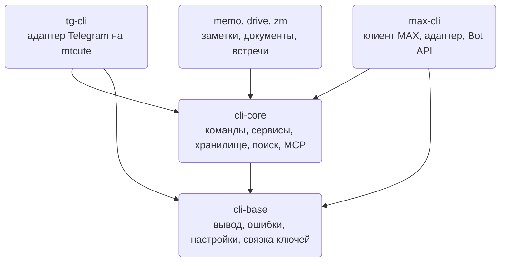
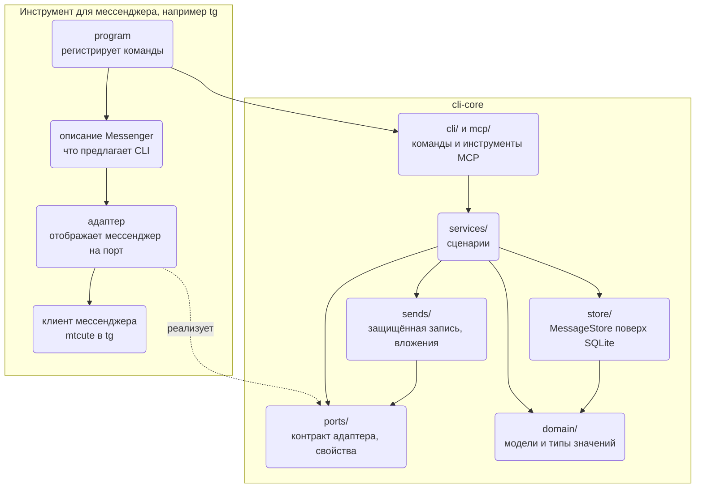
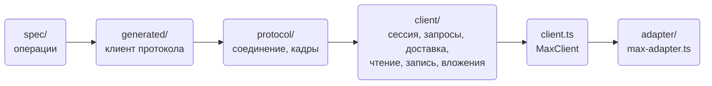
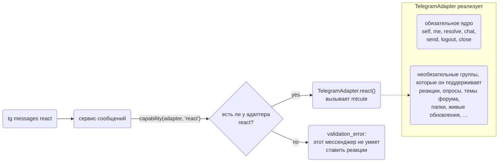
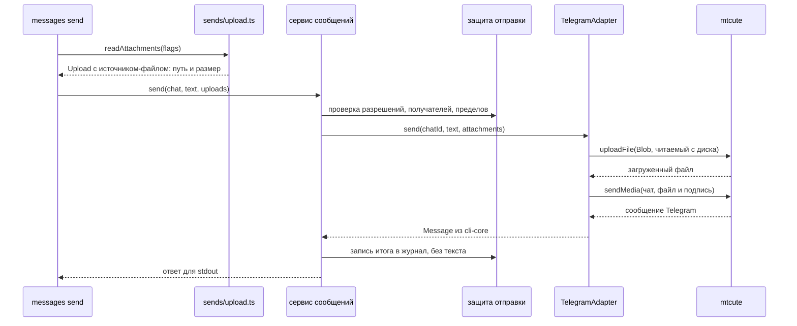

Здесь описано, как устроен код `tg`, `max` и других инструментов WireCat: какой слой может вызывать
какой, как модуль общается с остальными через интерфейс и что придётся изменить, чтобы заменить одну
часть. Прочитайте страницу перед изменением общего ядра, перед написанием нового адаптера мессенджера
или когда нужно понять, вписывается ли изменение в устройство. [Архитектура](./architecture.mdx)
подробнее рассказывает о пакетах и о пути команды во время работы; эта страница — о строении кода и о
том, как оно сохраняется.

Два слова встречаются повсюду.

- **Порт** — список методов, которые общему ядру нужны от мессенджера. Он записан один раз в cli-core как
  интерфейс TypeScript: `resolve(chat)` находит чат, `send(chatId, text)` отправляет сообщение и так далее.
  Ядро вызывает только эти методы и никогда не видит собственный API Telegram или другого мессенджера.
- **Адаптер** — класс в одном инструменте, который заполняет эти методы для одного мессенджера.
  `TelegramAdapter` в tg реализует `send` через библиотеку Telegram mtcute и превращает её ответ в
  `Message` из cli-core.

Поэтому `messages send` написана в cli-core один раз и работает в каждом инструменте: команда вызывает
порт, а каждый инструмент подключает свой адаптер. Чтобы поддержать новый мессенджер, пишут новый
адаптер, а ядро не меняют.

Описан код, прочитанный 14 октября 2026 года, на коммитах
[cli-core a3b5b3c](https://github.com/WireCatLabs/cli-core/tree/a3b5b3c47792d5e2df6529642e907ee32783e66a),
[max-cli 0536988](https://github.com/WireCatLabs/max-cli/tree/0536988bb3a9ae5aed40cdd12e572a72dd2564a1) и
[tg-cli faea191](https://github.com/WireCatLabs/tg-cli/tree/faea191a76ea40f3159e865cf5c17f99163c4104).
Число файлов и строк взято с этих коммитов. Хранилище, адаптер tg и пределы в конце страницы прочитаны
заново 17 октября 2026 года, на [cli-core 9be2271](https://github.com/WireCatLabs/cli-core/tree/9be227198793fabf506ee946b10aaad94d84d519), [tg-cli 868b433](https://github.com/WireCatLabs/tg-cli/tree/868b43356065170eeb923c648082e8ee03b0f349) и [max-cli 606bba4](https://github.com/WireCatLabs/max-cli/tree/606bba4a4fadd989e1b9300f273789487b8a9063).

## Пакеты



Зависимости направлены в одну сторону. `cli-base` ничего не знает о переписке. `cli-core` содержит всё о
переписке, что не относится к одному мессенджеру. Каждый инструмент закрепляет точную версию обоих, поэтому
изменение в ядре доходит до пользователей только тогда, когда инструмент переходит на новую версию.
Инструмент, который ещё не перешёл, продолжает работать на закреплённой версии.

## Слои

Слой может вызывать слои ниже себя и никогда — выше. На схеме — `cli-core` и один инструмент; пунктирная
стрелка означает реализацию порта, а не вызов.



| Слой | Задача | Размер | Что ему нельзя импортировать |
| --- | --- | --- | --- |
| `domain/` | Типы и значения, не привязанные к мессенджеру: `Chat`, `Message`, `Person`, локаторы, участки форматирования, наборы значений фактов, памяти и задач. Никакого поведения, которому нужна сеть или файл. Слой почти нижний: он берёт два типа из `search/` и виды задач из `tasks/`. | 29 файлов | `cli/`, библиотеку мессенджера или адаптер. |
| `ports/` | Контракт, который реализует каждый мессенджер (`messenger.ts`), то, что сервис читает о мессенджере (`traits.ts`), и кто такое приложение (`app.ts`). | 3 файла | То же. |
| `store/` | Локальный архив: `MessageStore`, который открывает `openStore`, — это 31 область, например `messages`, `chats`, `people` и `mail`; каждая в своём файле и создаётся при первом обращении, поверх табличных модулей SQLite, миграций и поисковых индексов. | 150 файлов (17 октября) | Команде, сервису, записи и инструменту MCP нельзя импортировать табличный модуль из `store/sqlite/`; они идут через `store.ts`. |
| `services/` | Сценарии: сообщения, чаты, люди, поиск, векторы, упоминания, модерация. | 87 файлов | Commander, что угодно из `cli/`, модуль SQLite. То же верно для `replies/`, `attachments/`, `moderation/`, `models/` и `analysis/`. |
| `sends/` | Любая запись: защита отправки, идентификаторы операций, журнал отправок, вложения. | 14 файлов | То же, что сервисам. |
| `cli/`, `mcp/` | Представление: команды, конверт JSON, настройки и профили; инструменты MCP поверх тех же сервисов. | 168 + 51 файл | Модуль SQLite. |
| `meetings/`, `tasks/` | Самостоятельные модули со своими портами. | 46 + 4 файла | Что-либо ещё из cli-core, базу данных или файловую систему. |
| `readers/`, `images/` | Чтение документов и описание картинок, выбираются из реестра. | 13 + 6 файлов | Хранилище, сервисы, команды и инструменты MCP. |

Последний столбец — не пожелание. Каждая строка — правило линтера в
[biome.json cli-core](https://github.com/WireCatLabs/cli-core/blob/a3b5b3c47792d5e2df6529642e907ee32783e66a/biome.json),
и импорт через границу проваливает pull request с фразой, которая называет правило.

### Внутри инструмента

У **max** нет официальной библиотеки, поэтому клиент — часть инструмента. Его слои: спецификация
протокола, сгенерированный по ней клиент, соединение WebSocket, 22 фабрики ресурсов в `src/client/` и
корень, который их собирает, —
[src/client.ts](https://github.com/WireCatLabs/max-cli/blob/0536988bb3a9ae5aed40cdd12e572a72dd2564a1/src/client.ts).
[max-adapter.ts](https://github.com/WireCatLabs/max-cli/blob/0536988bb3a9ae5aed40cdd12e572a72dd2564a1/src/adapter/max-adapter.ts)
отображает этот клиент на порт. Правила линтера держат протокол, спецификацию и сгенерированный код за
`src/client.ts`, отделяют часть для официального Bot API от сессии личного аккаунта и не дают сессии и
`max serve` импортировать команды.



**tg** использует [mtcute](https://github.com/mtcute/mtcute). Импортировать его может только
`src/telegram/`, а командам нельзя напрямую обращаться к его отображению и переводу ошибок. Класс в
[telegram/adapter.ts](https://github.com/WireCatLabs/tg-cli/blob/868b43356065170eeb923c648082e8ee03b0f349/src/telegram/adapter.ts)
передаёт каждый метод порта модулю функции рядом с ним: `messages.ts`, `chats.ts`, `groups.ts`, `topics.ts`,
`polls.ts` и ещё шести; у них общий контекст из `feature.ts`.

## Как модуль общается с остальными

### Контракт мессенджера

Порт для мессенджеров — `MessengerAdapter` в `ports/messenger.ts`. В нём две части:

- **Обязательное ядро из семи методов**, которые есть у любого мессенджера: `self`, `me`, `resolve`,
  `chat`, `send`, `logout` и `close`. Адаптер без любого из них не пройдёт проверку типов.
- **39 необязательных групп** для возможностей, которые есть не у всех мессенджеров: `MessagePolls`
  (опросы), `ForumControl` (темы форума), `ChatFolders`, `LiveUpdates` и другие. Адаптер реализует группы,
  которые поддерживает его мессенджер, и пропускает остальные.



Код, которому нужен необязательный метод, просит его по имени:

```ts
const react = capability(connection, "react", "react to a message")
```

`capability()` возвращает метод или завершается ошибкой `validation_error` с текстом «this messenger
cannot react to a message», если у адаптера его нет. Параметр, который мессенджер не может выполнить,
отклоняется так же, а не отбрасывается молча.

### Описание инструмента

Каждый инструмент передаёт ядру ещё и объект `Messenger`: имя приложения, как подключаться, как листать
историю, и флаги вроде `pollQuiz`, `topicShow` и `stickers`. Команды читают флаги, когда регистрируют свои
параметры, поэтому `polls create --quiz` есть только в инструменте, где мессенджер умеет викторины.

Сервисы видят только часть этого объекта. [`MessengerTraits`](https://github.com/WireCatLabs/cli-core/blob/80616b3813ca8264d8f9edca3e8e0fcce7a1e81e/src/ports/traits.ts) в `ports/traits.ts` — 14 полей, которые читает
сервис: имя приложения, как листается история, ищет ли мессенджер на своём сервере и другие. `Messenger`
добавляет к ним то, что нужно только CLI: `connect`, настройки, хук защиты отправки и диагностику для
`doctor`. Сервис не может дотянуться до команды, объекта commander или настройки, которую ему не передали.

### Сервисы и их зависимости

Сервис — функция, которая принимает один объект зависимостей и возвращает сценарий:
`messagesService(deps)`, `chatsService(deps)`. Классов и контейнера нет. Объект зависимостей,
[`ServiceDeps`](https://github.com/WireCatLabs/cli-core/blob/a3b5b3c47792d5e2df6529642e907ee32783e66a/src/services/deps.ts),
несёт описание мессенджера, защиту отправки и ленивые открыватели:

```ts
connection: () => Promise<MessengerAdapter>
store: () => Promise<MessageStore>
account: () => Promise<AccountKey>
```

Ничего не открывается, пока сервис не попросит, поэтому чтение, на которое отвечает локальное хранилище,
никогда не подключается к сети.
[`servicesFor(deps)`](https://github.com/WireCatLabs/cli-core/blob/a3b5b3c47792d5e2df6529642e907ee32783e66a/src/services/index.ts#L145)
собирает сервисы над одним объектом зависимостей: команда — на свой запуск, инструмент MCP — на свой
вызов. Оба вызывают одни и те же функции сервисов, поэтому у сценария одна реализация на двоих.

Инструмент может заменить один сервис, не копируя ядро. `Messenger.services` получает общие сервисы и
возвращает замены, например свой способ находить чат для модерации.

### Самостоятельные модули

`meetings/` и `tasks/` определяют свои порты: поставщик реализует `MeetingSource` в своём пакете, а
хранилище реализует `MeetingStore` и `TaskStore`. Остальной cli-core импортирует их только через
`index.ts`, а сами они ничего не импортируют из cli-core. Поставщик встреч вроде Zoom подключается так,
что ядро о нём не знает.

### Хранилище со стороны инструмента

Инструмент обращается к общему хранилищу только через области хранилища cli-core. Он не пишет SQL к общему файлу,
поэтому следующая миграция его не сломает ([WC-STORE-5](https://github.com/WireCatLabs/cli-base/blob/main/docs/standards/store.md#wc-store-5--a-cli-writes-no-sql-against-the-shared-store)).
Таблицы, нужные только одному инструменту, — контрольные точки, кэши — живут в его собственном файле SQLite рядом с
общим хранилищем и открываются через `openCache` из `@wirecat/cli-core/store`; они ссылаются на общие строки только по
id, и другие инструменты их не читают ([WC-DATA-1](https://github.com/WireCatLabs/cli-base/blob/main/docs/standards/data-model.md)).

### Реестры

Чтение документов и описание картинок регистрируются через `registerReader` и `registerImageProvider`,
с необязательной позицией. Добавить движок для PDF или модель для картинок — значит зарегистрировать их;
код, который вызывает чтение, не меняется.

## Одна запись от начала до конца

`tg messages send <chat> --file report.pdf`. Файл проверяется при запуске команды и читается только во
время загрузки, поэтому большой файл никогда не держится в памяти целиком.



Если загрузка обрывается, адаптер открывает файл заново и повторяет попытку. Адаптер max делает то же
со своим клиентом. Адаптер, чьей библиотеке нужны байты в памяти, вызывает `uploadBytes`, который
отклоняет файл больше 256 MiB.

## Приёмы

| Приём | Где | Что даёт |
| --- | --- | --- |
| Порты и адаптеры | `ports/messenger.ts`, `meetings/source.ts`, `tasks/store.ts` | Ядро никогда не импортирует поставщика; поставщик меняется без правок ядра. |
| Группы возможностей | `MessengerAdapter`, `capability()` | Мессенджер реализует то, что у него есть; отсутствующая функция — понятный отказ, а не падение. |
| Флаги описания | `Messenger` | Параметры появляются только там, где они работают. |
| Фабрики над одним объектом зависимостей | `xService(deps)`, `ServiceDeps` | Простые функции, их легко проверять с подделкой; ленивые открыватели делают разовые команды дешёвыми. |
| Корни сборки | `servicesFor`, `MaxClient`, контекст команды | Граф объектов строится в одном месте, и там же закрывается всё открытое. |
| Точка замены | `Messenger.services` | Инструмент меняет один сценарий сразу и для команд, и для инструментов MCP. |
| Защитное отображение | `max-adapter.ts`, `telegram/map.ts` | Типы и ошибки поставщика превращаются в доменные типы и типизированные коды ошибок в одном файле на инструмент. |
| Оборачивающий прокси | `throughWrapper` в `ports/messenger.ts` | Запись хода и кэш оборачивают адаптер; новый метод адаптера проходит без правок обёрток. |
| Реестры | `readers/registry.ts`, `images/registry.ts` | Новые движки подключаются без правок тех, кто их вызывает. |
| Сгенерированный клиент | max: из `spec/` в `generated/` | Операции MAX описаны один раз; тест падает, если сгенерированные файлы разошлись. |

## Что можно заменить и какой ценой

Часть можно заменить, если код над ней зависит от интерфейса, а не от самой части, и это держит правило
линтера или тест.

| Часть | Цена | Как |
| --- | --- | --- |
| Библиотека Telegram | Локально | Переписать `src/telegram/`; больше никто не импортирует mtcute. |
| Протокол MAX | Локально | Изменить спецификацию и перегенерировать; к протоколу обращается только клиент. |
| Один сценарий в одном инструменте | Мало | `Messenger.services`. |
| Чтение документов, описание картинок, модели векторов | Мало | Зарегистрировать читатель или поставщика; выбрать локальную или удалённую модель. |
| Поставщик встреч | Мало | Реализовать `MeetingSource` в пакете поставщика. |
| Новый мессенджер | Средне | Реализовать `MessengerCore` и те группы, что есть у мессенджера, и написать описание. Команды, инструменты MCP, хранилище, поиск и защита отправки приходят вместе с ядром. |
| Новый интерфейс рядом с CLI и MCP | Средне | Собрать `ServiceDeps`, вызвать `servicesFor(deps)` и отрисовать ответ. Сервисы ничего не импортируют из `cli/`; новый интерфейс пишет свой способ подключаться и читать настройки. |
| Движок хранилища | Сложно | Заново реализовать каждую область `MessageStore`, включая полнотекстовый поиск, основы слов и поиск по векторам. Вызывающий код зависит от интерфейсов областей, но каждая из 31 области построена на одном контексте SQLite, поэтому движок меняется во всех сразу. |

## Как сохранить устройство

Сами правила с их номерами описаны в [справочнике стандартов WireCat CLI](https://github.com/WireCatLabs/cli-base/blob/main/docs/standards/README.md); этот раздел
показывает, как их проверяют cli-core и инструменты. Большую часть устройства проверяют машины. Линтер и проверка типов, а в большинстве инструментов и линтер команд,
работают в каждом pull request, поэтому изменение, которое их ломает, падает ещё до ревью. Parity, контракты команд и
тесты сгенерированных файлов работают в полной проверке после каждого слияния в `main` ([правила CI](https://github.com/WireCatLabs/cli-base/blob/main/docs/standards/ci.md)), поэтому
поломка там видна сразу после слияния, а не в следующем выпуске.

| Проверка | Что она останавливает | Где |
| --- | --- | --- |
| Запрещённые импорты | Импорт через границу слоёв из таблицы выше или через границы инструмента, или SDK поставщика вне модуля, которому он принадлежит. | `biome.json` каждого репозитория, запускает `pnpm lint`. |
| Циклы импорта | Два модуля, которые во время работы импортируют друг друга, напрямую или через другие. Импорты только типов разрешены. | `noImportCycles` в верхнеуровневых правилах линтера cli-core и каждого инструмента. |
| Размер файла | Файл длиннее 1000 строк (в zoom — 500). Файл, который уже длиннее или который разделили, не может расти: его исключение ограничено нынешним размером. Тесты и сгенерированный код освобождены. | `noExcessiveLinesPerFile` в `biome.json` cli-core и каждого инструмента. |
| Parity | Изменение ядра, которое ломает сборку любого инструмента. Ветка с тем же именем в инструменте позволяет ломающему изменению пройти проверки до того, как инструменты его примут. | Workflow Parity в cli-core. |
| Контракт команд | Форма `commands --json`, объявленные эффекты у каждой команды, снимок справки. | `contracts:check` и `cli-dev lint` в каждом инструменте. |
| Проверка типов | Код, тесты и скрипты как три проекта. | `pnpm typecheck`. |
| Сгенерированные файлы | Ручные правки сгенерированных страниц команд или клиента протокола max. | Тесты, которые сравнивают с `pnpm generate`. |

Biome строит граф импортов для `noImportCycles`, только когда правило включено в верхнеуровневых
правилах. Внутри записи `overrides` оно ничего не сообщает, поэтому правило остаётся наверху.

Каждый месяц запись [проверок архитектуры](https://github.com/WireCatLabs/cli-testing/blob/main/performance/engineering/architecture-checks/README.md) заново измеряет эти правила в cli-core и каждом инструменте,
перечисляет файлы длиннее 500 строк с оценкой каждого и хранит динамику.

Правила для нового кода:

1. **Новая возможность мессенджера** — необязательная группа в `ports/messenger.ts`, доступная через
   `capability()` и предложенная через флаг описания. `MessengerCore` не растёт.
2. **Новый сценарий** — сервис, который принимает самую узкую зависимость, какая ему нужна. Сценарий, который
   только читает хранилище, принимает ту часть, которую читает (`Pick<MessageStore, …>` или хранилище и
   аккаунт), как большинство сервисов встреч и поиска: такой проще проверить и перенести. Сценарий, которому
   нужны ещё мессенджер, защита отправки или ленивое открытие, принимает `ServiceDeps`. Из 87 файлов сервисов
   25 принимают только хранилище, 36 — `ServiceDeps`. Сервис вызывают и команда, и инструмент MCP; в файле
   команды нет бизнес-логики.
3. **Новый вид записей** — новая область хранилища: свой файл в `store/`, который создаётся при первом обращении,
   а его SQL — в табличных модулях в `store/sqlite/` ([WC-STORE-2](https://github.com/WireCatLabs/cli-base/blob/main/docs/standards/store.md)). Сервис одного аккаунта читает
   через `accountStore(deps)`; намеренное чтение по нескольким аккаунтам называет себя через
   `crossAccount(deps, reason)`.
4. **Любая запись** идёт через защиту отправки: проверка до, запись в журнал после, с идентификатором операции.
5. **Тип поставщика** не выходит за адаптер.
6. **Ломающее изменение ядра** указывается в журнале изменений под «Changed — may break callers», с ветками того
   же имени в инструментах, чтобы Parity мог собрать их переход.
7. **Разделение файла** требует шва: зависимости, которую оно убирает, цикла, который разрывает, или части,
   которую можно проверить или заменить отдельно. Одна длина файла — не причина.

## Пределы нынешнего устройства

Правила описаны в [справочнике](https://github.com/WireCatLabs/cli-base/blob/main/docs/standards/README.md); этот список говорит, где код находится относительно них на
17 октября 2026 года.

- **Хранилище разделено на области, но все их ведёт один движок.** `MessageStore` — это 31 область, например
  `messages`, `chats`, `people`, `mail` и `meetings`. Каждая создаётся при первом обращении из своего файла,
  поэтому новый вид записей становится новой областью, а не новыми методами одного интерфейса
  ([WC-STORE-2](https://github.com/WireCatLabs/cli-base/blob/main/docs/standards/store.md)). [`store.ts`](https://github.com/WireCatLabs/cli-core/blob/9be227198793fabf506ee946b10aaad94d84d519/src/store/store.ts) только связывает области: в нём 301
  строка, и линтер ограничивает его 438 строками, чтобы он снова не рос. Все области работают на одном контексте
  SQLite, поэтому замена движка хранилища по-прежнему означает замену во всех.
- **Привязка сервиса к одному аккаунту сделана наполовину.** `store.forAccount(key)` привязывает 12 областей с
  данными одного аккаунта, поэтому вызов через неё не дотянется до строки другого аккаунта. Пять файлов сервисов
  работают через привязанное хранилище; 24 всё ещё берут `deps.store()` вместе с `deps.account()`
  ([WC-STORE-3](https://github.com/WireCatLabs/cli-base/blob/main/docs/standards/store.md)).
- **Части `Messenger`, нужные только CLI, принимают `Command` из commander.** `connect`, `accountOf`,
  `guard` и `diagnose` сами читают параметры команды. Сервисы их не видят, но второму интерфейсу пришлось бы
  написать свои.
- **Адаптер tg — тонкий класс над модулями функций.** [telegram/adapter.ts](https://github.com/WireCatLabs/tg-cli/blob/868b43356065170eeb923c648082e8ee03b0f349/src/telegram/adapter.ts) —
  625 строк: каждый метод порта — одна строка, которая вызывает один из 11 модулей функций, поэтому новая функция
  Telegram попадает в свой модуль, а не в класс. Подсказки в ошибках называют проверку, а команды tg превращают её
  в слова, так что ниже команд ничто не называет команду ([WC-ARCH-16](https://github.com/WireCatLabs/cli-base/blob/main/docs/standards/architecture.md)). Самый большой
  оставшийся файл — `map.ts`, 576 строк, которые превращают типы mtcute в типы cli-core.
- **Поисковые запросы компилируются по одному полю.** У каждого поля языка запросов свой компилятор в
  `store/sqlite/lucene-fields.ts`, и тест следит, чтобы этот список совпадал с реестром полей. В `lucene.ts`
  всё ещё 710 строк.
- **Правила импорта держатся, только пока каждая запись `overrides` полная.** Biome не объединяет две записи
  `overrides`, которые задают `noRestrictedImports`: для файла, подходящего под обе, поздняя заменяет раннюю.
  Поэтому каждая запись несёт весь список для своих путей, а запись, в которой части не хватает, выключает эти
  правила без ошибки. Так было в cli-core до [cli-core #1467](https://github.com/WireCatLabs/cli-core/pull/1467)
  ([WC-TOOL-15](https://github.com/WireCatLabs/cli-base/blob/main/docs/standards/toolchain.md)).
- **Инструменты MCP всё ещё пишутся вручную рядом с командами.** Команда и её инструмент MCP — два куска кода
  над одним сервисом. Создание инструментов из дерева команд, при котором вызов запускает саму команду, одобрено
  и строится в cli-core; пока выпуск не скажет, что оно готово, работающее описывают [правила MCP](https://github.com/WireCatLabs/cli-base/blob/main/docs/standards/mcp.md).
- **`client/values.ts` в max** содержит 59 экспортов, которые используют 20 модулей.
- **Некоторые большие файлы всё ещё делают несколько дел.** Линтер не даёт расти тем, что длиннее 1000 строк;
  запись [проверок архитектуры](https://github.com/WireCatLabs/cli-testing/blob/main/performance/engineering/architecture-checks/README.md) называет шов, по которому делить каждый.

Чтобы увидеть, где в этих слоях находятся поиск, векторы и граф разговоров, перейдите к
[архитектуре поиска](./search-architecture.mdx).
