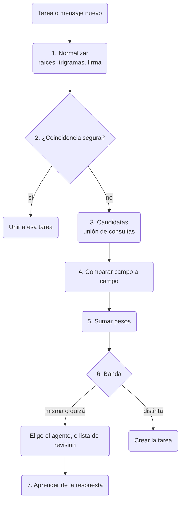

Comprende cómo se guarda una tarea, de dónde sale su clave y cómo decidirá la herramienta que dos
tareas son una. Sirve a desarrolladores y autores de agentes que leen el almacén local o construyen
sobre las tareas. Primero van los datos; después, lo previsto: claves por tipo, reservas y la
detección de duplicados con un ejemplo resuelto. Para el uso diario, empieza por [Tareas](./tasks.md).

El diseño viene del plan de tareas aprobado en cli-core
([WireCatLabs/cli-core#1216](https://github.com/WireCatLabs/cli-core/pull/1216)). Cada sección dice
si describe lo que ya existe o lo que está **previsto**.

## Los datos

**Ahora.** Una tabla, `tasks`, guarda todas las tareas del almacén local. La lista completa de
columnas está en el [modelo de datos](./data-model.mdx#tasks-1).

| Qué | Cómo se guarda |
| --- | --- |
| Tipo | `question`, `request`, `mention`, `promise` para tareas encontradas en mensajes; `bug`, `feature`, `chore` para tareas de proyecto |
| Plan | título, descripción, prioridad de 0 (urgente) a 4 (baja), fecha límite, próxima revisión, tarea padre |
| Estado | `open`, `done` o `dismissed`, con quién la cerró y por qué |
| Fuente | un localizador de mensaje o nota, nunca el texto del mensaje, así que un mensaje borrado no deja nada |
| Valoración | `useful` o `not_useful`, según valoraste una tarea que planteó un agente |
| Personas | asignaciones con un rol: responsable, revisor, observador |
| Historial | `task_events`: creada, estado, asignada, fecha límite, prioridad, movida, vinculada, desvinculada |
| Vínculos | filas de `links` a mensajes, chats, personas, documentos, notas y direcciones, con un tipo |

Cada tarea pertenece a un proyecto. Una tarea encontrada en un mensaje va al proyecto de entrada de su
cuenta; una tarea de proyecto va a un proyecto que creaste tú. Un vínculo a un mensaje tiene el tipo
`related-to`, `evidence` o `created-from`. Un vínculo entre dos tareas también es una fila de
`links`, con el tipo `blocked-by`, `follow-up-of` o `related-to`. Estos vínculos solo funcionan entre
tareas de tus propios proyectos, y solo tú los aplicas. Antes de escribir un `blocked-by` o un
`follow-up-of`, una consulta recursiva comprueba que no cierra un ciclo.

**Previsto.** Campos nuevos: `category`, marcas, `claimed_by`, `claimed_until`. Tipos de vínculo
nuevos: `duplicate-of` y `discovered-from`. Dos tablas de texto completo nuevas, `task_words` y
`task_stems`, hechas como las de las notas. Cada cambio de categoría pasa a ser una fila de
`task_events` del tipo `category`.

## Identificadores y claves

**Ahora.** Una tarea de proyecto tiene una clave formada por la clave del proyecto y un número:
`HRB-12`. El número sale de un contador en la fila del proyecto, tomado en la misma escritura que la
inserción:

```sql
UPDATE projects SET tasks_count = tasks_count + 1 WHERE id = ? RETURNING key, tasks_count
```

Una tarea encontrada en un mensaje tiene un id interno (un UUID) y una clave del proyecto de entrada
de su cuenta. `tasks list` muestra el principio del id; `tasks show` y `tasks agenda` muestran la clave.

**Previsto.** Una tarea encontrada en un mensaje recibe una clave por tipo: `Q-15` pregunta,
`REQ-22` petición, `M-7` mención, `PR-4` promesa. Cada tipo tiene su propia fila de contador, tomada
en la misma escritura que la inserción, como en los proyectos. Se resuelven tanto `task:<key>` como
`task:<uuid>`. La categoría es un campo, no parte de la clave, así que corregir una categoría nunca
rompe una clave citada en un chat o una nota.

**Por qué no identificadores hash.** [beads](https://github.com/gastownhall/beads) usa
identificadores hash como `bd-a3f8`, que se alargan a medida que crece la base de datos
([`internal/idgen/hash.go`](https://github.com/gastownhall/beads/blob/main/internal/idgen/hash.go)).
Los hash resuelven muchos escritores sobre muchas copias que se combinan después. Aquí hay un almacén
por ordenador y un escritor cada vez, así que un contador da claves cortas que una persona puede leer.
Si algún día los almacenes se sincronizan entre dispositivos, las claves llevarán un prefijo de
dispositivo; esa decisión queda para más adelante.

## Reservas (previsto)

Dos agentes, o un agente y tú, no deben trabajar a la vez en la misma tarea. `tasks claim` ejecuta
una sola sentencia dentro de `BEGIN IMMEDIATE`:

```sql
UPDATE tasks SET claimed_by = ?, claimed_until = ?
WHERE id = ? AND status = 'open' AND (claimed_by IS NULL OR claimed_until < ?)
RETURNING id
```

Si no vuelve ninguna fila, otro tiene la tarea; el error dice quién y hasta cuándo. SQLite deja
entrar a un solo escritor cada vez entre procesos, así que la reserva es atómica entre `tg`, `max`,
`memo` y los agentes del mismo ordenador. La reserva es un **préstamo con plazo**: termina sola (a
los 30 minutos por defecto), así que un agente que se cae nunca retiene una tarea para siempre.
`tasks release` la devuelve antes; cerrar una tarea también la libera. `tasks agenda` oculta las
tareas reservadas por otros salvo que `--claimed` las pida.

## La detección de duplicados (prevista)

La comprobación se ejecuta con cada tarea nueva y con cada mensaje nuevo vinculado a una tarea. Corre
en cli-core, sobre SQLite, sin embeddings y sin llamar a un proveedor de IA.



En palabras: la tarea nueva se normaliza; una coincidencia segura la une enseguida; si no, se reúnen
candidatas, cada una se compara campo a campo, se suman los pesos y el total decide: crear o
preguntar. Cada respuesta se guarda para ajustar los pesos más adelante.

### 1. Normalizar

- El título y la descripción pasan por el normalizador de la búsqueda: minúsculas, sin diacríticos,
  `ё` pasa a `е`, los grupos de cifras se unen (`15 000` pasa a `15000`).
- Un lematizador Snowball por escritura (ruso, inglés, español) reduce cada palabra a su raíz; se
  quitan las palabras vacías. El resultado es el **conjunto de raíces**.
- El título normalizado también se corta en **trigramas de caracteres**, todas las ventanas de tres
  letras. Atrapan errores de escritura y formas que el lematizador no ve.
- Unos patrones extraen la **firma**: un importe con su moneda (un número junto a `₽`, `руб`, `€`,
  `$`, `usd`), una fecha límite (fechas y frases como `by Friday` o `до пятницы`) y la persona
  (`person:<id>` de quien envió el mensaje de origen, a través de `identities`). Un agente puede
  pasarlos él mismo (`--amount`, `--due`, `--person`).

Las raíces y el texto normalizado van a `task_words` y `task_stems`, que actualizan las mismas
escrituras.

### 2. Coincidencias seguras

Estas unen el mensaje a una tarea existente sin puntuar:

1. El mensaje nuevo **responde a** un mensaje ya vinculado a una tarea abierta (el propio vínculo de
   respuesta del servicio de mensajería).
2. **La misma regla sobre el mismo mensaje**: un índice único sobre fuente y regla.
3. **El mismo título normalizado para la misma persona** en una tarea abierta.

No se crea nada nuevo, y la respuesta dice a qué tarea y por qué.

### 3. Candidatas

Las candidatas son la unión de consultas baratas:

```sql
SELECT task_id FROM task_stems
WHERE task_stems MATCH '<stems joined by OR>'
ORDER BY bm25(task_stems) LIMIT 20
```

más las tareas de la misma persona, de la misma categoría y de la misma cadena de respuestas, todas
consultas simples con índice. Solo cuentan las tareas abiertas o cerradas en los últimos 14 días. La
unión tiene unas 40 tareas como mucho. [`bm25()`](https://www.sqlite.org/fts5.html#the_bm25_function)
es la función de orden de SQLite FTS5.

Dos reglas evitan perder buenas candidatas:

- **Compartir chat no basta nunca para ser candidata.** Un chat tiene muchas tareas sin relación, y
  una misma petición puede llegar a un grupo y a un chat privado.
- **Una sola consulta nunca es la puerta.** Graphiti perdía duplicados exactos porque tomaba las
  candidatas de una sola búsqueda con un corte ([getzep/graphiti#1734](https://github.com/getzep/graphiti/issues/1734)).

### 4. Comparar campo a campo

| Campo | Comparación | Niveles |
| --- | --- | --- |
| Texto | Jaccard (elementos comunes divididos entre todos los distintos) sobre los conjuntos de raíces de título y descripción, y sobre los trigramas del título; cuenta el valor más alto | 0,6 o más · de 0,3 a 0,6 · menos de 0,3 |
| Persona | `person:<id>` | misma · distinta · desconocida |
| Importe | valor y moneda | igual · distinto · falta |
| Categoría | nombre | misma · distinta |
| Fecha límite | días de diferencia | 2 o menos · más · falta |
| Cadena de respuestas | los mensajes de origen se responden entre sí | sí · no |
| Tiempo | días entre las dos tareas | 3 o menos · de 4 a 14 · más |

### 5. Sumar los pesos

La puntuación sigue el modelo de Fellegi–Sunter para enlazar registros. Cada nivel tiene un peso
`log2(m / u)`. Aquí `m` es con qué frecuencia muestran ese nivel los duplicados reales, y `u`, con qué
frecuencia lo muestran tareas sin relación. Un nivel habitual entre duplicados sube la suma; uno raro
la baja. La [guía de Splink sobre el modelo de Fellegi–Sunter](https://moj-analytical-services.github.io/splink/topic_guides/theory/fellegi_sunter.html)
explica el método.

Los pesos iniciales se fijan a mano. Se ajustan con un conjunto de pruebas sintético antes de que
decidan nada:

| Nivel | Peso |
| --- | --- |
| Texto: 0,6 o más / de 0,3 a 0,6 / menos de 0,3 | +4 / +2 / −2 |
| Persona: misma / distinta / desconocida | +3 / −3 / 0 |
| Importe: igual / distinto / falta | +3 / −4 / 0 |
| Categoría: misma / distinta | +1 / −1 |
| Fecha límite: 2 días o menos / más / falta | +1 / −1 / 0 |
| Cadena de respuestas: sí / no | +6 / 0 |
| Tiempo: 3 días o menos / de 4 a 14 días / más | +1 / 0 / −1 |

El plan no da peso para «cadena de respuestas: no» ni para «tiempo: de 4 a 14 días»; esta página los
cuenta como 0. Bandas: **8 o más es «misma», de 3 a 7 es «quizá», menos de 3 es «distinta».** Los
pesos y las bandas viven en un solo módulo, con el motivo de cada número; nada más los fija en el
código.

### 6. Decidir

| Banda | Tarea añadida por un agente | Tarea abierta por una regla |
| --- | --- | --- |
| Segura (paso 2) | se une a la tarea, nada nuevo | igual |
| Misma | aparece primero; el agente debe elegir | a la lista de revisión; ninguna puntuación fusiona sola todavía |
| Quizá | `tasks add` se niega y lista hasta 5 candidatas con puntuación y motivos; el agente repite con `--attach <task>` o `--new` | a la lista de revisión |
| Distinta | se crea | se crea |

La herramienta se niega en lugar de avisar: un agente puede pasar por alto un aviso, pero no un código
de salida. Preguntar al agente que crea la tarea no cuesta una llamada extra a un proveedor de IA,
porque ese agente ya es el juez. Mem0 funciona igual: el agente que escribe un recuerdo elige
añadirlo, actualizar uno existente, borrar uno o no hacer nada
([Mem0, arXiv 2504.19413](https://arxiv.org/abs/2504.19413)).

**La lista de revisión.** `tasks duplicates` lista los pares que una regla dejó en «misma» o «quizá»,
los más nuevos primero, con motivos. `tasks merge <dup> --into <task>` vincula todos los mensajes del
duplicado a la tarea que se queda, cierra el duplicado como `dismissed` con un vínculo `duplicate-of`
y registra la decisión. `tasks duplicates reject <dup> <task>` registra «no es lo mismo», así que el
par no vuelve a aparecer.

**Una fusión se puede deshacer.** `tasks unmerge <dup>` reabre el duplicado y quita el vínculo. Los
vínculos a mensajes se quedan donde están hasta que se muevan. Una fusión nunca borra nada.

### 7. Aprender de las respuestas

Cada fusión, rechazo, `--attach` y `--new` tras una lista de candidatas es un par etiquetado. Con
suficientes pares, `m` y `u` de cada nivel se vuelven a contar a partir de ellos, la misma estimación
por conteo que usa Splink, sin paso de entrenamiento. Entonces la banda «misma» puede empezar a
fusionar sola, primero los pares de reglas. Hasta que tú lo permitas, solo las coincidencias seguras
del paso 2 se fusionan sin una persona.

## Un ejemplo resuelto

Bob Sample escribe en un chat privado: «Can you send the invoice for 15 000 ₽ by Friday?» (¿me mandas
la factura de 15 000 ₽ antes del viernes?). Una regla abre una petición. Antes de crearla, la
comprobación encuentra dos candidatas de Bob Sample:

- **REQ-22**, creada ayer: «Send the invoice for 15000 ₽», categoría `money`, sin fecha límite.
- **REQ-19**, creada hace 10 días: «Send the contract invoice, 40 000 ₽», categoría `money`, sin
  fecha límite.

Las raíces de la tarea nueva, con el lematizador inglés, son `send`, `invoic`, `15000`, `friday`. En
este ejemplo los trigramas dan un valor más bajo que las raíces en los dos pares, así que cuentan las
raíces.

| Campo | REQ-22 | Puntos | REQ-19 | Puntos |
| --- | --- | --- | --- | --- |
| Texto | raíces `send`, `invoic`, `15000`: 3 comunes de 4 distintas = 0,75 | +4 | raíces `send`, `contract`, `invoic`, `40000`: 2 comunes de 6 distintas = 0,33 | +2 |
| Persona | misma | +3 | misma | +3 |
| Importe | 15000 ₽ = 15000 ₽ | +3 | 15000 ₽ ≠ 40000 ₽ | −4 |
| Categoría | `money` = `money` | +1 | `money` = `money` | +1 |
| Fecha límite | falta en REQ-22 | 0 | falta en REQ-19 | 0 |
| Cadena de respuestas | no | 0 | no | 0 |
| Tiempo | 1 día | +1 | 10 días | 0 |
| **Total** | | **12: misma** | | **2: distinta** |

La petición la encontró una regla, así que la herramienta la crea como REQ-23 y pone el par REQ-23 y
REQ-22 en la lista de revisión; ninguna puntuación fusiona sola todavía. Después,
`tasks merge REQ-23 --into REQ-22` las une. Si la tarea la hubiera añadido un agente, `tasks add` se
negaría, mostraría REQ-22 primero con 12 puntos y «misma persona, mismo importe, 3 de 4 raíces en
común», y el agente repetiría con `--attach REQ-22`. REQ-19 comparte la persona y las palabras «send
invoice», pero el importe la hunde: es otro trabajo.

## Comparación con beads

[beads](https://github.com/gastownhall/beads) es un gestor de incidencias para agentes de
programación. Algunas de sus ideas se toman aquí y otras no.

| beads | Aquí |
| --- | --- |
| Identificadores hash `bd-a3f8` | Claves legibles de un contador: un almacén, un escritor cada vez |
| [Etiquetas](https://github.com/gastownhall/beads/blob/main/docs/core-concepts/labels.md) para todo lo que no es un campo | Una categoría de una lista fija, más marcas libres |
| Tipos de arista como `duplicates` y `discovered-from` | `duplicate-of` y `discovered-from` se suman a los tipos de vínculo |
| `bd ready`: trabajo abierto y sin bloqueos | `tasks agenda`, con `--category` y `--label` previstos |
| `bd update --claim`: una reserva atómica | `tasks claim`, un préstamo que termina solo |
| `external_ref` a un elemento externo | Cada tarea se vincula a todos sus mensajes |
| `bd duplicates` fusiona copias exactas; `bd find-duplicates` puntúa la coincidencia de palabras y solo informa | Una comprobación antes de crear, pesos por campo y una lista de revisión |

El texto de los chats nunca es una copia exacta, y nada en beads comprueba antes de crear una tarea.
Por eso la comprobación de aquí trabaja por campos y pregunta cuando no está segura.

## Trabajos relacionados

Los informes de errores duplicados son un problema antiguo. REP puntúa dos informes por su texto y por
campos como el producto y el componente, con pesos ajustados sobre duplicados conocidos
([Sun et al., ASE 2011](https://doi.org/10.1109/ASE.2011.6100061)). La comprobación de aquí usa la
misma idea de texto más campos, con pesos que se cuentan, no que se entrenan.

## Lo que no se hace

- **Ni embeddings ni llamadas a un proveedor de IA** para comparar tareas. Si el conjunto de pruebas
  muestra que el campo de texto es demasiado débil, el siguiente paso es un embedding local, medido
  frente a esta comprobación.
- **Nada se borra.** Un duplicado se cierra y se vincula; nunca se elimina.
- **Ningún límite de una tarea por chat o por persona.**
- **Ningún identificador hash**, hasta que los almacenes se sincronicen entre dispositivos.
- **Preguntas abiertas:** la lista de categorías por defecto, y si un mensaje que coincide con una
  tarea cerrada en los últimos 14 días la reabre o abre una tarea nueva vinculada con `follow-up-of`.
