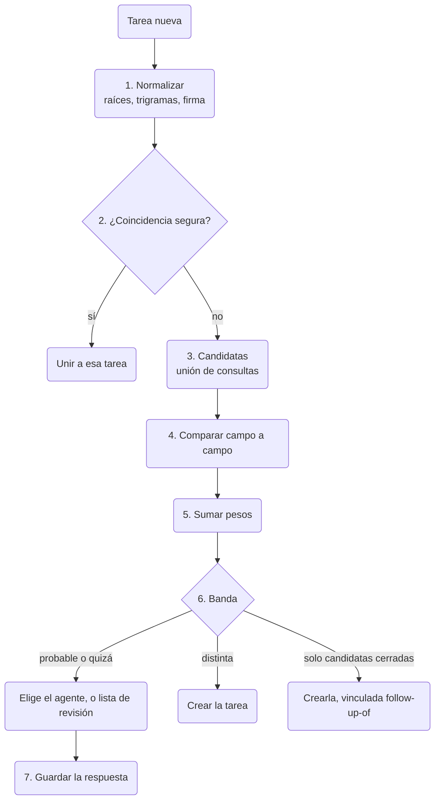

Comprende cómo se guarda una tarea, de dónde sale su clave y cómo encuentra la herramienta tareas
que pueden ser la misma. Sirve a desarrolladores y autores de agentes que leen el almacén local o construyen
sobre las tareas. Primero van los datos; después, las claves por tipo, las reservas y la detección de
duplicados con un ejemplo resuelto. Para el uso diario, empieza por [Tareas](./tasks.md).

El diseño viene del plan de tareas aprobado en cli-core
([WireCatLabs/cli-core#1216](https://github.com/WireCatLabs/cli-core/pull/1216)). Todo está ya hecho
en cli-core salvo las partes marcadas como **aún no está hecho**. `tg` y `max` lo tienen todo, salvo que solo `tg` lee la lista de categorías del archivo de ajustes compartido. `memo` no tiene los cierres de agente por certeza, los seguimientos, la lista de 59 categorías con sus categorías fuera de la lista ni la lectura de mensajes vinculados en la detección de duplicados; tiene categorías (`tasks plan --category`, `category:`), etiquetas y la detección de duplicados en `tasks add`, pero
aún no `tasks categories`, la reserva, `tasks related`, `tasks duplicates` ni `tasks merge`.

## Los datos

Una tabla, `tasks`, guarda todas las tareas del almacén local. La lista completa de
columnas está en el [modelo de datos](./data-model.mdx#tasks).

| Qué | Cómo se guarda |
| --- | --- |
| Tipo | `question`, `request`, `mention`, `promise` para tareas encontradas en mensajes; `bug`, `feature`, `chore` para tareas de proyecto |
| Plan | título, descripción, prioridad de 0 (urgente) a 4 (baja), fecha límite, próxima revisión, tarea padre |
| Estado | `open`, `done` o `dismissed`, con quién la cerró y por qué; el cierre de un agente guarda su certeza, y uno dudoso queda en la tarea abierta como sugerencia de cierre |
| Fuente | un localizador de mensaje o nota, nunca el texto del mensaje, así que un mensaje borrado no deja nada |
| Valoración | `useful` o `not_useful`, según valoraste una tarea que planteó un agente |
| Personas | asignaciones con un rol: responsable, revisor, observador |
| Historial | `task_events`: creada, estado, asignada, fecha límite, prioridad, movida, vinculada, desvinculada |
| Vínculos | filas de `links` a mensajes, chats, personas, documentos, notas y direcciones, con un tipo |

Cada tarea pertenece a un proyecto. Una tarea encontrada en un mensaje va al proyecto de entrada de su
cuenta; una tarea de proyecto va a un proyecto que creaste tú. Un vínculo a un mensaje tiene el tipo
`related-to`, `evidence` o `created-from`. Un vínculo entre dos tareas también es una fila de
`links`, con el tipo `blocked-by`, `follow-up-of` o `related-to`. Tú aplicas estos vínculos entre
tareas de tus propios proyectos. La detección de duplicados también escribe `follow-up-of` entre tareas
encontradas en mensajes, de una tarea nueva a una tarea cerrada en los últimos 14 días
([paso 6](#6-decidir)). Antes de escribir un `blocked-by` o un
`follow-up-of`, una consulta recursiva comprueba que no cierra un ciclo.

Una tarea tiene además una `category` y una reserva (`claimed_by`, `claimed_until`). Una tarea es un
tipo más en la tabla `taggings`, así que los comandos y filtros `tags` sirven en las tareas. Hay dos
tipos de vínculo más: `duplicate-of`, que une dos tareas encontradas en mensajes de una misma cuenta,
y `discovered-from`. Dos tablas de texto completo, `task_words` y `task_stems`, guardan el título y la
descripción de cada tarea, hechas como las de las notas. Cada cambio de categoría es una fila de
`task_events` del tipo `category`. La tabla `task_pairs` guarda cada par de tareas que pueden ser el
mismo trabajo y lo que se decidió sobre él. La versión 17 del almacén añade las columnas del cierre:
`close_certainty` y, para una sugerencia de cierre, `close_suggested_as`, `close_suggested_by_type`,
`close_suggested_by_id`, `close_suggested_certainty`, `close_suggested_reason` y `close_suggested_at`.

## Identificadores y claves

Una tarea de proyecto tiene una clave formada por la clave del proyecto y un número:
`HRB-12`. El número sale de un contador en la fila del proyecto, tomado en la misma escritura que la
inserción:

```sql
UPDATE projects SET tasks_count = tasks_count + 1 WHERE id = ? RETURNING key, tasks_count
```

Una tarea encontrada en un mensaje tiene un id interno (un UUID) y una clave legible por tipo: `Q-15`
pregunta, `REQ-22` petición, `M-7` mención, `PR-4` promesa. Cada tipo tiene su propia fila de
contador, tomada en la misma escritura que la inserción, como en los proyectos. Las tareas anteriores
conservan la clave del proyecto de entrada de su cuenta: `IN`, 8 caracteres hexadecimales y un
número, como `IN1A2B3C4D-17`. El UUID y los dos tipos de clave se resuelven como `task:<…>`.
`tasks show` y `tasks agenda` muestran la clave. La categoría es un campo, no parte de la clave, así que corregir una categoría nunca
rompe una clave citada en un chat o una nota.

**Por qué no identificadores hash.** [beads](https://github.com/gastownhall/beads) usa
identificadores hash como `bd-a3f8`, que se alargan a medida que crece la base de datos
([`internal/idgen/hash.go`](https://github.com/gastownhall/beads/blob/main/internal/idgen/hash.go)).
Los hash resuelven muchos escritores sobre muchas copias que se combinan después. Aquí hay un almacén
por ordenador y un escritor cada vez, así que un contador da claves cortas que una persona puede leer.
Si algún día los almacenes se sincronizan entre dispositivos, las claves llevarán un prefijo de
dispositivo; esa decisión queda para más adelante.

## Reservas

Dos agentes, o un agente y tú, no deben trabajar a la vez en la misma tarea. `tasks claim` ejecuta
una sola sentencia dentro de `BEGIN IMMEDIATE`:

```sql
UPDATE tasks SET claimed_by = ?, claimed_until = ?, updated_at = ?
WHERE id = ? AND status = 'open' AND (claimed_by IS NULL OR claimed_until < ? OR claimed_by = ?)
RETURNING id
```

Si no vuelve ninguna fila, otro tiene la tarea; el error dice quién y hasta cuándo. Quien la tiene
puede reservarla otra vez para alargar su propia reserva. SQLite deja
entrar a un solo escritor cada vez entre procesos, así que la reserva es atómica entre `tg`, `max`,
`memo` y los agentes del mismo ordenador. La reserva es un **préstamo con plazo**: termina sola (a
los 30 minutos por defecto), así que un agente que se cae nunca retiene una tarea para siempre.
`tasks release` la devuelve antes, y el propietario puede liberar cualquier reserva; cerrar una tarea
también la libera. `tasks agenda` muestra quién tiene cada tarea y oculta las tareas reservadas por
otros salvo que la consulta las pida con `claimed:any`. MCP tiene `tasks_claim` y `tasks_release`.

**Quien reserva** es una sesión de agente, así que dos sesiones de un mismo agente no comparten una
reserva. Gana lo primero que esté definido: `--holder <name>`, la variable `WIRECAT_HOLDER`,
`claude-code:<session id>` de `CLAUDE_CODE_SESSION_ID` (Claude Code la define en cada proceso que
inicia), el nombre del agente de `AI_AGENT` y, al final, `owner`. Un agente sin entorno, como un
agente web, pasa el id de su chat con `--holder`.

## Cierres de un agente

Los cierres de agente por certeza están disponibles en `tg` y `max`.

Un cierre no se puede deshacer (solo `tasks unmerge` reabre una tarea, y solo una que cerró una
fusión), así que un cierre del que un agente no está seguro espera al propietario. `tasks close`
distingue a un agente del propietario igual que `mentions confirm`: es un agente cuando están
definidas `AI_AGENT` o `CLAUDECODE`, y si no, el propietario. `--as-owner` cierra como el propietario
desde la terminal de un agente. MCP `tasks_close` es siempre un agente.

Un agente debe pasar `--certainty <0..1>` (en MCP, `certainty`); sin ella, el cierre se rechaza con
`task.certainty-required`. Lo que pasa después lo deciden dos ajustes de todo el almacén, guardados en
el almacén y no en un perfil, porque las reglas y los cierres de `tg`, `max` y `memo` tienen que
coincidir:

| Ajuste | Por defecto | Qué hace |
| --- | --- | --- |
| `task_agent_close` | `on` | `off` convierte cada cierre de un agente en una sugerencia |
| `task_agent_close_min` | `0.8` | la certeza mínima que cierra la tarea |

Con una certeza igual o superior al umbral y los cierres de agente activados, la tarea se cierra y
guarda `close_certainty`. Si no, la respuesta trae `state: open` y `close_suggestion`: cómo cerrarla,
quién (el nombre del agente), la certeza, el motivo y la hora. La reserva se libera. `tasks agenda`
muestra la tarea con el motivo `close-suggested`, y `tasks list close:suggested` la encuentra. El
propietario confirma con `tasks close <task>` (`--as` se puede omitir: se toman el estado y el motivo
de la sugerencia) o rechaza con `tasks reject <task>`. Una sugerencia posterior sustituye a la
anterior, y cada sugerencia es un evento `close-suggestion`.

Por qué 0.8: los agentes se puntúan alto y a saltos gruesos, así que la línea cae donde termina
«probablemente» y empieza «quizá». Más alto, cada cierre recae en el propietario; más bajo, pasa un
cierre con reservas. La regla que cierra una pregunta que el propietario respondió no es un cierre de
agente: vio la respuesta del propietario y cierra sin certeza.

## Categorías

La lista de categorías es una para todas las herramientas, no una por perfil ni por aplicación, porque
las reglas se ejecutan en `tg`, `max`, `memo` y `messages sync` y tienen que coincidir. `tg` lee los
cambios del propietario de un archivo de ajustes compartido, `~/.config/WireCat/config.json` (en
Windows, `%APPDATA%\WireCat\Config\config.json`), sección `task_categories`. La sección solo guarda
cambios sobre la lista por defecto: `"<name>": "<meaning> | <words>"` añade o sustituye una categoría
(una nueva va antes de `other`), y `null` quita una por defecto, así que las categorías que añada una
versión posterior siguen llegando. El propietario edita el archivo o usa estos comandos, que escriben
en el mismo archivo y conservan sus otras claves:

| Comando | Qué hace |
| --- | --- |
| `config set task_categories.<name> "<meaning> \| <words>"` | añade o sustituye una categoría; una palabra puede indicar su idioma (`es:vuelo`), si no, el cirílico se lee como ruso y lo demás como inglés |
| `config unset task_categories.<name>` | quita una categoría; `other` no se puede quitar |
| `config unset task_categories` | quita la sección y vuelve a la lista por defecto |
| `config show` | muestra las categorías con los demás ajustes; `from` indica el archivo en las categorías que cambia |

El archivo solo se lee donde hace falta una categoría (reglas, `tasks add`, `plan`, `categories`,
`agenda` y `config show`), y se vuelve a leer solo cuando cambió. Un archivo que no es JSON válido o
que nombra una categoría incorrecta se rechaza indicando su ruta; la lista nunca vuelve a la lista por
defecto sin avisar. Un almacén movido con `MESSAGING_STORE` lee el `config.json` que está a su lado, y
`WIRECAT_CONFIG_DIR` cambia el archivo de sitio, así que una prueba nunca lee el archivo del
propietario.

`tasks add` necesita una categoría de la lista (MCP `tasks_add` necesita `category`), y un nombre
desconocido se rechaza junto con la lista. Una regla compara las raíces del mensaje de origen con las
palabras de cada categoría: gana la que tiene más coincidencias, un empate va a la categoría anterior,
y sin coincidencias es `other`. Por eso la lista pone primero las concretas, después las acciones
genéricas (`money`, `documents`, `meeting`) y al final `work` y `personal`. Una palabra `es:` también
coincide por su raíz española cuando el mensaje se lee como español: una tilde, `ñ`, `¿` o `¡`, o una
palabra como `la`, `que` o `para`. Una lista admite hasta 80 categorías.
`tasks categories` (MCP `tasks_categories`) imprime la lista con significados y palabras.
`tasks agenda category:<name> tag:<name>` filtra la agenda con campos de consulta (MCP `tasks_agenda` los recibe en `query`). Cambiar la lista no cambia la
categoría de las tareas que ya existen.

Antes de que `tg` leyera el archivo, la lista se guardaba en el almacén (`store_settings`). Esa lista
guardada sigue siendo la base bajo los cambios del archivo hasta que el siguiente `config set` o
`unset` de una categoría la pasa al archivo y la quita del almacén. `max` y `memo` aún no leen el
archivo: usan una lista guardada en el almacén o la lista por defecto de la herramienta que abre el
almacén. Así que, después de que `tg` pase una lista guardada al archivo, `max` y `memo` usan su propia
lista por defecto. `tasks categories` (MCP `tasks_categories`) indica el archivo en `file`. Una categoría que salió de la lista mientras las tareas aún la llevan se nombra:
`tasks categories` la lista en `unlisted` con el número de tareas abiertas y el total (también MCP
`tasks_categories`), un `config set` o `unset` de `task_categories` termina su nota con las mismas
líneas, y `tasks agenda` nombra las que llevan las tareas abiertas (`unlisted_categories`).
`tasks list category:<name>` encuentra sus tareas, y `tasks plan <task> --category <name>` mueve una.

La lista por defecto en `tg` y `max`:

| Categoría | Significado |
| --- | --- |
| `taxes` | declaraciones de impuestos, el gestor, Hacienda |
| `investments` | acciones, fondos, criptomonedas, un bróker |
| `subscriptions` | una suscripción a un servicio: darse de alta, cancelar o renovar |
| `bills` | una factura periódica: suministros, teléfono, internet |
| `donations` | una donación, una recaudación de fondos, una ONG |
| `insurance` | una póliza de seguro o un siniestro |
| `bank` | tarjetas, cuentas bancarias, transferencias, una petición del banco |
| `civic` | votar, una petición, un censo, un jurado, el ayuntamiento |
| `government` | un visado, la residencia, un permiso, una cita en una oficina pública |
| `legal` | un abogado, un notario, un juzgado o un litigio |
| `hiring` | candidatos, entrevistas, ofertas de empleo |
| `sales` | leads, acuerdos, presupuestos |
| `partners` | una alianza o una integración con otra empresa |
| `support` | un problema de un usuario o cliente que resolver |
| `security` | una cuenta robada, una estafa, 2FA, una filtración |
| `access` | un acceso, una contraseña, una llave, una invitación o un permiso que dar o conseguir |
| `tech` | código, servidores, fallos, compilaciones, despliegues |
| `media` | la prensa, un periodista, un podcast o una entrevista para medios |
| `marketing` | campañas, anuncios, SEO, boletines, redes sociales |
| `design` | interfaz, maquetas, un logotipo o una marca que diseñar o revisar |
| `research` | una investigación, una encuesta, un análisis o un benchmark |
| `content` | publicaciones, artículos, vídeos que escribir, grabar o revisar |
| `vendors` | un proveedor, contratista o agencia a quien pagas un servicio |
| `car` | el coche: reparaciones, aparcamiento, multas, ITV |
| `travel` | vuelos, trenes, hoteles, viajes |
| `pets` | una mascota: el veterinario, la comida, un cuidador, paseos |
| `fitness` | el gimnasio, entrenamientos, un deporte |
| `beauty` | un corte de pelo, uñas, cosmética, un salón |
| `health` | médicos, recetas, medicamentos |
| `education` | cursos, libros, idiomas, estudios en el colegio o la universidad |
| `celebrations` | un cumpleaños, una boda, un aniversario o una fiesta que preparar o celebrar |
| `childcare` | una niñera, un canguro, la guardería, extraescolares |
| `elder-care` | el cuidado de un familiar mayor: un cuidador, una residencia |
| `family` | hijos, colegio, padres y familiares |
| `real-estate` | comprar, vender o alquilar un inmueble; una hipoteca |
| `moving` | una mudanza: transportistas, cajas, una dirección nueva |
| `home` | el piso: reparaciones, alquiler, el casero, los vecinos |
| `delivery` | un paquete, pedido o mensajero que enviar, seguir o recoger |
| `devices` | un teléfono, portátil o aparato que comprar, arreglar o configurar |
| `food` | la compra de comida, cocinar, un restaurante |
| `shopping` | cosas que comprar |
| `hobbies` | una afición: música, fotografía, manualidades, un juego al que juegas |
| `entertainment` | películas, series, conciertos, juegos, espectáculos |
| `events` | un evento, entradas, un local, una confirmación de asistencia |
| `religion` | la iglesia, una misa, una fiesta o un rito religioso |
| `community` | un grupo o club que llevas o ayudas: miembros, moderación, administración |
| `intro` | presentar a personas o pedir una presentación |
| `money` | pagar, facturar, reembolsar, un precio o una deuda |
| `documents` | un contrato, escaneo, formulario o firma que enviar o recibir |
| `admin` | gestiones de oficina: material, recados, papeleo sin un área más concreta |
| `meeting` | una llamada, reunión o cita que organizar o a la que ir |
| `clients` | la petición de un cliente, una propuesta, un seguimiento a un cliente |
| `projects` | resultados que entregar, plazos, lanzamientos |
| `team` | compañeros, revisiones, reuniones individuales, vacaciones |
| `follow-up` | esperas a alguien: recuérdaselo |
| `reply` | alguien espera tu respuesta |
| `work` | una tarea de trabajo sin una categoría más concreta |
| `personal` | amigos, regalos, favores |
| `other` | ninguna de las anteriores |

## Reglas al sincronizar

`messages sync` ejecuta las reglas de tareas sobre los chats en los que guardó mensajes, desde un
punto de parada por cuenta guardado en el almacén. La primera pasada lee solo los chats con algún
mensaje de los últimos 14 días, así que un almacén con años de chats no abre tareas por preguntas
antiguas. La respuesta lleva `tasks: {added, closed, review}`; `review` cuenta las tareas nuevas cuyas
candidatas fueron a la lista de revisión. Una pasada fallida es una nota, nunca un fallo de la
sincronización. Nada se une por su cuenta salvo una coincidencia segura (paso 2, abajo).

## La detección de duplicados

La comprobación se ejecuta con cada tarea nueva. Corre en cli-core, sobre SQLite, sin embeddings y
sin llamar a un proveedor de IA. `tasks related <task>` (MCP `tasks_related`) hace los pasos 3 a 5 para una tarea
guardada e imprime el resultado; no cambia nada.



En palabras: la tarea nueva se normaliza; una coincidencia segura la une enseguida; si no, se reúnen
candidatas, cada una se compara campo a campo, se suman los pesos y el total decide: crear o
preguntar. Cuando las únicas candidatas probables o quizá son tareas cerradas en los últimos 14 días,
la tarea se crea como su seguimiento. Una puntuación nunca fusiona dos tareas; decide un agente o una persona. Cada respuesta se
guarda, para poder ajustar los pesos más adelante.

**Los mensajes en los que se apoya una tarea.** Una tarea se compara a través de vistas: su título y
su descripción, y ese mismo texto más un mensaje, para su mensaje de origen y cada uno de sus 5
mensajes vinculados más recientes (tipos `related-to`, `evidence` o `created-from`; no `answered-by`,
la respuesta del propio propietario). Dos tareas puntúan como su mejor par de vistas, cada vista
entera, así que el texto, la persona, el importe y la fecha límite salen del mismo mensaje. Un mensaje
puede subir la puntuación de un par, nunca bajarla. El importe y la fecha límite de un mensaje solo
cuentan cuando el texto de la tarea no los tiene, y su «mañana» se cuenta desde cuándo se envió. Los
mensajes se leen del almacén al comparar; una tarea no guarda el texto de los mensajes.

**Después de un vínculo.** `tasks link <task> msg:…` (MCP `tasks_link`), `tasks add --into` y
`tasks merge` repiten la comprobación para la tarea que recibió el mensaje. Los nuevos pares probables
o quizá van a la lista de revisión, con la tarea más nueva como posible duplicado, y el `review` de la
respuesta los cuenta. El vínculo se mantiene siempre, nada se fusiona por una puntuación y una tarea
cerrada no se comprueba.

### 1. Normalizar

- El título y la descripción pasan por el normalizador de la búsqueda: minúsculas, sin diacríticos,
  `ё` pasa a `е`, los grupos de cifras se unen (`15 000` pasa a `15000`).
- Un lematizador Snowball por escritura (ruso, inglés, español) reduce cada palabra a su raíz; se
  quitan las palabras vacías. El resultado es el **conjunto de raíces**.
- El título normalizado también se corta en **trigramas de caracteres**, todas las ventanas de tres
  letras. Atrapan errores de escritura y formas que el lematizador no ve.
- Unos patrones extraen la **firma**: un importe con su moneda (un número junto a `₽`, `руб`, `€`,
  `$`, `usd`), una fecha límite (fechas y frases en inglés, ruso y español, como `by Friday`, `до пятницы`
  o `el viernes`) y la persona
  (`person:<id>` de quien envió el mensaje de origen, a través de `identities`). Una fecha límite que
  un agente pasa con `--due` se usa en lugar de la del texto.

Las raíces y el texto normalizado van a `task_words` y `task_stems`. Los grupos de cifras se unen y
las palabras vacías se quedan fuera. Escribir una tarea la pone en cola, y la siguiente consulta la
indexa, como con las notas.

### 2. Coincidencias seguras

Solo una coincidencia une sin puntuar: **el mismo mensaje** ya tiene una tarea de ese tipo. No se crea
nada nuevo, y la respuesta muestra esa tarea (`created: false`). Una regla tampoco abre ninguna tarea
para un mensaje vinculado a una tarea como `evidence`, que es lo que escriben `--into` y
`tasks merge`.

En el primer borrador también eran seguras una respuesta y el mismo título. En el conjunto de pruebas
se equivocaron 6 veces de 11: una respuesta que añade una petición nueva, el «+1» de otra persona, el
mismo título para otro trabajo. Ahora una respuesta es un campo con peso (paso 4), y el mismo título
es solo una puntuación de texto alta.

### 3. Candidatas

Las candidatas son la unión de consultas baratas:

```sql
SELECT task_id FROM task_stems
WHERE task_stems MATCH '<stems joined by OR>'
ORDER BY bm25(task_stems) LIMIT 20
```

más las tareas de la misma persona, de la misma categoría y de la misma cadena de respuestas, todas
consultas simples con índice. Solo cuentan las tareas abiertas o cerradas en los últimos 14 días. La
unión tiene unas 40 tareas como mucho. [`bm25()`](https://www.sqlite.org/fts5.html#the_bm25_function)
es la función de orden de SQLite FTS5.

Dos reglas evitan perder buenas candidatas:

- **Compartir chat no basta nunca para ser candidata.** Un chat tiene muchas tareas sin relación, y
  una misma petición puede llegar a un grupo y a un chat privado.
- **Una sola consulta nunca es la puerta.** Graphiti perdía duplicados exactos porque tomaba las
  candidatas de una sola búsqueda con un corte ([getzep/graphiti#1734](https://github.com/getzep/graphiti/issues/1734)).

### 4. Comparar campo a campo

| Campo | Comparación | Niveles |
| --- | --- | --- |
| Texto | Jaccard (elementos comunes divididos entre todos los distintos) sobre los conjuntos de raíces de título y descripción, y sobre los trigramas del título; cuenta el valor más alto | 0,6 o más · de 0,3 a 0,6 · menos de 0,3 |
| Persona | `person:<id>` | misma · distinta · desconocida |
| Importe | valor y moneda | igual · distinto · falta |
| Categoría | nombre | misma · distinta · desconocida |
| Fecha límite | días de diferencia | 2 o menos · más · falta |
| Cadena de respuestas | los mensajes de origen se responden entre sí | sí · no |
| Tiempo | días entre las dos tareas | 3 o menos · de 4 a 14 · más |

### 5. Sumar los pesos

La puntuación sigue el modelo de Fellegi–Sunter para enlazar registros. Cada nivel tiene un peso
`log2(m / u)`. Aquí `m` es con qué frecuencia muestran ese nivel los duplicados reales, y `u`, con qué
frecuencia lo muestran tareas sin relación. Un nivel habitual entre duplicados sube la suma; uno raro
la baja. La [guía de Splink sobre el modelo de Fellegi–Sunter](https://moj-analytical-services.github.io/splink/topic_guides/theory/fellegi_sunter.html)
explica el método.

Los primeros pesos se fijaron a mano y después se ajustaron con un conjunto de pruebas sintético:

| Nivel | Peso |
| --- | --- |
| Texto: 0,6 o más / de 0,3 a 0,6 / menos de 0,3 | +5 / +5 / −2 |
| Persona: misma / distinta / desconocida | +1 / −3 / 0 |
| Importe: igual / distinto / falta | +6 / −4 / 0 |
| Categoría: misma / distinta / desconocida | +1 / −1 / 0 |
| Fecha límite: 2 días o menos / más / falta | +4 / −1 / 0 |
| Cadena de respuestas: sí / no | +6 / 0 |
| Tiempo: 3 días o menos / de 4 a 14 días / más | +2 / −2 / −3 |

Ningún duplicado del conjunto tenía otra persona, otro importe u otra categoría, así que contar daría
a esos niveles −5 o −6 sin ninguna observación. Conservan los valores fijados a mano.

Bandas: **10 o más es «probable», de 5 a 9 es «quizá», menos de 5 es «distinta».** «Probable» solo
pone una candidata la primera de la lista; nada se fusiona por una puntuación. Los pesos y las bandas
viven en un solo módulo, con el motivo de cada número; nada más los fija en el código.

### Lo que mostró el conjunto de pruebas

El conjunto tiene 251 tareas sintéticas en ruso e inglés, con 80 pares duplicados. Usa el `bm25()` real
de FTS5 y el lematizador de cli-core; los pesos se ajustaron con una mitad y se probaron con la otra
([WireCatLabs/cli-testing#60](https://github.com/WireCatLabs/cli-testing/pull/60)).

- «Quizá» y «probable» juntas encuentran el 90% de los duplicados. El 58% de los pares que muestran son
  duplicados reales, y el 21% de las tareas nuevas se rechaza hasta que se elige.
- «Probable» sola acierta el 85% de las veces y encuentra el 43% de los duplicados.
- **Ninguna puntuación es segura para fusionar sola.** La primera puntuación sin fusiones erróneas es
  16, y atrapa el 4% de los duplicados. Las tareas parecidas que quedan, como un regalo para mamá y
  otro para papá por el mismo importe con dos días de diferencia, se distinguen por el sentido de una
  palabra, que ningún campo ve.

Límites: los datos son sintéticos, la misma persona escribió los datos y la puntuación, y los
duplicados entre idiomas se detectan mal (2 de 5 salieron «distinta»). Aún no hay medidas sobre chats
reales.

### 6. Decidir

| Banda | Tarea añadida por un agente | Tarea abierta por una regla |
| --- | --- | --- |
| Segura (paso 2) | nada nuevo; la respuesta muestra esa tarea (`created: false`) | nada nuevo |
| Probable | aparece primero; el agente debe elegir | se crea; el par va a la lista de revisión |
| Quizá | `tasks add` se niega (código de salida 2, motivo `task.duplicate-candidates`) y lista hasta 5 candidatas con puntuación y motivos; el agente repite con `--into <task>` o `--new` | se crea; el par va a la lista de revisión |
| Distinta | se crea | se crea |
| Probable o quizá, pero cerrada en los últimos 14 días | se crea, vinculada `follow-up-of` a la cerrada | se crea, vinculada `follow-up-of` a la cerrada |

La herramienta se niega en lugar de avisar: un agente puede pasar por alto un aviso, pero no un código
de salida. Preguntar al agente que crea la tarea no cuesta una llamada extra a un proveedor de IA,
porque ese agente ya es el juez. Mem0 funciona igual: el agente que escribe un recuerdo elige
añadirlo, actualizar uno existente, borrar uno o no hacer nada
([Mem0, arXiv 2504.19413](https://arxiv.org/abs/2504.19413)).

**Quién revisa.** La decisión del propietario: el agente que repasa las tareas después de `sync`
decide cada par que una regla dejó en «probable» o «quizá». Lee el sentido que los campos no ven. El
propietario ve solo los pares que ese agente marca como dudosos. Las fusiones del agente se pueden
deshacer como cualquier otra.

**La lista de revisión.** Los pares viven en `task_pairs`. `tasks duplicates` lista los pares que una
regla dejó en «probable» o «quizá», los más nuevos primero, con puntuación, banda, niveles y motivos.
`tasks merge <dup> --into <task>` vincula todos los mensajes del duplicado a la tarea que se queda,
cierra el duplicado como `dismissed` con un vínculo `duplicate-of` y registra la decisión.
`tasks duplicates reject <dup> <task>` registra «no es lo mismo», así que el par no vuelve a aparecer.
`tasks duplicates defer <dup> <task>` deja el par al propietario, guardado como `unsure`, y `tasks duplicates decision:unsure` lista
esos pares. MCP tiene las mismas herramientas: `tasks_duplicates`, `tasks_merge`, `tasks_unmerge`,
`tasks_duplicates_reject` y `tasks_duplicates_defer`.

**Seguimientos.** Cuando todas las candidatas probables o quizá son tareas cerradas en los últimos 14
días, `tasks add` abre la tarea y la vincula `follow-up-of` a la cerrada con mejor puntuación
(`follow_up_of` en la respuesta); una regla hace lo mismo. Se sigue negando mientras una tarea abierta
pueda ser el mismo trabajo, porque solo una tarea abierta puede ser el trabajo que aún espera. La
tarea cerrada sigue cerrada, y el par no va ni a la lista de revisión ni a `task_pairs`: una fusión
metería trabajo nuevo en una tarea cerrada. `tasks show` y la ficha de MCP muestran el vínculo.

**Una fusión se puede deshacer.** `tasks unmerge <dup>` reabre el duplicado y quita el vínculo. Los
vínculos a mensajes se quedan donde están hasta que se muevan. Una fusión nunca borra nada.

### 7. Aprender de las respuestas

**Ahora.** Cada fusión, rechazo, `--into` y `--new` tras una lista de candidatas se guarda en
`task_pairs` como un par etiquetado.

**Aún no está hecho.** Con suficientes pares, `m` y `u` de cada nivel se vuelven a contar a partir de ellos, la misma estimación
por conteo que usa Splink, sin paso de entrenamiento, y las bandas se mueven. Una puntuación nunca
fusiona sola. Si las respuestas reales muestran que casi siempre aceptas los pares «probable»,
fusionarlos será decisión tuya.

## Un ejemplo resuelto

Bob Sample escribe en un chat privado: «Can you send the invoice for 15 000 ₽ by Friday?» (¿me mandas
la factura de 15 000 ₽ antes del viernes?). Una regla abre una petición. Antes de crearla, la
comprobación encuentra dos candidatas de Bob Sample:

- **REQ-22**, creada ayer: «Send the invoice for 15000 ₽», categoría `money`, sin fecha límite.
- **REQ-19**, creada hace 10 días: «Send the contract invoice, 40 000 ₽», categoría `money`, sin
  fecha límite.

Las raíces de la tarea nueva, con el lematizador inglés, son `send`, `invoic`, `15000`, `friday`. En
este ejemplo los trigramas dan un valor más bajo que las raíces en los dos pares, así que cuentan las
raíces.

| Campo | REQ-22 | Puntos | REQ-19 | Puntos |
| --- | --- | --- | --- | --- |
| Texto | raíces `send`, `invoic`, `15000`: 3 comunes de 4 distintas = 0,75 | +5 | raíces `send`, `contract`, `invoic`, `40000`: 2 comunes de 6 distintas = 0,33 | +5 |
| Persona | misma | +1 | misma | +1 |
| Importe | 15000 ₽ = 15000 ₽ | +6 | 15000 ₽ ≠ 40000 ₽ | −4 |
| Categoría | `money` = `money` | +1 | `money` = `money` | +1 |
| Fecha límite | falta en REQ-22 | 0 | falta en REQ-19 | 0 |
| Cadena de respuestas | no | 0 | no | 0 |
| Tiempo | 1 día | +2 | 10 días | −2 |
| **Total** | | **15: probable** | | **1: distinta** |

La petición la encontró una regla, así que la herramienta la crea como REQ-23 y pone el par REQ-23 y
REQ-22 en la lista de revisión. Nada se fusiona por la puntuación: el agente que revisa después de
sincronizar lee las dos tareas y ejecuta `tasks merge REQ-23 --into REQ-22`. Si no pudiera decidir,
marcaría el par como dudoso para ti. Si la tarea la hubiera añadido un agente, `tasks add` se
negaría, mostraría REQ-22 primero con 15 puntos y «misma persona, mismo importe, 3 de 4 raíces en
común», y el agente repetiría con `--into REQ-22`. REQ-19 comparte la persona y las palabras «send
invoice», pero el importe y la antigüedad la hunden: es otro trabajo.

## Comparación con beads

[beads](https://github.com/gastownhall/beads) es un gestor de incidencias para agentes de
programación. Algunas de sus ideas se toman aquí y otras no.

| beads | Aquí |
| --- | --- |
| Identificadores hash `bd-a3f8` | Claves legibles de un contador: un almacén, un escritor cada vez |
| [Etiquetas](https://github.com/gastownhall/beads/blob/main/docs/core-concepts/labels.md) para todo lo que no es un campo | Una categoría de una sola lista por almacén, más las etiquetas que ya existen |
| Tipos de arista como `duplicates` y `discovered-from` | `duplicate-of` y `discovered-from` se suman a los tipos de vínculo |
| `bd ready`: trabajo abierto y sin bloqueos | `tasks agenda`, con filtros por categoría y etiqueta |
| `bd update --claim`: una reserva atómica | `tasks claim`, un préstamo que termina solo |
| `external_ref` a un elemento externo | Cada tarea se vincula a todos sus mensajes |
| `bd duplicates` fusiona copias exactas; `bd find-duplicates` puntúa la coincidencia de palabras y solo informa | Una comprobación antes de crear, pesos por campo y una elección del agente o una lista de revisión |

El texto de los chats nunca es una copia exacta, y nada en beads comprueba antes de crear una tarea.
Por eso la comprobación de aquí trabaja por campos y pregunta cuando no está segura.

## Trabajos relacionados

Los informes de errores duplicados son un problema antiguo. REP puntúa dos informes por su texto y por
campos como el producto y el componente, con pesos ajustados sobre duplicados conocidos
([Sun et al., ASE 2011](https://doi.org/10.1109/ASE.2011.6100061)). La comprobación de aquí usa la
misma idea de texto más campos, con pesos que se cuentan, no que se entrenan.

## Lo que no se hace

- **Ajustar los pesos con los pares guardados.** Los pares se guardan; todavía nada vuelve a contar
  los pesos.
- **Ni embeddings ni llamadas a un proveedor de IA** para comparar tareas. Si el conjunto de pruebas
  muestra que el campo de texto es demasiado débil, el siguiente paso es un embedding local, medido
  frente a esta comprobación.
- **Nada se borra.** Un duplicado se cierra y se vincula; nunca se elimina.
- **Ningún límite de una tarea por chat o por persona.**
- **Ningún identificador hash**, hasta que los almacenes se sincronicen entre dispositivos.
