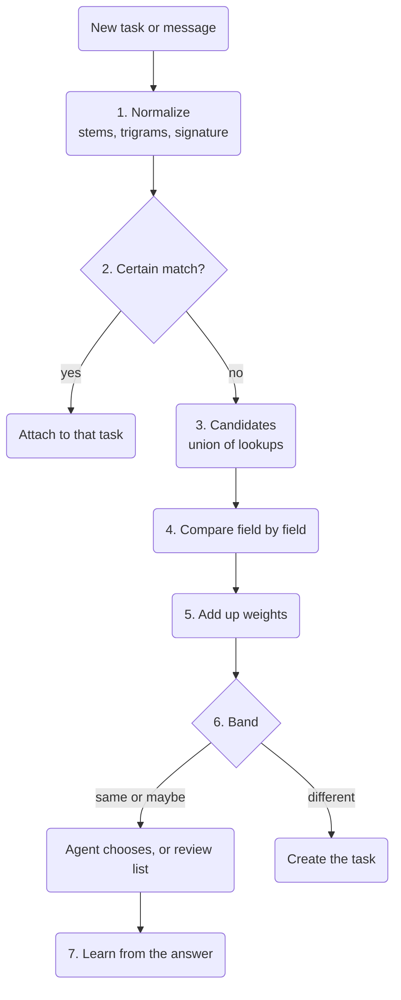

Understand how a task is stored, how it gets its key and how the tool will decide that two tasks
are one. This helps developers and agent authors who read the local store or build on tasks. The data
comes first, then the planned parts: keys per type, claiming and the duplicate check with a worked
example. For everyday use, start with [Tasks](./tasks.md).

The design comes from the approved tasks plan in cli-core
([WireCatLabs/cli-core#1216](https://github.com/WireCatLabs/cli-core/pull/1216)). Each section says
whether it describes what exists now or what is **planned**.

## The data

**Now.** One table, `tasks`, holds every task in the local store. The full column list is in the
[data model](./data-model.mdx#tasks-1).

| What | How it is kept |
| --- | --- |
| Type | `question`, `request`, `mention`, `promise` for tasks found in messages; `bug`, `feature`, `chore` for project tasks |
| Plan | title, description, priority 0 (urgent) to 4 (low), due time, next check time, parent task |
| State | `open`, `done` or `dismissed`, with who closed it and why |
| Source | one message or note locator, never the message text, so a deleted message leaves nothing behind |
| Verdict | `useful` or `not_useful`, as you judged a task an agent raised |
| People | assignments in a role: assignee, reviewer, watcher |
| History | `task_events`: created, status, assigned, due, priority, moved, linked, unlinked |
| Links | `links` rows to messages, chats, people, documents, notes and URLs, with a kind |

Every task belongs to a project. A task found in a message goes to the inbox project of its account;
a project task goes to a project you made. A link to a message has the kind `related-to`, `evidence`
or `created-from`. A relation between two tasks is also a `links` row, with the kind `blocked-by`,
`follow-up-of` or `related-to`. Relations work only between tasks of your own projects, and only
you apply them. Before a `blocked-by` or `follow-up-of` row is written, a recursive query checks
that it does not close a loop.

**Planned.** New fields: `category`, labels, `claimed_by`, `claimed_until`. New relation kinds:
`duplicate-of` and `discovered-from`. Two new full-text tables, `task_words` and `task_stems`,
built like the ones for notes. Every category change becomes a `task_events` row of kind
`category`.

## Ids and keys

**Now.** A project task has a key made of the project key and a number: `HRB-12`. The number comes
from a counter on the project row, taken in the same write as the insert:

```sql
UPDATE projects SET tasks_count = tasks_count + 1 WHERE id = ? RETURNING key, tasks_count
```

A task found in a message has an internal id (a UUID) and a key from its account's inbox project.
`tasks list` shows the start of the id; `tasks show` and `tasks agenda` show the key.

**Planned.** A task found in a message gets a key per type: `Q-15` question, `REQ-22` request,
`M-7` mention, `PR-4` promise. Each type has its own counter row, taken in the same write as the
insert, as for projects. `task:<key>` and `task:<uuid>` both resolve. The category is a field, not
part of the key, so correcting a category never breaks a key quoted in a chat or a note.

**Why not hash ids.** [beads](https://github.com/gastownhall/beads) uses hash ids such as `bd-a3f8`
that grow longer as the database grows ([`internal/idgen/hash.go`](https://github.com/gastownhall/beads/blob/main/internal/idgen/hash.go)).
Hashes solve many writers on many copies that merge later. Here there is one store per computer
and one writer at a time, so a counter gives short keys a person can read. If stores ever sync
between devices, keys get a device prefix; that is a later decision.

## Claiming (planned)

Two agents, or an agent and you, must not work on one task at the same time. `tasks claim` runs one
statement inside `BEGIN IMMEDIATE`:

```sql
UPDATE tasks SET claimed_by = ?, claimed_until = ?
WHERE id = ? AND status = 'open' AND (claimed_by IS NULL OR claimed_until < ?)
RETURNING id
```

No row back means that someone else holds the task; the error names who and until when. SQLite
lets one writer in at a time across processes, so the claim is atomic between `tg`, `max`, `memo`
and agents on the same computer. The claim is a **lease**: it ends by itself (30 minutes by default),
so a crashed agent never holds a task forever. `tasks release` gives it back early; closing a task
releases it. `tasks agenda` hides tasks claimed by someone else unless `--claimed` asks for them.

## The duplicate check (planned)

The check runs on every new task and on every new message linked to a task. It runs in cli-core, on
SQLite, with no embeddings and no call to an AI provider.



In words: the new task is normalized; a certain match attaches it at once; otherwise a set of
candidates is collected, each candidate is compared field by field, the weights are added up, and
the total decides: create, or ask. Each answer is kept to tune the weights later.

### 1. Normalize

- The title and the description go through the search normalizer: lower case, no diacritics,
  `ё` becomes `е`, digit groups are joined (`15 000` becomes `15000`).
- A Snowball stemmer for each script (Russian, English, Spanish) reduces each word to its stem;
  stop words are removed. The result is the **stem set**.
- The normalized title is also cut into **character trigrams**, every window of three letters. They
  catch typos and forms that a stemmer misses.
- Patterns extract the **signature**: an amount with its currency (a number beside `₽`, `руб`, `€`,
  `$`, `usd`), a due date (dates and phrases such as `by Friday` or `до пятницы`) and the person
  (`person:<id>` of the source message's sender, through `identities`). An agent can pass them
  itself (`--amount`, `--due`, `--person`).

The stems and the normalized text go to `task_words` and `task_stems`, kept by the same writes.

### 2. Certain matches

These attach the message to an existing task with no score:

1. The new message **replies to** a message already linked to an open task (the messenger's own
   reply link).
2. The **same rule on the same message**: a unique index on source and rule.
3. The **same normalized title for the same person** on an open task.

Nothing new is created, and the answer says which task and why.

### 3. Candidates

The candidates are the union of cheap lookups:

```sql
SELECT task_id FROM task_stems
WHERE task_stems MATCH '<stems joined by OR>'
ORDER BY bm25(task_stems) LIMIT 20
```

plus tasks of the same person, of the same category and on the same reply chain, all plain indexed
queries. Only open tasks, or tasks closed in the last 14 days, count. The union is about 40 tasks at
most. [`bm25()`](https://www.sqlite.org/fts5.html#the_bm25_function) is the ranking function of
SQLite FTS5.

Two rules keep good candidates in:

- **The same chat alone never makes a candidate.** A chat holds many unrelated tasks, and one request
  can arrive in a group and in a private chat.
- **One lookup alone is never the gate.** Graphiti lost exact duplicates because it took candidates
  from one search with a cut-off ([getzep/graphiti#1734](https://github.com/getzep/graphiti/issues/1734)).

### 4. Compare field by field

| Field | Comparison | Levels |
| --- | --- | --- |
| Text | Jaccard (shared items divided by all distinct items) on the stem sets of title and description, and on the title trigrams; the higher value counts | 0.6 or more · 0.3 to 0.6 · under 0.3 |
| Person | `person:<id>` | same · different · unknown |
| Amount | value and currency | equal · different · missing |
| Category | name | same · different |
| Due date | days apart | 2 or fewer · more · missing |
| Reply chain | the source messages reply to one another | yes · no |
| Time | days between the two tasks | 3 or fewer · 4 to 14 · more |

### 5. Add up the weights

The score follows the Fellegi–Sunter model of record linkage. Each level has a weight
`log2(m / u)`. Here `m` is how often true duplicates show that level, and `u` is how often unrelated
tasks show it. A level that duplicates usually share pushes the sum up; a level they rarely share
pushes it down. The [Splink guide to the Fellegi–Sunter model](https://moj-analytical-services.github.io/splink/topic_guides/theory/fellegi_sunter.html)
explains the method.

The starting weights are set by hand. They are tuned on a synthetic test set before they decide
anything:

| Level | Weight |
| --- | --- |
| Text: 0.6 or more / 0.3 to 0.6 / under 0.3 | +4 / +2 / −2 |
| Person: same / different / unknown | +3 / −3 / 0 |
| Amount: equal / different / missing | +3 / −4 / 0 |
| Category: same / different | +1 / −1 |
| Due date: 2 days or fewer / more / missing | +1 / −1 / 0 |
| Reply chain: yes / no | +6 / 0 |
| Time: 3 days or fewer / 4 to 14 days / more | +1 / 0 / −1 |

The plan gives no weight for "reply chain: no" and "time: 4 to 14 days"; this page counts them as 0.
Bands: **8 or more is "same", 3 to 7 is "maybe", under 3 is "different".** Weights and bands live in
one module, with the reason for each number; nothing else hard-codes them.

### 6. Decide

| Band | Task added by an agent | Task opened by a rule |
| --- | --- | --- |
| Certain (step 2) | linked to the task, nothing new | the same |
| Same | listed first; the agent must choose | to the review list; no score merges on its own yet |
| Maybe | `tasks add` refuses and lists up to 5 candidates with score and reasons; the agent repeats with `--attach <task>` or `--new` | to the review list |
| Different | created | created |

The tool refuses instead of warning: an agent can skip a warning, but not an exit code. Asking the
agent that creates the task costs no extra call to an AI provider, because that agent is already the
judge. Mem0 works the same way: the agent that writes a memory chooses to add it, update an
existing one, delete one or do nothing
([Mem0, arXiv 2504.19413](https://arxiv.org/abs/2504.19413)).

**The review list.** `tasks duplicates` lists the pairs a rule left in "same" or "maybe", newest
first, with reasons. `tasks merge <dup> --into <task>` links every message of the duplicate to the
kept task, closes the duplicate as `dismissed` with a `duplicate-of` relation, and records the
decision. `tasks duplicates reject <dup> <task>` records "not the same", so the pair does not come
back.

**A merge can be undone.** `tasks unmerge <dup>` reopens the duplicate and removes the relation. Links
stay where they are until they are moved. A merge never deletes anything.

### 7. Learn from answers

Every merge, rejection, `--attach` and `--new` after a candidate list is a labelled pair. With
enough pairs, `m` and `u` for each level are counted again from them, the same counting estimate
that Splink uses, with no training step. Then the "same" band may start to merge on its own, rule
pairs first. Until you allow it, only the certain matches of step 2 merge without a person.

## A worked example

Bob Sample writes in a private chat: "Can you send the invoice for 15 000 ₽ by Friday?" A rule
opens a request. Before it is created, the check finds two candidates from Bob Sample:

- **REQ-22**, made yesterday: "Send the invoice for 15000 ₽", category `money`, no due date.
- **REQ-19**, made 10 days ago: "Send the contract invoice, 40 000 ₽", category `money`, no due date.

The new task's stems are `send`, `invoic`, `15000`, `friday`. In this example the trigram value is
lower than the stem value for both pairs, so the stem value counts.

| Field | REQ-22 | Points | REQ-19 | Points |
| --- | --- | --- | --- | --- |
| Text | stems `send`, `invoic`, `15000`: 3 shared of 4 distinct = 0.75 | +4 | stems `send`, `contract`, `invoic`, `40000`: 2 shared of 6 distinct = 0.33 | +2 |
| Person | same | +3 | same | +3 |
| Amount | 15000 ₽ = 15000 ₽ | +3 | 15000 ₽ ≠ 40000 ₽ | −4 |
| Category | `money` = `money` | +1 | `money` = `money` | +1 |
| Due date | missing on REQ-22 | 0 | missing on REQ-19 | 0 |
| Reply chain | no | 0 | no | 0 |
| Time | 1 day | +1 | 10 days | 0 |
| **Total** | | **12: same** | | **2: different** |

A rule found this request, so the tool creates it as REQ-23 and puts the pair REQ-23 and REQ-22 on
the review list; no score merges on its own yet. `tasks merge REQ-23 --into REQ-22` then joins them.
If an agent had added the task, `tasks add` would refuse, show REQ-22 first with 12 points and
"same person, same amount, 3 of 4 stems shared", and the agent would repeat with `--attach REQ-22`.
REQ-19 shares the person and the words "send invoice", but the amount pulls it down: it is another
job.

## Compared with beads

[beads](https://github.com/gastownhall/beads) is an issue tracker for coding agents. Some of its ideas
are taken here, some are not.

| beads | Here |
| --- | --- |
| Hash ids `bd-a3f8` | Readable keys from a counter: one store, one writer at a time |
| [Labels](https://github.com/gastownhall/beads/blob/main/docs/core-concepts/labels.md) for everything that is not a field | One category from a fixed list, plus free labels |
| Edge types such as `duplicates` and `discovered-from` | `duplicate-of` and `discovered-from` join the relation kinds |
| `bd ready`: open, unblocked work | `tasks agenda`, with `--category` and `--label` planned |
| `bd update --claim`: an atomic claim | `tasks claim`, a lease that ends by itself |
| `external_ref` to one outside item | Every task links to all of its messages |
| `bd duplicates` merges exact copies; `bd find-duplicates` scores word overlap and only reports | A check before creating, field weights, and a review list |

Chat text is never an exact copy of itself, and nothing in beads checks before a task is created.
That is why the check here works on fields and asks when it is not sure.

## Related work

Duplicate bug reports are an old problem. REP scores two bug reports by their text and by fields
such as product and component, with weights tuned on known duplicates
([Sun et al., ASE 2011](https://doi.org/10.1109/ASE.2011.6100061)). The check here uses the same idea
of text plus fields, with weights that are counted, not trained.

## What is not done

- **No embeddings and no call to an AI provider** to compare tasks. If the test set shows that the
  text field is too weak, a local embedding is the next step, measured against this check.
- **No deletes.** A duplicate is closed and linked; it is never removed.
- **No limit of one task per chat or per person.**
- **No hash ids**, until stores sync between devices.
- **Open questions:** the default category list, and whether a message that matches a task closed in
  the last 14 days reopens it or opens a new task linked `follow-up-of`.
