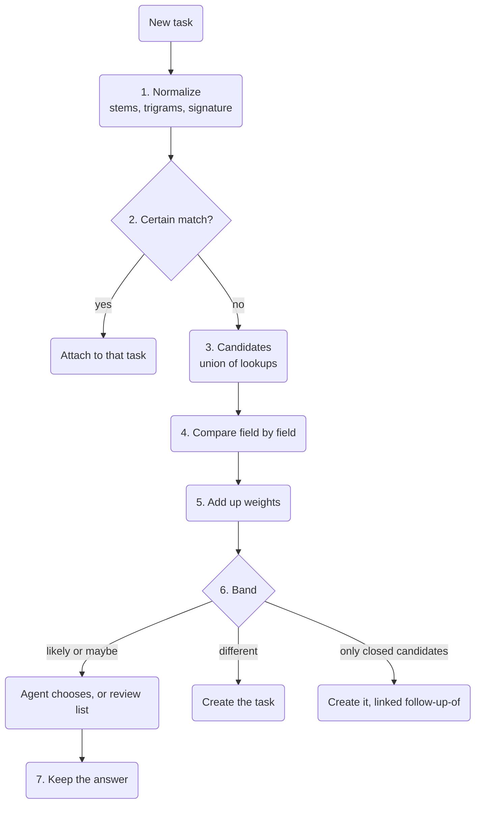

Understand how a task is stored, how it gets its key and how the tool finds tasks that may be
the same. This helps developers and agent authors who read the local store or build on tasks. The data
comes first, then keys per type, claiming and the duplicate check with a worked example. For everyday
use, start with [Tasks](./tasks.md).

The design comes from the approved tasks plan in cli-core
([WireCatLabs/cli-core#1216](https://github.com/WireCatLabs/cli-core/pull/1216)). All of it is built
in cli-core except the parts marked **not built yet**. `tg` and `max` have all of it, except that only `tg` reads the category list from the shared settings file,
opens tasks in a group only for what is addressed to the owner (and every question in a group tagged `watch-tasks`), has assignees on tasks
found in messages, and compares two tasks from one message by their own words. `max` names the history scan `tasks apply`; in `tg` it is `tasks scan`. `memo` lacks agent closes by certainty, follow-ups, the list of 59 categories with its unlisted categories, and duplicate checks that read linked messages; it has categories
(`tasks plan --category`, `category:`), tags and the duplicate check in `tasks add`, but not yet
`tasks categories`, claims, `tasks related`, `tasks duplicates` or `tasks merge`.

## The data

One table, `tasks`, holds every task in the local store. The full column list is in the
[data model](./data-model.mdx#tasks-1).

| What | How it is kept |
| --- | --- |
| Type | `question`, `request`, `mention`, `promise` for tasks found in messages; `bug`, `feature`, `chore` for project tasks |
| Plan | title, description, priority 0 (urgent) to 4 (low), due time, next check time, parent task |
| State | `open`, `done` or `dismissed`, with who closed it and why; an agent's close keeps its certainty, and an unsure one stays on the open task as a close suggestion |
| Source | one message or note locator, never the message text, so a deleted message leaves nothing behind |
| Verdict | `useful` or `not_useful`, as you judged a task an agent raised |
| People | assignments in a role: assignee, reviewer, watcher |
| History | `task_events`: created, status, assigned, due, priority, moved, linked, unlinked |
| Links | `links` rows to messages, chats, people, documents, notes and URLs, with a kind |

Every task belongs to a project. A task found in a message goes to the inbox project of its account;
a project task goes to a project you made. A link to a message has the kind `related-to`, `evidence`
or `created-from`. A relation between two tasks is also a `links` row, with the kind `blocked-by`,
`follow-up-of` or `related-to`. You apply these between tasks of your own projects. The duplicate check
also writes `follow-up-of` between tasks found in messages, from a new task to a task closed in the last
14 days ([step 6](#6-decide)). Before a `blocked-by` or `follow-up-of` row is written, a recursive query checks
that it does not close a loop.

A task also has a `category` and a claim (`claimed_by`, `claimed_until`). A task is one more
taggable type in the `taggings` table, so the `tags` commands and filters work on tasks. Two more
relation kinds exist: `duplicate-of`, which joins two tasks found in messages of one account, and
`discovered-from`. Two full-text tables, `task_words` and `task_stems`, hold each task's title and
description, built like the ones for notes. Every category change is a `task_events` row of kind
`category`. The table `task_pairs` keeps each pair of tasks that may be one job and what was decided
about it. Store version 17 adds the close columns: `close_certainty`, and for a close suggestion
`close_suggested_as`, `close_suggested_by_type`, `close_suggested_by_id`, `close_suggested_certainty`,
`close_suggested_reason` and `close_suggested_at`.

## Ids and keys

A project task has a key made of the project key and a number: `HRB-12`. The number comes
from a counter on the project row, taken in the same write as the insert:

```sql
UPDATE projects SET tasks_count = tasks_count + 1 WHERE id = ? RETURNING key, tasks_count
```

A task found in a message has an internal id (a UUID) and a readable key per type: `Q-15` question,
`REQ-22` request, `M-7` mention, `PR-4` promise. Each type has its own counter row, taken in the same
write as the insert, as for projects. Tasks made before keep their key from the account's inbox
project: `IN`, 8 hexadecimal characters and a number, such as `IN1A2B3C4D-17`. The UUID and both
kinds of key resolve as `task:<…>`. `tasks show` and `tasks agenda` show the key. The category is a field, not
part of the key, so correcting a category never breaks a key quoted in a chat or a note.

**Why not hash ids.** [beads](https://github.com/gastownhall/beads) uses hash ids such as `bd-a3f8`
that grow longer as the database grows ([`internal/idgen/hash.go`](https://github.com/gastownhall/beads/blob/main/internal/idgen/hash.go)).
Hashes solve many writers on many copies that merge later. Here there is one store per computer
and one writer at a time, so a counter gives short keys a person can read. If stores ever sync
between devices, keys get a device prefix; that is a later decision.

## Claiming

Two agents, or an agent and you, must not work on one task at the same time. `tasks claim` runs one
statement inside `BEGIN IMMEDIATE`:

```sql
UPDATE tasks SET claimed_by = ?, claimed_until = ?, updated_at = ?
WHERE id = ? AND status = 'open' AND (claimed_by IS NULL OR claimed_until < ? OR claimed_by = ?)
RETURNING id
```

No row back means that someone else holds the task; the error names who and until when. The holder
can claim again to extend its own claim. SQLite
lets one writer in at a time across processes, so the claim is atomic between `tg`, `max`, `memo`
and agents on the same computer. The claim is a **lease**: it ends by itself (30 minutes by default),
so a crashed agent never holds a task forever. `tasks release` gives it back early, and the owner
may release any claim; closing a task releases it. `tasks agenda` shows each task's holder and hides
tasks claimed by someone else unless the query asks for them with `claimed:any`. MCP has `tasks_claim` and
`tasks_release`.

**The holder** is one agent session, so two sessions of one agent do not share a claim. The first
that is set wins: `--holder <name>`, the `WIRECAT_HOLDER` variable, `claude-code:<session id>` from
`CLAUDE_CODE_SESSION_ID` (Claude Code sets it in every process it starts), the agent's name from
`AI_AGENT`, then `owner`. An agent with no environment, such as a web agent, passes its chat id with
`--holder`.

## Agent closes

Both `tg` and `max` support agent closes by certainty.

A close cannot be undone (only `tasks unmerge` reopens a task, and only one a merge closed), so a close
that an agent is unsure of waits for the owner. `tasks close` tells an agent from the owner as
`mentions confirm` does: an agent when `AI_AGENT` or `CLAUDECODE` is set, otherwise the owner.
`--as-owner` closes as the owner from an agent's terminal. MCP `tasks_close` is always an agent.

An agent must pass `--certainty <0..1>` (MCP: `certainty`); without it the close is refused with
`task.certainty-required`. Two store-wide settings decide what happens, kept in the store, not in a
profile, because rules and closes in `tg`, `max` and `memo` must agree:

| Setting | Default | What it does |
| --- | --- | --- |
| `task_agent_close` | `on` | `off` makes every agent close a suggestion |
| `task_agent_close_min` | `0.8` | the least certainty that closes the task |

At or above the threshold, with agent closes on, the task closes and keeps `close_certainty`. Otherwise
the answer has `state: open` and `close_suggestion`: as, by (the agent's name), certainty, reason and
time. The claim is released. `tasks agenda` lists the task with the reason `close-suggested`, and
`tasks list close:suggested` finds it. The owner confirms with `tasks close <task>` (`--as` may be left
out; the suggestion's state and reason are taken) or refuses with `tasks reject <task>`. A later
suggestion replaces the earlier one, and every suggestion is a `close-suggestion` event.

Why 0.8: agents rate themselves high and in coarse steps, so the line falls where "probably" ends and
"maybe" begins. Higher, every close lands on the owner; lower, a hedged close passes. The rule that
closes a question the owner answered is not an agent close: it saw the owner's reply, and it closes
with no certainty.

## Categories

The category list is one list for every tool, not one per profile or per app, because the rules run in
`tg`, `max`, `memo` and `messages sync` and must agree. `tg` reads the owner's changes from a shared
settings file, `~/.config/WireCat/config.json` (on Windows, `%APPDATA%\WireCat\Config\config.json`),
section `task_categories`. The section holds only changes on top of the default list:
`"<name>": "<meaning> | <words>"` adds or replaces a category (a new one goes before `other`), and `null`
drops a default one, so categories a later release adds still arrive. The owner edits the file or uses
these commands, which write the same file and keep its other keys:

| Command | What it does |
| --- | --- |
| `config set task_categories.<name> "<meaning> \| <words>"` | adds or replaces a category; a word may name its language (`es:vuelo`), otherwise Cyrillic reads as Russian and the rest as English |
| `config unset task_categories.<name>` | removes a category; `other` cannot be removed |
| `config unset task_categories` | drops the section and goes back to the default list |
| `config show` | lists the categories with the other settings; `from` names the file for the categories it changes |

The file is read only where a category is needed (rules, `tasks add`, `plan`, `categories`, `agenda`
and `config show`), and read again only when it changed. A file that is not valid JSON, or names a bad
category, is refused with its path; the list never falls back to the default without a word. A store
moved by `MESSAGING_STORE` reads the `config.json` beside it, and `WIRECAT_CONFIG_DIR` moves the file,
so a test never reads the owner's file.

`tasks add` needs a category from the list (MCP `tasks_add` needs `category`), and an unknown name is
refused with the list. A rule matches the source message's stems against each category's words: the
most hits wins, a tie goes to the earlier category, and no hit is `other`. That is why the list is
ordered narrow first, the generic actions (`money`, `documents`, `meeting`) after them, and `work` and
`personal` last. An `es:` word also matches by its Spanish stem when the message reads as Spanish: an
accent, `ñ`, `¿` or `¡`, or a word such as `la`, `que` or `para`. A list holds up to 80 categories. `tasks categories` (MCP `tasks_categories`) prints the list
with meanings and words. `tasks agenda category:<name> tag:<name>` filters the agenda with query fields (MCP `tasks_agenda` takes them in `query`). Changing the
list does not change the category of existing tasks.

Before `tg` read the file, the list was saved in the store (`store_settings`). Such a saved list is
still the base under the file's changes until the next `config set` or `unset` of a category moves it
into the file and drops it from the store. `max` and `memo` do not read the file yet: they use a list
saved in the store, or the default list of the tool that opens the store. So after `tg` moves a saved
list into the file, `max` and `memo` use their own default list. `tasks categories` (MCP
`tasks_categories`) names the file in `file`. A category that left
the list while tasks still carry it is named: `tasks categories` lists it under `unlisted` with open and
total task counts (MCP `tasks_categories` too), a `config set` or `unset` of `task_categories` ends its
note with the same lines, and `tasks agenda` names the ones open tasks carry (`unlisted_categories`).
`tasks list category:<name>` finds their tasks, and `tasks plan <task> --category <name>` moves one.

The default list in `tg` and `max`:

| Category | Meaning |
| --- | --- |
| `taxes` | tax returns, the accountant, the tax office |
| `investments` | stocks, funds, crypto, a broker |
| `subscriptions` | a service subscription to start, cancel or renew |
| `bills` | a recurring bill: utilities, phone, internet |
| `donations` | a donation, a fundraiser, a charity |
| `insurance` | an insurance policy or claim |
| `bank` | cards, bank accounts, wire transfers, a bank's request |
| `civic` | voting, a petition, a census, jury duty, the local council |
| `government` | a visa, residence, a permit, an appointment at a public office |
| `legal` | a lawyer, a notary, a court or a dispute |
| `hiring` | candidates, interviews, job offers |
| `sales` | leads, deals, quotes |
| `partners` | a partnership or an integration with another company |
| `support` | a user's or customer's problem to solve |
| `security` | a hacked account, a scam, 2FA, a leak or breach |
| `access` | a login, password, key, invite or permission to give or get |
| `tech` | code, servers, bugs, builds, deploys |
| `media` | the press, a journalist, a podcast or an interview for the media |
| `marketing` | campaigns, ads, SEO, newsletters, social media |
| `design` | UI, mockups, a logo or a brand to design or review |
| `research` | research, a survey, an analysis or a benchmark |
| `content` | posts, articles, videos to write, film or review |
| `vendors` | a supplier, contractor or agency you pay for a service |
| `car` | the car: repairs, parking, fines, inspection |
| `travel` | flights, trains, hotels, trips |
| `pets` | a pet: the vet, food, a sitter, walks |
| `fitness` | the gym, training, a sport |
| `beauty` | a haircut, nails, cosmetics, a salon |
| `health` | doctors, prescriptions, medicines |
| `education` | courses, books, languages, studies at school or university |
| `celebrations` | a birthday, wedding, anniversary or holiday to plan or mark |
| `childcare` | a nanny, a babysitter, kindergarten, kids' clubs |
| `elder-care` | care for an older relative: a carer, a care home |
| `family` | kids, school, parents and relatives |
| `real-estate` | buying, selling or letting a property; a mortgage |
| `moving` | moving house: movers, boxes, a new address |
| `home` | the flat: repairs, rent, the landlord, neighbours |
| `delivery` | a parcel, order or courier to send, track or collect |
| `devices` | a phone, laptop or gadget to buy, fix or set up |
| `food` | groceries, cooking, a restaurant |
| `shopping` | things to buy |
| `hobbies` | a hobby: music, photography, crafts, a game you play |
| `entertainment` | films, series, concerts, games, shows |
| `events` | an event, tickets, a venue, an RSVP |
| `religion` | church, a service, a religious holiday or rite |
| `community` | a group or club you run or help: members, moderation, admin work |
| `intro` | introduce people, or ask for an introduction |
| `money` | pay, invoice, refund, a price or a debt |
| `documents` | a contract, scan, form or signature to send or receive |
| `admin` | office admin: supplies, errands, paperwork with no closer area |
| `meeting` | a call, meeting or appointment to arrange or attend |
| `clients` | a client's request, a proposal, a client follow-up |
| `projects` | deliverables, deadlines, launches |
| `team` | colleagues, reviews, one-to-ones, time off |
| `follow-up` | you wait for someone: chase them |
| `reply` | someone waits for your answer |
| `work` | a job task with no closer category |
| `personal` | friends, gifts, favours |
| `other` | none of the above |


## Where the rules open tasks

A task is what the owner must do or what someone owes the owner, not every question in every chat. In
`tg`, the rules open tasks by the kind of chat:

| Chat kind | What opens a task |
| --- | --- |
| One-to-one chat | every question the owner did not answer, and a mention of the owner |
| Group, and a chat whose kind the store does not know | only a question (a message with `?`) that replies to the owner's message, and a mention of the owner |
| Group tagged `watch-tasks` | every question the owner did not answer, whoever it is for, and a mention of the owner |
| Channel, Saved Messages | nothing |

The tag is an ordinary chat tag: `tags add --chat <group> watch-tasks`. It changes nothing in a
one-to-one chat or a channel. `review`, `serve`, the pass on sync and `tasks scan` all read it. A rule
closes a task only in a chat where it may open one. In `max`, every question the owner did not answer
opens a task, in any chat.

Why: on a real store, the newest 300 posts of one channel would have opened 85 tasks under the
earlier rule, which opened a task for any unanswered question in any chat. Now a channel opens none.

## Assignees

In `tg`, a task found in a message can name who should do it, through the same assignment rows as
project tasks (role `assignee`). An open task with an assignee is what that person owes the owner.

| Command | What it does |
| --- | --- |
| `tasks add <message> … --assignee sender` | the person who sent the task's message |
| `tasks add <message> … --assignee person:<id>` | a named person; several values name several people |
| `tasks plan <task> --assignee none` | removes the assignees |
| `tasks list "assignee:any state:open"` | open tasks with any assignee: what others owe the owner |
| `tasks list assignee:none`, `tasks list assignee:person:<id>` | tasks with no assignee, or one person's tasks |

MCP `tasks_add` and `tasks_plan` take `assignee`, and the task card prints each assignee. When the
store knows no person for the sender, `--assignee sender` leaves the task unassigned instead of
refusing it: a task with no assignee is better than a missed one.

## Rules on sync

`messages sync` runs the task rules over the chats it stored into, from a stop point per account kept
in the store. The first pass reads only chats with a message in the last 14 days, so a store with
years of chats opens no task for an old question. The answer carries `tasks: {added, closed, review}`;
`review` counts the new tasks whose candidates went to the review list. A failed pass is a note, never
a failed sync. Nothing is attached on its own beyond a certain match (step 2 below).

In `tg` and `max`, the first pass of an account also opens at most `task_first_pass_per_chat` tasks
per chat, the newest first; the default is 0. A first sync reads history, and which chats are worth
turning into tasks is the owner's choice. The tasks it held back are counted in `tasks` as `held`, in
`held_chats` chats, and a note names `tasks scan` (`tasks apply` in `max`). In `tg`, `held` does not
count a chat where the rules open nothing, such as a channel. Closes still run: a question the owner answered closes its open
task. The setting is store-wide, kept in `store_settings` like the agent-close settings, a whole number
from 0 to 1000; `config unset task_first_pass_per_chat` goes back to 0.

In `tg` and `max`, after the first pass, a pass skips a chat where nothing was sent since the stop point. A sync that
fetches old history into a quiet chat therefore opens no task for a question asked months ago.

**`tasks scan <chat...>`** (MCP `tasks_scan`, permission key `tasks.scan`) runs the same rules over the newest stored messages
of each named chat: 50 by default, `--last` up to 1000 (MCP `last`). It reads only the local store.
Without the global `--yes` (MCP `yes`) it changes nothing and lists, per chat, the messages read and
each task that would open, with its source, type and category; with it, the tasks open through the
duplicate check, as on a sync, and answered questions close. A message that already has a task is not
listed again. The MCP tool's description tells an agent to ask the owner before it builds a chat's
tasks. In `max` the command is still `tasks apply` (MCP `tasks_apply`); `tg` keeps no old name.

| Command | What it does |
| --- | --- |
| `tasks scan <chat>` | lists the tasks the rules would open from the newest 50 stored messages |
| `tasks scan <chat> --last 300 --yes` | opens them from the newest 300 |
| `config set task_first_pass_per_chat <n>` | lets an account's first pass open up to n tasks per chat |

## The duplicate check

The check runs on every new task. It runs in cli-core, on SQLite, with no embeddings and no call to
an AI provider. `tasks related <task>` (MCP `tasks_related`)
runs steps 3 to 5 for one stored task and prints the result; it changes nothing.



In words: the new task is normalized; a certain match attaches it at once; otherwise a set of
candidates is collected, each candidate is compared field by field, the weights are added up, and
the total decides: create, or ask. When the only likely or maybe candidates are tasks closed in the
last 14 days, the task is created as their follow-up. A score never merges two tasks; an agent or a person decides.
Each answer is kept, so the weights can be tuned later.

**The messages a task stands on.** A task is compared through views: its title and description,
and the same text plus one message, for its source message and each of its 5 newest linked messages
(kinds `related-to`, `evidence` or `created-from`; not `answered-by`, the owner's own answer). Two
tasks score as their best pair of views, each view taken whole, so text, person, amount and due date
come from the same message. A message can raise a pair's score, never lower it. A message's amount and
due date count only when the task's own text has none, and its "tomorrow" is read from when it was
sent. Messages are read from the store at compare time; a task stores no message text.

**Two tasks from one message.** In `tg`, when two tasks have the same source message, such as a
promise and a request an agent took from one long message, they are compared by their own title and
description only. The shared message would make two different jobs look like one.

**Time is message time.** In `tg` and `max`, the time field and the reading of "tomorrow" in a task's own text
use when its source message was sent, not when the task was written. An agent that goes through history
writes many tasks within minutes; compared by write time, every pair looked "created together" (+2) and
"tomorrow" in each meant the same day (+4). A task with no source message keeps its creation time.

**After a link.** `tasks link <task> msg:…` (MCP `tasks_link`), `tasks add --into` and `tasks merge`
run the check again for the task that got the message. New likely or maybe pairs go to the review
list, with the newer task as the would-be duplicate, and the answer's `review` counts them. The link
always stands, nothing merges on a score, and a closed task is not checked.

### 1. Normalize

- The title and the description go through the search normalizer: lower case, no diacritics,
  `ё` becomes `е`, digit groups are joined (`15 000` becomes `15000`).
- A Snowball stemmer for each script (Russian, English, Spanish) reduces each word to its stem;
  stop words are removed. The result is the **stem set**.
- The normalized title is also cut into **character trigrams**, every window of three letters. They
  catch typos and forms that a stemmer misses.
- Patterns extract the **signature**: an amount with its currency (a number beside `₽`, `руб`, `€`,
  `$`, `usd`), a due date (dates and phrases in English, Russian and Spanish, such as `by Friday`,
  `до пятницы` or `el viernes`) and the person
  (`person:<id>` of the source message's sender, through `identities`). A due date that an agent
  passes with `--due` is used instead of the one in the text.

The stems and the normalized text go to `task_words` and `task_stems`. Digit groups are joined and
stop words are left out. A task write queues the task, and the next lookup indexes it, as for
notes.

### 2. Certain matches

Only one match attaches with no score: the **same message** already has a task of that type. Nothing
new is created, and the answer shows that task (`created: false`). A rule also opens no task for a
message that is linked to a task as `evidence`, which is what `--into` and `tasks merge` write.

A reply and the same title were certain matches in the first draft. On the test set they were wrong
6 times in 11: a reply that adds a new request, another person's "+1", the same title for a
different job. Now a reply is a weighted field (step 4), and the same title is only a high text
score.

### 3. Candidates

The candidates are the union of cheap lookups:

```sql
SELECT task_id FROM task_stems
WHERE task_stems MATCH '<stems joined by OR>'
ORDER BY bm25(task_stems) LIMIT 20
```

plus tasks of the same person, of the same category and on the same reply chain, all plain indexed
queries. Only open tasks, or tasks closed in the last 14 days, count. The union is about 40 tasks at
most. [`bm25()`](https://www.sqlite.org/fts5.html#the_bm25_function) is the ranking function of
SQLite FTS5.

Two rules keep good candidates in:

- **The same chat alone never makes a candidate.** A chat holds many unrelated tasks, and one request
  can arrive in a group and in a private chat.
- **One lookup alone is never the gate.** Graphiti lost exact duplicates because it took candidates
  from one search with a cut-off ([getzep/graphiti#1734](https://github.com/getzep/graphiti/issues/1734)).

### 4. Compare field by field

| Field | Comparison | Levels |
| --- | --- | --- |
| Text | Jaccard (shared items divided by all distinct items) on the stem sets of title and description, and on the title trigrams; the higher value counts | 0.6 or more · 0.3 to 0.6 · under 0.3 |
| Person | `person:<id>` | same · different · unknown |
| Amount | value and currency | equal · different · missing |
| Category | name | same · different · unknown |
| Due date | days apart | 2 or fewer · more · missing |
| Reply chain | the source messages reply to one another | yes · no |
| Time | days between the two tasks: in `tg` and `max`, between when their source messages were sent | 3 or fewer · 4 to 14 · more |

### 5. Add up the weights

The score follows the Fellegi–Sunter model of record linkage. Each level has a weight
`log2(m / u)`. Here `m` is how often true duplicates show that level, and `u` is how often unrelated
tasks show it. A level that duplicates usually share pushes the sum up; a level they rarely share
pushes it down. The [Splink guide to the Fellegi–Sunter model](https://moj-analytical-services.github.io/splink/topic_guides/theory/fellegi_sunter.html)
explains the method.

The first weights were set by hand, then tuned on a synthetic test set:

| Level | Weight |
| --- | --- |
| Text: 0.6 or more / 0.3 to 0.6 / under 0.3 | +5 / +5 / −2 |
| Person: same / different / unknown | +1 / −3 / 0 |
| Amount: equal / different / missing | +6 / −4 / 0 |
| Category: same / different / unknown | +1 / −1 / 0 |
| Due date: 2 days or fewer / more / missing | +4 / −1 / 0 |
| Reply chain: yes / no | +6 / 0 |
| Time: 3 days or fewer / 4 to 14 days / more | +2 / −2 / −3 |

No duplicate in the test set had a different person, amount or category, so counting would give
those levels −5 or −6 from no observations. They keep their hand-set values.

Bands: **10 or more is "likely", 5 to 9 is "maybe", under 5 is "different".** "Likely" only puts a
candidate first in the list; nothing merges on a score. Weights and bands live in one module, with
the reason for each number; nothing else hard-codes them.

### What the test set showed

The test set has 251 synthetic Russian and English tasks with 80 duplicate pairs. It uses the real
FTS5 `bm25()` and the cli-core stemmer; the weights were tuned on one half and tested on the other
([WireCatLabs/cli-testing#60](https://github.com/WireCatLabs/cli-testing/pull/60)).

- "Maybe" and "likely" together find 90% of the duplicates. 58% of the pairs they show are true
  duplicates, and 21% of new tasks are refused for a choice.
- "Likely" alone is right 85% of the time and finds 43% of the duplicates.
- **No score is safe for an automatic merge.** The first score with no wrong merge is 16, and it
  catches 4% of the duplicates. The similar pairs that remain, such as a gift for mum and a gift for
  dad with the same amount two days apart, differ in the meaning of one word, which no field sees.

Limits: the data is synthetic, the same author wrote the data and the scorer, and duplicates
across languages are weak (2 of 5 scored "different").

**On real chats.** A later run replayed 148 tasks that an agent drafted from 1,104 real messages of
7 chats ([real chats follow-up](https://github.com/WireCatLabs/cli-testing/tree/main/performance/tasks/duplicates#follow-up-real-chats-2026-10-17)).
Compared by when the tasks were written, `tasks add` refused 74 of them, and "likely" was right 27% of
the time. Compared by when their messages were sent, it refused 36, and "likely" was right 50% of the
time. The weights did not change: 85 labelled pairs are too few to tune them.

### 6. Decide

| Band | Task added by an agent | Task opened by a rule |
| --- | --- | --- |
| Certain (step 2) | nothing new; the answer shows that task (`created: false`) | nothing new |
| Likely | listed first; the agent must choose | created; the pair goes to the review list |
| Maybe | `tasks add` refuses (exit code 2, reason `task.duplicate-candidates`) and lists up to 5 candidates with score and reasons; the agent repeats with `--into <task>` or `--new` | created; the pair goes to the review list |
| Different | created | created |
| Likely or maybe, but closed in the last 14 days | created, linked `follow-up-of` the closed task | created, linked `follow-up-of` the closed task |

The tool refuses instead of warning: an agent can skip a warning, but not an exit code. Asking the
agent that creates the task costs no extra call to an AI provider, because that agent is already the
judge. Mem0 works the same way: the agent that writes a memory chooses to add it, update an
existing one, delete one or do nothing
([Mem0, arXiv 2504.19413](https://arxiv.org/abs/2504.19413)).

**Who reviews.** The owner's ruling: the agent that goes through tasks after `sync` decides each
pair a rule left in "likely" or "maybe". It reads the meaning that the fields miss. The owner sees only
the pairs that agent marks unsure. The agent's merges can be undone like any other.

**The review list.** The pairs live in `task_pairs`. `tasks duplicates` lists the pairs a rule left in
"likely" or "maybe", newest first, with score, band, levels and reasons. `tasks merge <dup> --into
<task>` links every message of the duplicate to the kept task, closes the duplicate as `dismissed`
with a `duplicate-of` relation, and records the decision. `tasks duplicates reject <dup> <task>`
records "not the same", so the pair does not come back. `tasks duplicates defer <dup> <task>` leaves
the pair to the owner, stored as `unsure`, and `tasks duplicates decision:unsure` lists those pairs. MCP has the same tools:
`tasks_duplicates`, `tasks_merge`, `tasks_unmerge`, `tasks_duplicates_reject` and
`tasks_duplicates_defer`.

**Follow-ups.** When every likely or maybe candidate is a task closed in the last 14 days, `tasks add`
opens the task and links it `follow-up-of` the best-scoring closed one (`follow_up_of` in the answer);
a rule does the same. It still refuses while an open task may be the same job, since only an open task
can be the job still waiting. The closed task stays closed, and the pair goes neither to the review list
nor to `task_pairs`: a merge would fold new work into a closed task. `tasks show` and the MCP card list
the link.

**A merge can be undone.** `tasks unmerge <dup>` reopens the duplicate and removes the relation. Links
stay where they are until they are moved. A merge never deletes anything.

### 7. Learn from answers

**Now.** Every merge, rejection, `--into` and `--new` after a candidate list is kept as a labelled
pair in `task_pairs`.

**Not built yet.** With enough pairs, `m` and `u` for each level are counted again from them, the
same counting estimate that Splink uses, with no training step, and the bands move. A score never
merges on its own. If real answers show that you almost always accept "likely" pairs, merging them is
your decision.

## A worked example

Bob Sample writes in a private chat: "Can you send the invoice for 15 000 ₽ by Friday?" A rule
opens a request. Before it is created, the check finds two candidates from Bob Sample:

- **REQ-22**, made yesterday: "Send the invoice for 15000 ₽", category `money`, no due date.
- **REQ-19**, made 10 days ago: "Send the contract invoice, 40 000 ₽", category `money`, no due date.

The new task's stems are `send`, `invoic`, `15000`, `friday`. In this example the trigram value is
lower than the stem value for both pairs, so the stem value counts.

| Field | REQ-22 | Points | REQ-19 | Points |
| --- | --- | --- | --- | --- |
| Text | stems `send`, `invoic`, `15000`: 3 shared of 4 distinct = 0.75 | +5 | stems `send`, `contract`, `invoic`, `40000`: 2 shared of 6 distinct = 0.33 | +5 |
| Person | same | +1 | same | +1 |
| Amount | 15000 ₽ = 15000 ₽ | +6 | 15000 ₽ ≠ 40000 ₽ | −4 |
| Category | `money` = `money` | +1 | `money` = `money` | +1 |
| Due date | missing on REQ-22 | 0 | missing on REQ-19 | 0 |
| Reply chain | no | 0 | no | 0 |
| Time | 1 day | +2 | 10 days | −2 |
| **Total** | | **15: likely** | | **1: different** |

A rule found this request, so the tool creates it as REQ-23 and puts the pair REQ-23 and REQ-22 on
the review list. Nothing merges on the score: the agent that reviews after the sync reads both tasks
and runs `tasks merge REQ-23 --into REQ-22`. If it could not tell, it would mark the pair unsure for
you. If an agent had added the task, `tasks add` would
refuse, show REQ-22 first with 15 points and
"same person, same amount, 3 of 4 stems shared", and the agent would repeat with `--into REQ-22`.
REQ-19 shares the person and the words "send invoice", but the amount and the age pull it down: it
is another job.

## Compared with beads

[beads](https://github.com/gastownhall/beads) is an issue tracker for coding agents. Some of its ideas
are taken here, some are not.

| beads | Here |
| --- | --- |
| Hash ids `bd-a3f8` | Readable keys from a counter: one store, one writer at a time |
| [Labels](https://github.com/gastownhall/beads/blob/main/docs/core-concepts/labels.md) for everything that is not a field | One category from one list per store, plus the existing tags |
| Edge types such as `duplicates` and `discovered-from` | `duplicate-of` and `discovered-from` join the relation kinds |
| `bd ready`: open, unblocked work | `tasks agenda`, with a category and a tag filter |
| `bd update --claim`: an atomic claim | `tasks claim`, a lease that ends by itself |
| `external_ref` to one outside item | Every task links to all of its messages |
| `bd duplicates` merges exact copies; `bd find-duplicates` scores word overlap and only reports | A check before creating, field weights, and a choice by the agent or on a review list |

Chat text is never an exact copy of itself, and nothing in beads checks before a task is created.
That is why the check here works on fields and asks when it is not sure.

## Related work

Duplicate bug reports are an old problem. REP scores two bug reports by their text and by fields
such as product and component, with weights tuned on known duplicates
([Sun et al., ASE 2011](https://doi.org/10.1109/ASE.2011.6100061)). The check here uses the same idea
of text plus fields, with weights that are counted, not trained.

## What is not done

- **Tuning the weights from saved pairs.** The pairs are kept; nothing recounts the weights yet.
- **No embeddings and no call to an AI provider** to compare tasks. If the test set shows that the
  text field is too weak, a local embedding is the next step, measured against this check.
- **No deletes.** A duplicate is closed and linked; it is never removed.
- **No limit of one task per chat or per person.**
- **No hash ids**, until stores sync between devices.
