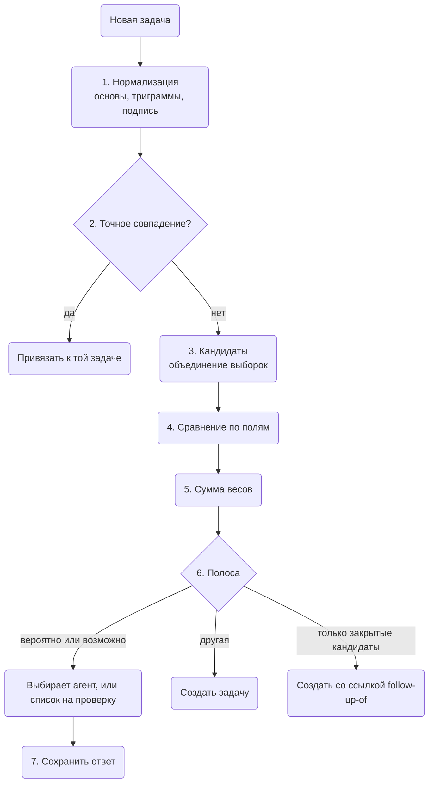

Разберитесь, как хранится задача, откуда берётся её ключ и как инструмент находит задачи,
которые могут быть одной. Это пригодится разработчикам и авторам агентов, которые читают локальное хранилище или
строят что-то поверх задач. Сначала — данные, потом ключи по типам, бронь и проверка на дубликаты с
разобранным примером. Для повседневной работы начните со страницы [Задачи](./tasks.md).

Устройство описано в утверждённом плане задач в cli-core
([WireCatLabs/cli-core#1216](https://github.com/WireCatLabs/cli-core/pull/1216)). Всё это уже есть в
cli-core, кроме частей с пометкой **ещё не сделано**. В `tg` и `max` есть всё это, только `serve` в `max` открывает лишь задачи правил автоответа. В `memo` нет закрытия агентом по уверенности, продолжений, списка из 59 категорий с категориями вне списка и чтения привязанных сообщений при проверке на дубликаты; в нём есть
категории (`tasks plan --category`, `category:`), теги и проверка на дубликаты в `tasks add`, но пока нет
`tasks categories`, брони, `tasks related`, `tasks duplicates` и `tasks merge`.

## Данные

Одна таблица, `tasks`, хранит все задачи локального хранилища. Полный список столбцов —
в [модели данных](./data-model.mdx#tasks).

| Что | Как хранится |
| --- | --- |
| Тип | `question`, `request`, `mention`, `promise` для задач из сообщений; `bug`, `feature`, `chore` для задач проекта |
| План | название, описание, приоритет от 0 (срочно) до 4 (низкий), срок, время следующей проверки, родительская задача |
| Состояние | `open`, `done` или `dismissed`, с тем, кто закрыл и почему; закрытие агентом хранит его уверенность, а неуверенное остаётся на открытой задаче как предложение закрыть |
| Источник | один указатель на сообщение или заметку, никогда не текст сообщения, поэтому удалённое сообщение ничего не оставляет |
| Оценка | `useful` или `not_useful` — как вы оценили задачу, поднятую агентом |
| Люди | назначения с ролью: исполнитель, проверяющий, наблюдатель |
| История | `task_events`: создана, статус, назначена, срок, приоритет, перенесена, привязка, отвязка |
| Привязки | строки `links` к сообщениям, чатам, людям, документам, заметкам и адресам, с видом |

Каждая задача принадлежит проекту. Задача из сообщения попадает во входящий проект своего аккаунта;
задача проекта — в проект, который создали вы. Привязка к сообщению имеет вид `related-to`,
`evidence` или `created-from`. Отношение между двумя задачами — тоже строка `links`, с видом
`blocked-by`, `follow-up-of` или `related-to`. Их устанавливаете вы между задачами своих проектов.
Проверка на дубликаты тоже пишет `follow-up-of` между задачами из сообщений: от новой задачи к задаче,
закрытой за последние 14 дней ([шаг 6](#6-решение)). Перед записью `blocked-by` или `follow-up-of`
рекурсивный запрос проверяет, что новая строка не замыкает цикл.

У задачи есть также `category` и бронь (`claimed_by`, `claimed_until`). Задача — ещё один тип в
таблице `taggings`, поэтому команды и фильтры `tags` работают и на задачах. Есть ещё два вида
отношений: `duplicate-of`, который связывает две задачи из сообщений одного аккаунта, и
`discovered-from`. Две полнотекстовые таблицы, `task_words` и `task_stems`, хранят название и
описание каждой задачи и устроены как таблицы заметок. Каждое изменение категории — строка
`task_events` вида `category`. Таблица `task_pairs` хранит каждую пару задач, которые могут быть одним
делом, и то, что о ней решили. Версия хранилища 17 добавляет столбцы закрытия: `close_certainty`, а для
предложения закрыть — `close_suggested_as`, `close_suggested_by_type`, `close_suggested_by_id`,
`close_suggested_certainty`, `close_suggested_reason` и `close_suggested_at`.

## Идентификаторы и ключи

У задачи проекта есть ключ из ключа проекта и номера: `HRB-12`. Номер берётся из
счётчика в строке проекта, в той же записи, что и вставка задачи:

```sql
UPDATE projects SET tasks_count = tasks_count + 1 WHERE id = ? RETURNING key, tasks_count
```

У задачи из сообщения есть внутренний id (UUID) и читаемый ключ по типу: `Q-15` вопрос, `REQ-22`
просьба, `M-7` упоминание, `PR-4` обещание. У каждого типа своя строка-счётчик, которая берётся в той
же записи, что и вставка, как у проектов. Старые задачи сохраняют ключ из входящего проекта своего
аккаунта: `IN`, 8 шестнадцатеричных символов и номер, например `IN1A2B3C4D-17`. UUID и оба вида
ключей находятся как `task:<…>`. `tasks show` и `tasks agenda` показывают ключ. Категория — поле,
а не часть ключа, поэтому исправленная категория не ломает ключ, уже процитированный в чате или
заметке.

**Почему не хеш-идентификаторы.** [beads](https://github.com/gastownhall/beads) использует
хеш-идентификаторы вроде `bd-a3f8`, которые удлиняются с ростом базы
([`internal/idgen/hash.go`](https://github.com/gastownhall/beads/blob/main/internal/idgen/hash.go)).
Хеши решают задачу многих писателей на многих копиях, которые потом сливаются. Здесь одно хранилище
на компьютер и один писатель за раз, поэтому счётчик даёт короткие ключи, которые человек может
прочитать. Если хранилища когда-нибудь начнут синхронизироваться между устройствами, ключи получат
префикс устройства; это решение на потом.

## Бронь

Два агента или агент и вы не должны одновременно работать над одной задачей. `tasks claim`
выполняет один запрос внутри `BEGIN IMMEDIATE`:

```sql
UPDATE tasks SET claimed_by = ?, claimed_until = ?, updated_at = ?
WHERE id = ? AND status = 'open' AND (claimed_by IS NULL OR claimed_until < ? OR claimed_by = ?)
RETURNING id
```

Если строка не вернулась, задачу держит кто-то другой; ошибка называет кто и до какого времени.
Держатель может забронировать задачу снова, чтобы продлить свою бронь.
SQLite пускает только одного писателя за раз во всех процессах, поэтому бронь атомарна между `tg`,
`max`, `memo` и агентами на одном компьютере. Бронь — это **аренда**: она заканчивается сама (по
умолчанию через 30 минут), поэтому упавший агент не держит задачу вечно. `tasks release` снимает
бронь раньше, а владелец может снять любую бронь; закрытие задачи снимает её тоже. `tasks agenda`
показывает держателя каждой задачи и скрывает задачи, забронированные другими, если не попросить их
полем запроса `claimed:any`. В MCP есть `tasks_claim` и `tasks_release`.

**Держатель** — одна сессия агента, поэтому две сессии одного агента не делят одну бронь. Побеждает
первое, что задано: `--holder <name>`, переменная `WIRECAT_HOLDER`, `claude-code:<session id>` из
`CLAUDE_CODE_SESSION_ID` (Claude Code задаёт её в каждом процессе, который запускает), имя агента из
`AI_AGENT`, затем `owner`. Агент без окружения, например веб-агент, передаёт id своего чата через
`--holder`.

## Закрытие агентом

Закрытие агентом по уверенности поддерживают `tg` и `max`.

Закрытие нельзя отменить (только `tasks unmerge` снова открывает задачу, и только закрытую
объединением), поэтому закрытие, в котором агент не уверен, ждёт владельца. `tasks close` отличает
агента от владельца так же, как `mentions confirm`: агент — когда задана `AI_AGENT` или `CLAUDECODE`,
иначе владелец. `--as-owner` закрывает от имени владельца из терминала агента. MCP `tasks_close` —
всегда агент.

Агент обязан передать `--certainty <0..1>` (в MCP — `certainty`); без неё закрытие отклоняется с
`task.certainty-required`. Что происходит дальше, решают две настройки всего хранилища. Они хранятся
в хранилище, а не в профиле, потому что правила и закрытия в `tg`, `max` и `memo` должны совпадать:

| Настройка | По умолчанию | Что делает |
| --- | --- | --- |
| `task_agent_close` | `on` | `off` делает любое закрытие агентом предложением |
| `task_agent_close_min` | `0.8` | наименьшая уверенность, при которой задача закрывается |

При уверенности не ниже порога и включённых закрытиях агентом задача закрывается и хранит
`close_certainty`. Иначе в ответе `state: open` и `close_suggestion`: как закрыть, кто (имя агента),
уверенность, причина и время. Бронь снимается. `tasks agenda` показывает задачу с причиной
`close-suggested`, а `tasks list close:suggested` находит её. Владелец подтверждает командой
`tasks close <task>` (`--as` можно не указывать: берутся состояние и причина из предложения) или
отклоняет командой `tasks reject <task>`. Более позднее предложение заменяет прежнее, и каждое
предложение — событие `close-suggestion`.

Почему 0.8: агенты оценивают себя высоко и крупными шагами, поэтому граница проходит там, где
кончается «вероятно» и начинается «может быть». Выше — каждое закрытие ложится на владельца; ниже —
проходит закрытие с оговорками. Правило, которое закрывает вопрос, когда владелец ответил, — не
закрытие агентом: оно видело ответ владельца и закрывает без уверенности.

## Категории

Список категорий один для всех инструментов, а не для профиля или приложения: правила работают в
`tg`, `max`, `memo` и `messages sync` и должны совпадать. `tg` и `max` читают изменения владельца из общего
файла настроек `~/.config/WireCat/config.json` (в Windows — `%APPDATA%\WireCat\Config\config.json`),
раздел `task_categories`. В разделе только изменения поверх списка по умолчанию:
`"<name>": "<meaning> | <words>"` добавляет или заменяет категорию (новая встаёт перед `other`), а
`null` убирает категорию по умолчанию, поэтому категории, которые добавит следующий выпуск, всё равно
появятся. Владелец правит файл или пользуется этими командами; они пишут в тот же файл и сохраняют его
другие ключи:

| Команда | Что делает |
| --- | --- |
| `config set task_categories.<name> "<meaning> \| <words>"` | добавляет или заменяет категорию; слово может указать свой язык (`es:vuelo`), иначе кириллица читается как русский, остальное как английский |
| `config unset task_categories.<name>` | удаляет категорию; `other` удалить нельзя |
| `config unset task_categories` | убирает раздел и возвращает список по умолчанию |
| `config show` | показывает категории вместе с другими настройками; `from` называет файл для категорий, которые он меняет |

Файл читается только там, где нужна категория (правила, `tasks add`, `plan`, `categories`, `agenda` и
`config show`), и читается снова, только если он изменился. Файл с неверным JSON или с неверной
категорией отклоняется с указанием его пути; список никогда молча не возвращается к списку по
умолчанию. Хранилище, перенесённое через `MESSAGING_STORE`, читает `config.json` рядом с собой, а
`WIRECAT_CONFIG_DIR` переносит файл, поэтому тест никогда не читает файл владельца.

`tasks add` требует категорию из списка (MCP `tasks_add` требует `category`), а неизвестное имя
отклоняется вместе со списком. Правило сравнивает основы исходного сообщения со словами каждой
категории: побеждает больше совпадений, при равенстве — более ранняя категория, без совпадений —
`other`. Поэтому в списке сначала узкие категории, за ними общие действия (`money`, `documents`,
`meeting`), а `work` и `personal` в конце. Слово с `es:` совпадает и по испанской основе, когда
сообщение читается как испанское: ударение, `ñ`, `¿` или `¡` либо слово вроде `la`, `que` или `para`.
В списке до 80 категорий. `tasks categories` (MCP
`tasks_categories`) печатает список со смыслом и словами. `tasks agenda category:<name> tag:<name>`
фильтрует план полями запроса (MCP `tasks_agenda` принимает их в `query`). Изменение списка не меняет категорию существующих задач.

До того как инструменты стали читать файл, список сохранялся в хранилище (`store_settings`). Такой
сохранённый список остаётся основой под изменениями из файла, пока следующая `config set` или `unset`
для категории не перенесёт его в файл и не уберёт из хранилища. `memo` пока не читает файл: он берёт
список, сохранённый в хранилище, или свой список по умолчанию. Поэтому после того как `tg` или `max`
перенёс сохранённый список в файл, `memo` берёт свой список по умолчанию. `tasks categories` (MCP `tasks_categories`) называет файл в `file`. Категория, которой больше нет в списке, но которая стоит у задач, называется:
`tasks categories` показывает её в разделе `unlisted` с числом открытых задач и всего (MCP
`tasks_categories` тоже), `config set` или `unset` для `task_categories` заканчивает свою заметку
теми же строками, а `tasks agenda` называет те, что стоят у открытых задач (`unlisted_categories`).
`tasks list category:<name>` находит их задачи, а `tasks plan <task> --category <name>` переносит одну.

Список по умолчанию в `tg` и `max`:

| Категория | Смысл |
| --- | --- |
| `taxes` | налоговые декларации, бухгалтер, налоговая |
| `investments` | акции, фонды, криптовалюта, брокер |
| `subscriptions` | подписка на сервис: оформить, отменить или продлить |
| `bills` | регулярный счёт: коммунальные услуги, телефон, интернет |
| `donations` | пожертвование, сбор средств, благотворительность |
| `insurance` | страховой полис или страховой случай |
| `bank` | карты, банковские счета, переводы, запрос банка |
| `civic` | выборы, петиция, перепись, присяжные, местный совет |
| `government` | виза, вид на жительство, разрешение, запись в госучреждение |
| `legal` | юрист, нотариус, суд или спор |
| `hiring` | кандидаты, собеседования, предложения о работе |
| `sales` | лиды, сделки, коммерческие предложения |
| `partners` | партнёрство или интеграция с другой компанией |
| `support` | проблема пользователя или клиента, которую нужно решить |
| `security` | взломанный аккаунт, мошенничество, 2FA, утечка |
| `access` | вход, пароль, ключ, приглашение или права, которые нужно дать или получить |
| `tech` | код, серверы, баги, сборки, выкладки |
| `media` | пресса, журналист, подкаст или интервью для СМИ |
| `marketing` | кампании, реклама, SEO, рассылки, соцсети |
| `design` | интерфейс, макеты, логотип или бренд: сделать или проверить |
| `research` | исследование, опрос, анализ или сравнительный тест |
| `content` | посты, статьи, видео: написать, снять или проверить |
| `vendors` | поставщик, подрядчик или агентство, которому вы платите за услугу |
| `car` | машина: ремонт, парковка, штрафы, техосмотр |
| `travel` | перелёты, поезда, отели, поездки |
| `pets` | питомец: ветеринар, корм, передержка, прогулки |
| `fitness` | спортзал, тренировки, спорт |
| `beauty` | стрижка, маникюр, косметика, салон |
| `health` | врачи, рецепты, лекарства |
| `education` | курсы, книги, языки, учёба в школе или университете |
| `celebrations` | день рождения, свадьба, годовщина или праздник: устроить или отметить |
| `childcare` | няня, детский сад, кружки |
| `elder-care` | забота о пожилом родственнике: сиделка, пансионат |
| `family` | дети, школа, родители и родственники |
| `real-estate` | покупка, продажа или сдача недвижимости; ипотека |
| `moving` | переезд: грузчики, коробки, новый адрес |
| `home` | квартира: ремонт, аренда, хозяин, соседи |
| `delivery` | посылка, заказ или курьер: отправить, отследить или забрать |
| `devices` | телефон, ноутбук или гаджет: купить, починить или настроить |
| `food` | продукты, готовка, ресторан |
| `shopping` | что купить |
| `hobbies` | хобби: музыка, фотография, рукоделие, игра, в которую вы играете |
| `entertainment` | фильмы, сериалы, концерты, игры, шоу |
| `events` | мероприятие, билеты, площадка, ответ на приглашение |
| `religion` | церковь, служба, религиозный праздник или обряд |
| `community` | группа или клуб, который вы ведёте или которому помогаете: участники, модерация, администрирование |
| `intro` | познакомить людей или попросить о знакомстве |
| `money` | оплата, счёт, возврат, цена или долг |
| `documents` | договор, скан, анкета или подпись: отправить или получить |
| `admin` | офисные дела: канцтовары, поручения, бумаги без более точной области |
| `meeting` | звонок, встреча или запись: договориться или прийти |
| `clients` | просьба клиента, предложение, напоминание клиенту |
| `projects` | результаты, дедлайны, запуски |
| `team` | коллеги, ревью, встречи один на один, отпуск |
| `follow-up` | вы ждёте кого-то: напомнить ему |
| `reply` | кто-то ждёт вашего ответа |
| `work` | рабочая задача без более точной категории |
| `personal` | друзья, подарки, одолжения |
| `other` | ничего из перечисленного |

## Где правила открывают задачи

Задача — это то, что должен сделать владелец, или то, что кто-то должен владельцу, а не каждый вопрос в
каждом чате. В `tg` и `max` правила открывают задачи в зависимости от вида чата:

| Вид чата | Что открывает задачу |
| --- | --- |
| Личный чат | каждый вопрос, на который владелец не ответил, и упоминание владельца |
| Группа, а также чат, вид которого хранилищу неизвестен | только вопрос (сообщение с `?`), который отвечает на сообщение владельца, и упоминание владельца |
| Группа с тегом `watch-tasks` | каждый вопрос, на который владелец не ответил, кому бы он ни был адресован, и упоминание владельца |
| Канал, «Избранное» | ничего |

Это обычный тег чата: `tags add --chat <group> watch-tasks`. В личном чате и в канале он ничего не
меняет. Его читают `review`, `serve` в `tg`, проход при синхронизации и `tasks scan`. Правило закрывает задачу
только в чате, где может её открыть, по ответу владельца. В группе с тегом её закрывает и прямой ответ
(reply) на вопрос от любого участника, кроме спросившего, с причиной «answered in the group»; более
позднее сообщение, которое не отвечает на вопрос, ничего не закрывает. Вопрос — это
сообщение с вопросительным знаком или ответ на сообщение владельца; просьбу или обещание без знака
добавляет агент. `max` считает диалоги MAX личными чатами, его групповые чаты — группами, а каналы —
каналами; вид любого другого чата хранилищу неизвестен. В `max` `serve` выполняет только действие
`task` правил автоответа, поэтому вопрос, который пришёл, пока он работает, откроет задачу при
следующей синхронизации или `review`.

Зачем: в реальном хранилище 300 последних постов одного канала открыли бы 85 задач по прежнему
правилу, которое открывало задачу на любой вопрос без ответа в любом чате. Теперь канал не открывает
ни одной.

## Исполнители

В `tg` и `max` у задачи из сообщения можно указать, кто должен её сделать, — через те же строки назначений,
что и у задач проекта (роль `assignee`). Открытая задача с исполнителем — это то, что этот человек
должен владельцу.

| Команда | Что делает |
| --- | --- |
| `tasks add <message> … --assignee sender` | человек, который отправил сообщение задачи |
| `tasks add <message> … --assignee person:<id>` | названный человек; несколько значений — несколько человек |
| `tasks plan <task> --assignee none` | убирает исполнителей |
| `tasks list "assignee:any state:open"` | открытые задачи с любым исполнителем: что другие должны владельцу |
| `tasks list assignee:none`, `tasks list assignee:person:<id>` | задачи без исполнителя или задачи одного человека |

MCP `tasks_add` и `tasks_plan` принимают `assignee`, а карточка задачи печатает каждого исполнителя.
Если хранилище не знает человека-отправителя, `--assignee sender` оставляет задачу без исполнителя, а
не отказывает: задача без исполнителя лучше, чем пропущенная.

## Правила при синхронизации

`messages sync` запускает правила задач по чатам, в которые сохранил сообщения, с точки остановки
для каждого аккаунта, которая хранится в хранилище. Первый проход читает только чаты с сообщением за
последние 14 дней, поэтому хранилище с годами переписки не открывает задач по старым вопросам. В
ответе есть `tasks: {added, closed, review}`; `review` считает новые задачи, чьи кандидаты ушли в
список на проверку. Неудачный проход — это заметка, а не ошибка синхронизации. Сам по себе ничего не
привязывается, кроме точного совпадения (шаг 2 ниже).

В `tg` и `max` первый проход аккаунта к тому же открывает не больше `task_first_pass_per_chat` задач на чат,
начиная с самых новых; по умолчанию 0. Первая синхронизация читает историю, а какие чаты стоит
превратить в задачи, решает владелец. Отложенные задачи считаются в `tasks` как `held`, в `held_chats`
чатах, а заметка называет `tasks scan`. `held` не считает чат, где
правила ничего не открывают, например канал. Закрытия по-прежнему работают: вопрос, на который владелец
ответил, закрывает свою открытую задачу. Настройка действует на всё хранилище и хранится в
`store_settings`, как настройки закрытия агентом; это целое число от 0 до 1000, а
`config unset task_first_pass_per_chat` возвращает 0.

В `tg` и `max` после первого прохода проход пропускает чат, где ничего не отправляли после точки остановки. Поэтому
синхронизация, которая загружает старую историю в тихий чат, не открывает задач по вопросам
многомесячной давности.

**`tasks scan <chat...>`** (MCP `tasks_scan`, ключ разрешения `tasks.scan`) запускает те же правила на последних сохранённых
сообщениях каждого названного чата: по умолчанию 50, `--last` — до 1000 (MCP `last`). Команда читает
только локальное хранилище. Без глобального `--yes` (MCP `yes`) она ничего не меняет и показывает для
каждого чата число прочитанных сообщений и каждую задачу, которая откроется, с источником, типом и
категорией; с ним задачи открываются через проверку на дубликаты, как при синхронизации, а отвеченные
вопросы закрываются. Сообщение, у которого уже есть задача, повторно не показывается. Описание
инструмента MCP просит агента спросить владельца, прежде чем строить задачи чата. Ни в `tg`, ни в
`max` старого имени `tasks apply` нет.

| Команда | Что делает |
| --- | --- |
| `tasks scan <chat>` | показывает задачи, которые правила откроют по 50 последним сохранённым сообщениям |
| `tasks scan <chat> --last 300 --yes` | открывает их по 300 последним |
| `config set task_first_pass_per_chat <n>` | разрешает первому проходу аккаунта открыть до n задач на чат |

## Проверка на дубликаты

Проверка запускается для каждой новой задачи. Она работает в cli-core, на SQLite, без эмбеддингов и
без обращения к провайдеру ИИ. `tasks related <task>` (MCP `tasks_related`) выполняет шаги 3–5 для одной сохранённой задачи и
печатает результат; ничего не меняет.



Словами: новая задача нормализуется; точное совпадение сразу привязывает её; иначе собираются
кандидаты, каждый сравнивается по полям, веса складываются, и сумма решает: создать или спросить.
Если единственные кандидаты «вероятно» или «возможно» — задачи, закрытые за последние 14 дней, задача
создаётся как их продолжение.
Счёт никогда не объединяет две задачи; решает агент или человек. Каждый ответ сохраняется, чтобы
веса можно было подстроить потом.

**Сообщения, на которых стоит задача.** Задача сравнивается через представления: её название и
описание, а также тот же текст плюс одно сообщение — для исходного сообщения и каждого из 5 новейших
привязанных (виды `related-to`, `evidence` или `created-from`; не `answered-by`, собственный ответ
владельца). Две задачи получают счёт лучшей пары представлений, каждое берётся целиком, поэтому
текст, человек, сумма и срок приходят из одного сообщения. Сообщение может поднять счёт пары, но не
снизить. Сумма и срок из сообщения учитываются, только если в тексте самой задачи их нет, а его
«завтра» отсчитывается от времени отправки. Сообщения читаются из хранилища во время сравнения;
задача не хранит текст сообщений.

**Две задачи из одного сообщения.** В `tg` и `max`, когда у двух задач одно исходное сообщение, например
обещание и просьба, которые агент взял из одного длинного сообщения, они сравниваются только по своим
названиям и описаниям. Общее сообщение сделало бы два разных дела похожими на одно.

**Время — это время сообщения.** В `tg` и `max` поле времени и чтение «завтра» в тексте самой задачи берут
время отправки её исходного сообщения, а не время записи задачи. Агент, который проходит по истории,
записывает много задач за несколько минут; при сравнении по времени записи каждая пара выглядела
«созданной вместе» (+2), а «завтра» в каждой означало один и тот же день (+4). Задача без исходного
сообщения сохраняет время создания.

**После привязки.** `tasks link <task> msg:…` (MCP `tasks_link`), `tasks add --into` и `tasks merge`
снова запускают проверку для задачи, получившей сообщение. Новые пары «вероятно» или «возможно» идут
в список на проверку, где возможным дубликатом считается более новая задача, а `review` в ответе их
считает. Привязка остаётся в любом случае, ничего не объединяется по счёту, а закрытая задача не
проверяется.

### 1. Нормализация

- Название и описание проходят через нормализатор поиска: нижний регистр, без диакритики, `ё`
  становится `е`, группы цифр склеиваются (`15 000` становится `15000`).
- Стеммер Snowball для каждой письменности (русский, английский, испанский) сводит каждое слово к
  основе; стоп-слова убираются. Получается **набор основ**.
- Нормализованное название также режется на **символьные триграммы** — все окна по три буквы. Они
  ловят опечатки и формы, которые стеммер пропускает.
- Шаблоны извлекают **подпись**: сумму с валютой (число рядом с `₽`, `руб`, `€`, `$`, `usd`), срок
  (даты и фразы на английском, русском и испанском, вроде `by Friday`, `до пятницы` или `el viernes`)
  и человека (`person:<id>` автора исходного
  сообщения, через `identities`). Срок, который агент передал через `--due`, заменяет срок из
  текста.

Основы и нормализованный текст попадают в `task_words` и `task_stems`. Группы цифр склеиваются,
стоп-слова не попадают. Запись задачи ставит её в очередь, и следующий поиск её индексирует, как у
заметок.

### 2. Точные совпадения

Без подсчёта баллов привязывает только одно совпадение: у **того же сообщения** уже есть задача
этого типа. Новая задача не создаётся, а в ответе показана та задача (`created: false`). Правило
также не открывает задачу для сообщения, привязанного к задаче как `evidence`, — это записывают
`--into` и `tasks merge`.

В первом варианте точными считались ещё ответ и то же название. На тестовом наборе они ошиблись 6 раз
из 11: ответ с новой просьбой, чужое «+1», то же название для другого дела. Теперь ответ — поле с
весом (шаг 4), а то же название — просто высокий балл текста.

### 3. Кандидаты

Кандидаты — объединение дешёвых выборок:

```sql
SELECT task_id FROM task_stems
WHERE task_stems MATCH '<stems joined by OR>'
ORDER BY bm25(task_stems) LIMIT 20
```

плюс задачи того же человека, той же категории и той же цепочки ответов — обычные запросы по
индексам. Учитываются только открытые задачи и задачи, закрытые за последние 14 дней. В объединении
не больше примерно 40 задач. [`bm25()`](https://www.sqlite.org/fts5.html#the_bm25_function) —
функция ранжирования SQLite FTS5.

Два правила не дают потерять хороших кандидатов:

- **Один только общий чат никогда не делает кандидата.** В чате много несвязанных задач, а одна
  просьба может прийти и в группу, и в личный чат.
- **Одна выборка никогда не решает в одиночку.** Graphiti терял точные дубликаты, потому что брал
  кандидатов из одного поиска с отсечкой ([getzep/graphiti#1734](https://github.com/getzep/graphiti/issues/1734)).

### 4. Сравнение по полям

| Поле | Сравнение | Уровни |
| --- | --- | --- |
| Текст | Жаккар (общие элементы, делённые на все различные) по наборам основ названия и описания и по триграммам названия; берётся большее | 0,6 и выше · от 0,3 до 0,6 · ниже 0,3 |
| Человек | `person:<id>` | тот же · другой · неизвестен |
| Сумма | значение и валюта | равны · разные · нет |
| Категория | название | та же · другая · неизвестна |
| Срок | разница в днях | 2 и меньше · больше · нет |
| Цепочка ответов | исходные сообщения отвечают друг на друга | да · нет |
| Время | дней между задачами: в `tg` и `max` — между отправкой их исходных сообщений | 3 и меньше · от 4 до 14 · больше |

### 5. Сумма весов

Счёт следует модели Феллеги — Сантера для связывания записей. У каждого уровня есть вес
`log2(m / u)`. Здесь `m` — как часто этот уровень встречается у настоящих дубликатов, а `u` — у
несвязанных задач. Уровень, который у дубликатов обычен, поднимает сумму; уровень, который у них
редок, опускает её. Метод объясняет [руководство Splink по модели Феллеги — Сантера](https://moj-analytical-services.github.io/splink/topic_guides/theory/fellegi_sunter.html).

Первые веса заданы вручную, затем подстроены на синтетическом тестовом наборе:

| Уровень | Вес |
| --- | --- |
| Текст: 0,6 и выше / от 0,3 до 0,6 / ниже 0,3 | +5 / +5 / −2 |
| Человек: тот же / другой / неизвестен | +1 / −3 / 0 |
| Сумма: равны / разные / нет | +6 / −4 / 0 |
| Категория: та же / другая / неизвестна | +1 / −1 / 0 |
| Срок: 2 дня и меньше / больше / нет | +4 / −1 / 0 |
| Цепочка ответов: да / нет | +6 / 0 |
| Время: 3 дня и меньше / от 4 до 14 дней / больше | +2 / −2 / −3 |

Ни у одного дубликата в наборе не было другого человека, суммы или категории, поэтому подсчёт дал бы
этим уровням −5 или −6 без единого наблюдения. Они сохраняют веса, заданные вручную.

Полосы: **10 и больше — «вероятно», от 5 до 9 — «возможно», меньше 5 — «другая».** «Вероятно» только
ставит кандидата первым в списке; по счёту ничего не объединяется. Веса и полосы живут в одном
модуле, с причиной для каждого числа; больше нигде они не зашиты.

### Что показал тестовый набор

В наборе 251 синтетическая задача на русском и английском и 80 пар дубликатов. Используются настоящий
`bm25()` из FTS5 и стеммер cli-core; веса подстроены на одной половине и проверены на другой
([WireCatLabs/cli-testing#60](https://github.com/WireCatLabs/cli-testing/pull/60)).

- «Возможно» и «вероятно» вместе находят 90% дубликатов. 58% показанных пар — настоящие дубликаты,
  а 21% новых задач отклоняется до выбора.
- Одна полоса «вероятно» права в 85% случаев и находит 43% дубликатов.
- **Ни один счёт не безопасен для автоматического объединения.** Первый счёт без ошибочных
  объединений — 16, и он ловит 4% дубликатов. Оставшиеся похожие пары, например подарок маме и
  подарок папе на ту же сумму с разницей в два дня, отличаются смыслом одного слова, а его не видит
  ни одно поле.

Ограничения: данные синтетические, данные и оценку писал один автор, дубликаты на разных языках
находятся плохо (2 из 5 получили «другая»).

**На настоящих чатах.** Позже 148 задач, которые агент набросал по 1104 настоящим сообщениям из 7 чатов,
прогнали через проверку ([продолжение на настоящих чатах](https://github.com/WireCatLabs/cli-testing/tree/main/performance/tasks/duplicates#follow-up-real-chats-2026-10-17)).
При сравнении по времени записи задач `tasks add` отказал 74 из них, а «вероятно» было верным в 27%
случаев. При сравнении по времени отправки сообщений отказов стало 36, а «вероятно» было верным в 50%.
Веса не менялись: 85 размеченных пар — слишком мало, чтобы их настраивать.

### 6. Решение

| Полоса | Задачу добавляет агент | Задачу открывает правило |
| --- | --- | --- |
| Точное (шаг 2) | ничего нового; в ответе показана та задача (`created: false`) | ничего нового |
| Вероятно | показана первой; агент обязан выбрать | создаётся; пара идёт в список на проверку |
| Возможно | `tasks add` отказывает (код выхода 2, причина `task.duplicate-candidates`) и показывает до 5 кандидатов со счётом и причинами; агент повторяет с `--into <task>` или `--new` | создаётся; пара идёт в список на проверку |
| Другая | создаётся | создаётся |
| «Вероятно» или «возможно», но закрыта за последние 14 дней | создаётся со ссылкой `follow-up-of` на закрытую | создаётся со ссылкой `follow-up-of` на закрытую |

Инструмент отказывает, а не предупреждает: предупреждение агент может пропустить, код выхода — нет.
Спросить агента, который создаёт задачу, не стоит лишнего обращения к провайдеру ИИ: этот агент и
так судья. Mem0 устроен так же: агент, который записывает воспоминание, выбирает — добавить его,
обновить существующее, удалить или ничего не делать
([Mem0, arXiv 2504.19413](https://arxiv.org/abs/2504.19413)).

**Кто проверяет.** Решение владельца: каждую пару, которую правило оставило в полосе «вероятно» или
«возможно», решает агент, который разбирает задачи после `sync`. Он читает смысл, который поля не
видят. Владелец видит только пары, которые этот агент отметил как неясные. Объединения агента можно
отменить, как любые другие.

**Список на проверку.** Пары хранятся в `task_pairs`. `tasks duplicates` показывает пары, которые
правило оставило в полосе «вероятно» или «возможно», сначала новые, со счётом, полосой, уровнями и
причинами. `tasks merge <dup> --into <task>` привязывает все сообщения дубликата к оставшейся задаче,
закрывает дубликат как `dismissed` с отношением `duplicate-of` и записывает решение.
`tasks duplicates reject <dup> <task>` записывает «не одно и то же», и пара больше не предлагается.
`tasks duplicates defer <dup> <task>` оставляет пару владельцу с решением `unsure`, а `tasks duplicates decision:unsure`
показывает такие пары. В MCP те же инструменты: `tasks_duplicates`, `tasks_merge`, `tasks_unmerge`,
`tasks_duplicates_reject` и `tasks_duplicates_defer`.

**Продолжения.** Если каждый кандидат «вероятно» или «возможно» — задача, закрытая за последние 14
дней, `tasks add` открывает задачу и связывает её `follow-up-of` с закрытой, у которой лучший счёт
(`follow_up_of` в ответе); правило делает то же. Отказ остаётся, пока той же работой может быть
открытая задача: ждать может только открытая. Закрытая задача остаётся закрытой, а пара не идёт ни в
список на проверку, ни в `task_pairs`: объединение влило бы новую работу в закрытую задачу.
`tasks show` и карточка MCP показывают ссылку.

**Объединение можно отменить.** `tasks unmerge <dup>` снова открывает дубликат и убирает отношение.
Привязки остаются на месте, пока их не перенесут. Объединение никогда ничего не удаляет.

### 7. Учёт ответов

**Сейчас.** Каждое объединение, отказ, `--into` и `--new` после списка кандидатов сохраняется в
`task_pairs` как размеченная пара.

**Ещё не сделано.** Когда пар достаточно, `m` и `u` для каждого уровня пересчитываются по ним — та же оценка подсчётом, что в
Splink, без шага обучения, — и полосы сдвигаются. Счёт никогда не объединяет сам. Если настоящие
ответы покажут, что пары «вероятно» вы почти всегда принимаете, объединять ли их — решать вам.

## Разобранный пример

Иван Пример пишет в личном чате: «Пришлёшь счёт на 15 000 ₽ до пятницы?» Правило открывает
просьбу. До её создания проверка находит двух кандидатов от того же человека:

- **REQ-22**, создана вчера: «Send the invoice for 15000 ₽» (отправить счёт на 15000 ₽), категория
  `money`, без срока.
- **REQ-19**, создана 10 дней назад: «Send the contract invoice, 40 000 ₽» (отправить счёт по
  договору), категория `money`, без срока.

Названия задач записаны по-английски, поэтому работает английский стеммер. Новая задача названа
«Send the invoice for 15 000 ₽ by Friday»; её основы: `send`, `invoic`, `15000`, `friday`. В этом примере триграммы дают меньше, чем основы, для обеих
пар, поэтому считаются основы.

| Поле | REQ-22 | Баллы | REQ-19 | Баллы |
| --- | --- | --- | --- | --- |
| Текст | основы `send`, `invoic`, `15000`: 3 общих из 4 различных = 0,75 | +5 | основы `send`, `contract`, `invoic`, `40000`: 2 общих из 6 различных = 0,33 | +5 |
| Человек | тот же | +1 | тот же | +1 |
| Сумма | 15000 ₽ = 15000 ₽ | +6 | 15000 ₽ ≠ 40000 ₽ | −4 |
| Категория | `money` = `money` | +1 | `money` = `money` | +1 |
| Срок | нет у REQ-22 | 0 | нет у REQ-19 | 0 |
| Цепочка ответов | нет | 0 | нет | 0 |
| Время | 1 день | +2 | 10 дней | −2 |
| **Итого** | | **15: вероятно** | | **1: другая** |

Просьбу нашло правило, поэтому инструмент создаёт её как REQ-23 и кладёт пару REQ-23 и REQ-22 в
список на проверку. По счёту ничего не объединяется: агент, который разбирает задачи после
синхронизации, читает обе задачи и запускает `tasks merge REQ-23 --into REQ-22`. Если бы он не смог
решить, он отметил бы пару как неясную для вас. Если бы задачу добавлял агент, `tasks add` отказал бы, показал
REQ-22 первой с 15 баллами и причиной «тот же человек, та же сумма, общих основ 3 из 4», и агент повторил бы команду с
`--into REQ-22`. У REQ-19 тот же человек и те же слова «отправить счёт», но сумма и давность тянут
её вниз: это другое дело.

## Сравнение с beads

[beads](https://github.com/gastownhall/beads) — трекер задач для агентов-программистов. Часть его
идей взята сюда, часть — нет.

| beads | Здесь |
| --- | --- |
| Хеш-идентификаторы `bd-a3f8` | Читаемые ключи из счётчика: одно хранилище, один писатель за раз |
| [Метки](https://github.com/gastownhall/beads/blob/main/docs/core-concepts/labels.md) для всего, что не поле | Одна категория из одного списка на хранилище плюс существующие теги |
| Виды связей, например `duplicates` и `discovered-from` | `duplicate-of` и `discovered-from` добавляются к видам отношений |
| `bd ready`: открытая работа без блокировок | `tasks agenda` с фильтрами по категории и тегу |
| `bd update --claim`: атомарный захват | `tasks claim` — аренда, которая заканчивается сама |
| `external_ref` на один внешний объект | Каждая задача привязана ко всем своим сообщениям |
| `bd duplicates` объединяет точные копии; `bd find-duplicates` считает совпадение слов и только сообщает | Проверка до создания, веса полей и выбор агента или список на проверку |

Текст в чатах никогда не бывает точной копией, и ничто в beads не проверяет задачу до создания.
Поэтому проверка здесь работает по полям и спрашивает, когда не уверена.

## Похожие работы

Дубликаты отчётов об ошибках — старая задача. REP сравнивает два отчёта по тексту и по полям вроде
продукта и компонента, с весами, подобранными на известных дубликатах
([Sun et al., ASE 2011](https://doi.org/10.1109/ASE.2011.6100061)). Проверка здесь использует ту же
идею — текст плюс поля, — но веса считаются, а не обучаются.

## Чего нет

- **Настройки весов по сохранённым парам.** Пары сохраняются; веса пока ничто не пересчитывает.
- **Ни эмбеддингов, ни обращения к провайдеру ИИ** для сравнения задач. Если тестовый набор покажет,
  что текстовое поле слишком слабое, следующий шаг — локальный эмбеддинг, измеренный против этой
  проверки.
- **Никаких удалений.** Дубликат закрывается и привязывается; его никогда не удаляют.
- **Никакого ограничения «одна задача на чат или на человека».**
- **Никаких хеш-идентификаторов**, пока хранилища не синхронизируются между устройствами.
