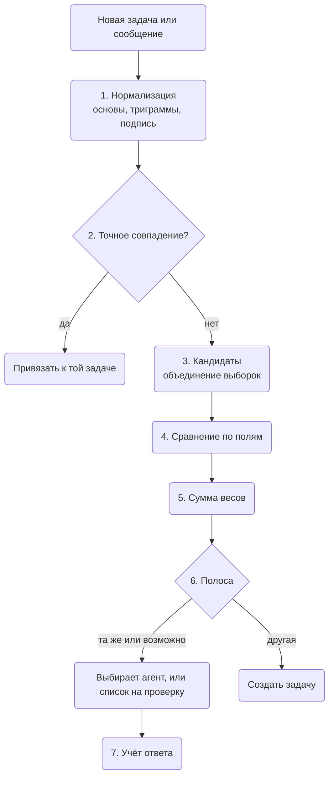

Разберитесь, как хранится задача, откуда берётся её ключ и как инструмент будет решать, что две
задачи — одна. Это пригодится разработчикам и авторам агентов, которые читают локальное хранилище или
строят что-то поверх задач. Сначала — данные, потом планируемое: ключи по типам, бронь и проверка на
дубликаты с разобранным примером. Для повседневной работы начните со страницы [Задачи](./tasks.md).

Устройство описано в утверждённом плане задач в cli-core
([WireCatLabs/cli-core#1216](https://github.com/WireCatLabs/cli-core/pull/1216)). В каждом разделе
сказано, что уже есть, а что **планируется**.

## Данные

**Сейчас.** Одна таблица, `tasks`, хранит все задачи локального хранилища. Полный список столбцов —
в [модели данных](./data-model.mdx#tasks-1).

| Что | Как хранится |
| --- | --- |
| Тип | `question`, `request`, `mention`, `promise` для задач из сообщений; `bug`, `feature`, `chore` для задач проекта |
| План | название, описание, приоритет от 0 (срочно) до 4 (низкий), срок, время следующей проверки, родительская задача |
| Состояние | `open`, `done` или `dismissed`, с тем, кто закрыл и почему |
| Источник | один указатель на сообщение или заметку, никогда не текст сообщения, поэтому удалённое сообщение ничего не оставляет |
| Оценка | `useful` или `not_useful` — как вы оценили задачу, поднятую агентом |
| Люди | назначения с ролью: исполнитель, проверяющий, наблюдатель |
| История | `task_events`: создана, статус, назначена, срок, приоритет, перенесена, привязка, отвязка |
| Привязки | строки `links` к сообщениям, чатам, людям, документам, заметкам и адресам, с видом |

Каждая задача принадлежит проекту. Задача из сообщения попадает во входящий проект своего аккаунта;
задача проекта — в проект, который создали вы. Привязка к сообщению имеет вид `related-to`,
`evidence` или `created-from`. Отношение между двумя задачами — тоже строка `links`, с видом
`blocked-by`, `follow-up-of` или `related-to`. Отношения работают только между задачами ваших
собственных проектов, и устанавливаете их только вы. Перед записью `blocked-by` или `follow-up-of`
рекурсивный запрос проверяет, что новая строка не замыкает цикл.

**Планируется.** Новые поля: `category`, пометки, `claimed_by`, `claimed_until`. Новые виды
отношений: `duplicate-of` и `discovered-from`. Две новые полнотекстовые таблицы, `task_words` и
`task_stems`, устроенные как таблицы заметок. Каждое изменение категории становится строкой
`task_events` вида `category`.

## Идентификаторы и ключи

**Сейчас.** У задачи проекта есть ключ из ключа проекта и номера: `HRB-12`. Номер берётся из
счётчика в строке проекта, в той же записи, что и вставка задачи:

```sql
UPDATE projects SET tasks_count = tasks_count + 1 WHERE id = ? RETURNING key, tasks_count
```

У задачи из сообщения есть внутренний id (UUID) и ключ из входящего проекта её аккаунта.
`tasks list` показывает начало id; `tasks show` и `tasks agenda` показывают ключ.

**Планируется.** Задача из сообщения получает ключ по типу: `Q-15` вопрос, `REQ-22` просьба,
`M-7` упоминание, `PR-4` обещание. У каждого типа своя строка-счётчик, которая берётся в той же
записи, что и вставка, как у проектов. Находятся и `task:<key>`, и `task:<uuid>`. Категория — поле,
а не часть ключа, поэтому исправленная категория не ломает ключ, уже процитированный в чате или
заметке.

**Почему не хеш-идентификаторы.** [beads](https://github.com/gastownhall/beads) использует
хеш-идентификаторы вроде `bd-a3f8`, которые удлиняются с ростом базы
([`internal/idgen/hash.go`](https://github.com/gastownhall/beads/blob/main/internal/idgen/hash.go)).
Хеши решают задачу многих писателей на многих копиях, которые потом сливаются. Здесь одно хранилище
на компьютер и один писатель за раз, поэтому счётчик даёт короткие ключи, которые человек может
прочитать. Если хранилища когда-нибудь начнут синхронизироваться между устройствами, ключи получат
префикс устройства; это решение на потом.

## Бронь (планируется)

Два агента или агент и вы не должны одновременно работать над одной задачей. `tasks claim`
выполняет один запрос внутри `BEGIN IMMEDIATE`:

```sql
UPDATE tasks SET claimed_by = ?, claimed_until = ?
WHERE id = ? AND status = 'open' AND (claimed_by IS NULL OR claimed_until < ?)
RETURNING id
```

Если строка не вернулась, задачу держит кто-то другой; ошибка называет кто и до какого времени.
SQLite пускает только одного писателя за раз во всех процессах, поэтому бронь атомарна между `tg`,
`max`, `memo` и агентами на одном компьютере. Бронь — это **аренда**: она заканчивается сама (по
умолчанию через 30 минут), поэтому упавший агент не держит задачу вечно. `tasks release` снимает
бронь раньше; закрытие задачи снимает её тоже. `tasks agenda` скрывает задачи, забронированные
другими, если не попросить их через `--claimed`.

## Проверка на дубликаты (планируется)

Проверка запускается для каждой новой задачи и для каждого нового сообщения, привязанного к задаче.
Она работает в cli-core, на SQLite, без эмбеддингов и без обращения к провайдеру ИИ.



Словами: новая задача нормализуется; точное совпадение сразу привязывает её; иначе собираются
кандидаты, каждый сравнивается по полям, веса складываются, и сумма решает: создать или спросить.
Каждый ответ сохраняется, чтобы потом подстроить веса.

### 1. Нормализация

- Название и описание проходят через нормализатор поиска: нижний регистр, без диакритики, `ё`
  становится `е`, группы цифр склеиваются (`15 000` становится `15000`).
- Стеммер Snowball для каждой письменности (русский, английский, испанский) сводит каждое слово к
  основе; стоп-слова убираются. Получается **набор основ**.
- Нормализованное название также режется на **символьные триграммы** — все окна по три буквы. Они
  ловят опечатки и формы, которые стеммер пропускает.
- Шаблоны извлекают **подпись**: сумму с валютой (число рядом с `₽`, `руб`, `€`, `$`, `usd`), срок
  (даты и фразы вроде `by Friday` или `до пятницы`) и человека (`person:<id>` автора исходного
  сообщения, через `identities`). Агент может передать их сам (`--amount`, `--due`, `--person`).

Основы и нормализованный текст попадают в `task_words` и `task_stems`, которые обновляются теми же
записями.

### 2. Точные совпадения

Они привязывают сообщение к существующей задаче без подсчёта баллов:

1. Новое сообщение **отвечает на** сообщение, уже привязанное к открытой задаче (собственная
   ответная ссылка мессенджера).
2. **То же правило на том же сообщении**: уникальный индекс по источнику и правилу.
3. **То же нормализованное название для того же человека** у открытой задачи.

Новая задача не создаётся, а в ответе сказано, к какой задаче и почему.

### 3. Кандидаты

Кандидаты — объединение дешёвых выборок:

```sql
SELECT task_id FROM task_stems
WHERE task_stems MATCH '<stems joined by OR>'
ORDER BY bm25(task_stems) LIMIT 20
```

плюс задачи того же человека, той же категории и той же цепочки ответов — обычные запросы по
индексам. Учитываются только открытые задачи и задачи, закрытые за последние 14 дней. В объединении
не больше примерно 40 задач. [`bm25()`](https://www.sqlite.org/fts5.html#the_bm25_function) —
функция ранжирования SQLite FTS5.

Два правила не дают потерять хороших кандидатов:

- **Один только общий чат никогда не делает кандидата.** В чате много несвязанных задач, а одна
  просьба может прийти и в группу, и в личный чат.
- **Одна выборка никогда не решает в одиночку.** Graphiti терял точные дубликаты, потому что брал
  кандидатов из одного поиска с отсечкой ([getzep/graphiti#1734](https://github.com/getzep/graphiti/issues/1734)).

### 4. Сравнение по полям

| Поле | Сравнение | Уровни |
| --- | --- | --- |
| Текст | Жаккар (общие элементы, делённые на все различные) по наборам основ названия и описания и по триграммам названия; берётся большее | 0,6 и выше · от 0,3 до 0,6 · ниже 0,3 |
| Человек | `person:<id>` | тот же · другой · неизвестен |
| Сумма | значение и валюта | равны · разные · нет |
| Категория | название | та же · другая |
| Срок | разница в днях | 2 и меньше · больше · нет |
| Цепочка ответов | исходные сообщения отвечают друг на друга | да · нет |
| Время | дней между задачами | 3 и меньше · от 4 до 14 · больше |

### 5. Сумма весов

Счёт следует модели Феллеги — Сантера для связывания записей. У каждого уровня есть вес
`log2(m / u)`. Здесь `m` — как часто этот уровень встречается у настоящих дубликатов, а `u` — у
несвязанных задач. Уровень, который у дубликатов обычен, поднимает сумму; уровень, который у них
редок, опускает её. Метод объясняет [руководство Splink по модели Феллеги — Сантера](https://moj-analytical-services.github.io/splink/topic_guides/theory/fellegi_sunter.html).

Начальные веса заданы вручную. Их подстраивают на синтетическом тестовом наборе, прежде чем они
начнут что-либо решать:

| Уровень | Вес |
| --- | --- |
| Текст: 0,6 и выше / от 0,3 до 0,6 / ниже 0,3 | +4 / +2 / −2 |
| Человек: тот же / другой / неизвестен | +3 / −3 / 0 |
| Сумма: равны / разные / нет | +3 / −4 / 0 |
| Категория: та же / другая | +1 / −1 |
| Срок: 2 дня и меньше / больше / нет | +1 / −1 / 0 |
| Цепочка ответов: да / нет | +6 / 0 |
| Время: 3 дня и меньше / от 4 до 14 дней / больше | +1 / 0 / −1 |

В плане нет веса для «цепочка ответов: нет» и «время: от 4 до 14 дней»; эта страница считает их
равными 0. Полосы: **8 и больше — «та же», от 3 до 7 — «возможно», меньше 3 — «другая».** Веса и
полосы живут в одном модуле, с причиной для каждого числа; больше нигде они не зашиты.

### 6. Решение

| Полоса | Задачу добавляет агент | Задачу открывает правило |
| --- | --- | --- |
| Точное (шаг 2) | привязка к задаче, ничего нового | так же |
| Та же | показана первой; агент обязан выбрать | в список на проверку; пока ни один счёт не объединяет сам |
| Возможно | `tasks add` отказывает и показывает до 5 кандидатов со счётом и причинами; агент повторяет с `--attach <task>` или `--new` | в список на проверку |
| Другая | создаётся | создаётся |

Инструмент отказывает, а не предупреждает: предупреждение агент может пропустить, код выхода — нет.
Спросить агента, который создаёт задачу, не стоит лишнего обращения к провайдеру ИИ: этот агент и
так судья. Mem0 устроен так же: агент, который записывает воспоминание, выбирает — добавить его,
обновить существующее, удалить или ничего не делать
([Mem0, arXiv 2504.19413](https://arxiv.org/abs/2504.19413)).

**Список на проверку.** `tasks duplicates` показывает пары, которые правило оставило в полосе «та
же» или «возможно», сначала новые, с причинами. `tasks merge <dup> --into <task>` привязывает все
сообщения дубликата к оставшейся задаче, закрывает дубликат как `dismissed` с отношением
`duplicate-of` и записывает решение. `tasks duplicates reject <dup> <task>` записывает «не одно и
то же», и пара больше не предлагается.

**Объединение можно отменить.** `tasks unmerge <dup>` снова открывает дубликат и убирает отношение.
Привязки остаются на месте, пока их не перенесут. Объединение никогда ничего не удаляет.

### 7. Учёт ответов

Каждое объединение, отказ, `--attach` и `--new` после списка кандидатов — размеченная пара. Когда
пар достаточно, `m` и `u` для каждого уровня пересчитываются по ним — та же оценка подсчётом, что в
Splink, без шага обучения. Тогда полоса «та же» может начать объединять сама, сначала пары от
правил. Пока вы этого не разрешили, без человека объединяются только точные совпадения шага 2.

## Разобранный пример

Иван Пример пишет в личном чате: «Пришлёшь счёт на 15 000 ₽ до пятницы?» Правило открывает
просьбу. До её создания проверка находит двух кандидатов от того же человека:

- **REQ-22**, создана вчера: «Send the invoice for 15000 ₽» (отправить счёт на 15000 ₽), категория
  `money`, без срока.
- **REQ-19**, создана 10 дней назад: «Send the contract invoice, 40 000 ₽» (отправить счёт по
  договору), категория `money`, без срока.

Названия задач записаны по-английски, поэтому работает английский стеммер. Новая задача названа
«Send the invoice for 15 000 ₽ by Friday»; её основы: `send`, `invoic`, `15000`, `friday`. В этом примере триграммы дают меньше, чем основы, для обеих
пар, поэтому считаются основы.

| Поле | REQ-22 | Баллы | REQ-19 | Баллы |
| --- | --- | --- | --- | --- |
| Текст | основы `send`, `invoic`, `15000`: 3 общих из 4 различных = 0,75 | +4 | основы `send`, `contract`, `invoic`, `40000`: 2 общих из 6 различных = 0,33 | +2 |
| Человек | тот же | +3 | тот же | +3 |
| Сумма | 15000 ₽ = 15000 ₽ | +3 | 15000 ₽ ≠ 40000 ₽ | −4 |
| Категория | `money` = `money` | +1 | `money` = `money` | +1 |
| Срок | нет у REQ-22 | 0 | нет у REQ-19 | 0 |
| Цепочка ответов | нет | 0 | нет | 0 |
| Время | 1 день | +1 | 10 дней | 0 |
| **Итого** | | **12: та же** | | **2: другая** |

Просьбу нашло правило, поэтому инструмент создаёт её как REQ-23 и кладёт пару REQ-23 и REQ-22 в
список на проверку; пока ни один счёт не объединяет сам. Потом `tasks merge REQ-23 --into REQ-22`
объединяет их. Если бы задачу добавлял агент, `tasks add` отказал бы, показал REQ-22 первой с 12
баллами и причиной «тот же человек, та же сумма, общих основ 3 из 4», и агент повторил бы команду с
`--attach REQ-22`. У REQ-19 тот же человек и те же слова «отправить счёт», но сумма тянет её вниз:
это другое дело.

## Сравнение с beads

[beads](https://github.com/gastownhall/beads) — трекер задач для агентов-программистов. Часть его
идей взята сюда, часть — нет.

| beads | Здесь |
| --- | --- |
| Хеш-идентификаторы `bd-a3f8` | Читаемые ключи из счётчика: одно хранилище, один писатель за раз |
| [Метки](https://github.com/gastownhall/beads/blob/main/docs/core-concepts/labels.md) для всего, что не поле | Одна категория из фиксированного списка плюс свободные пометки |
| Виды связей, например `duplicates` и `discovered-from` | `duplicate-of` и `discovered-from` добавляются к видам отношений |
| `bd ready`: открытая работа без блокировок | `tasks agenda`; `--category` и `--label` планируются |
| `bd update --claim`: атомарный захват | `tasks claim` — аренда, которая заканчивается сама |
| `external_ref` на один внешний объект | Каждая задача привязана ко всем своим сообщениям |
| `bd duplicates` объединяет точные копии; `bd find-duplicates` считает совпадение слов и только сообщает | Проверка до создания, веса полей и список на проверку |

Текст в чатах никогда не бывает точной копией, и ничто в beads не проверяет задачу до создания.
Поэтому проверка здесь работает по полям и спрашивает, когда не уверена.

## Похожие работы

Дубликаты отчётов об ошибках — старая задача. REP сравнивает два отчёта по тексту и по полям вроде
продукта и компонента, с весами, подобранными на известных дубликатах
([Sun et al., ASE 2011](https://doi.org/10.1109/ASE.2011.6100061)). Проверка здесь использует ту же
идею — текст плюс поля, — но веса считаются, а не обучаются.

## Чего нет

- **Ни эмбеддингов, ни обращения к провайдеру ИИ** для сравнения задач. Если тестовый набор покажет,
  что текстовое поле слишком слабое, следующий шаг — локальный эмбеддинг, измеренный против этой
  проверки.
- **Никаких удалений.** Дубликат закрывается и привязывается; его никогда не удаляют.
- **Никакого ограничения «одна задача на чат или на человека».**
- **Никаких хеш-идентификаторов**, пока хранилища не синхронизируются между устройствами.
- **Открытые вопросы:** список категорий по умолчанию и что делать с сообщением, похожим на задачу,
  закрытую за последние 14 дней: снова открыть её или открыть новую со ссылкой `follow-up-of`.
